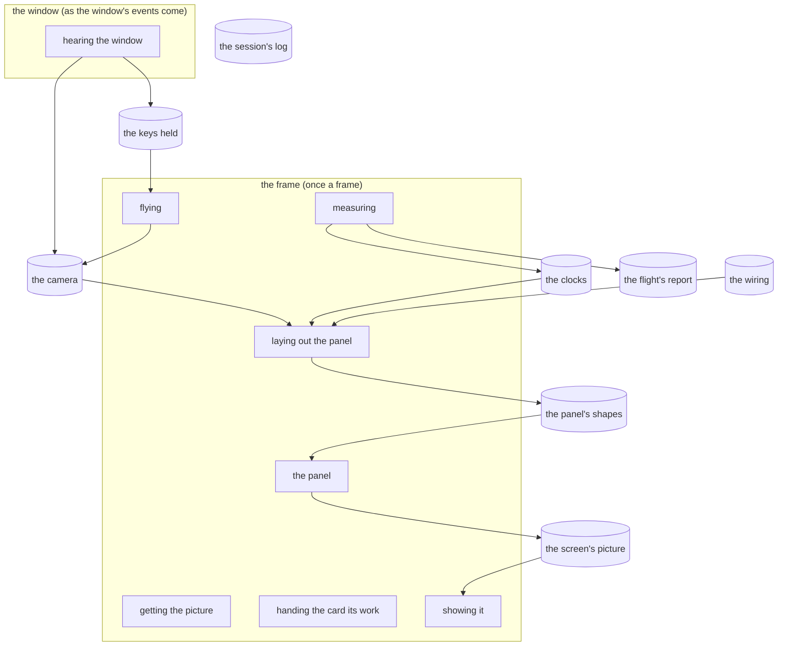

# The software map

What exists and how it's wired, drawn from the code's own list of its parts (`src/wiring.rs`) by its test on
every build: change the list, never this file. In the game, the same map is live: the editor (F2), "Software map".

The words: a **lane** is a line of work with its own pace; a **pass** is one piece of a lane's work, on the
processor or the card; a **stage** is one step of the world's recipe (none yet); a **store** is something held.

The costs are the newest kept flight's, `kept logs/flight-1794487963.txt`: Incus Artus, build 118 (29a02df); the code committed.

## The lanes

### the window

- **Runs:** as the window's events come.
- **What it is:** What the window hears: keys pressed and let go, the mouse moving, the window resized, closed or left.
- **Its passes, in order:** hearing the window.
- **Files:** src/runner.rs.

### the frame

- **Runs:** once a frame.
- **What it is:** Each frame, its passes in order: the camera flies, the panels are laid out, the card draws the picture, and it's handed to the screen.
- **Its passes, in order:** flying, laying out the panel, getting the picture, the panel, handing the card its work, showing it and measuring.
- **Switch** `INCUS_FLIGHT`: a measured flight: 5 s settling, 20 s measured uncapped with the panel hidden, a report, then quits.
- **Switch** `WGPU_ADAPTER_NAME`: the card, by part of its name (intel: the laptop's Intel card).
- **Switch** `WGPU_POWER_PREF`: the card, by power (low or high).
- **Switch** `WGPU_BACKEND`: the card's language (DirectX 12 unless set).
- **Switch** `WGPU_DX12_COMPILER`: the shader compiler (the Windows SDK's DXC unless set).
- **Files:** src/main.rs, src/runner.rs and src/card.rs.

## The passes

### hearing the window

- **A pass** in the window, on the processor.
- **What it is:** Each event: the keys held kept, the mouse turning the camera while it's captured, and F2 (the editor), F3 (the panel), F11 (window or full screen) and Tab (the mouse).
- **Reads:** none. **Writes:** the keys held and the camera.
- **Cost, last measured** (`kept logs/flight-1794487963.txt`): on the processor not run.
- **Files:** src/runner.rs and src/camera.rs.

### flying

- **A pass** in the frame, on the processor.
- **What it is:** The camera flies by the keys held (WASD, Space, Ctrl, Shift), on real time. Not while the editor is open.
- **Reads:** the keys held. **Writes:** the camera.
- **Cost, last measured** (`kept logs/flight-1794487963.txt`): on the processor median 0.000, 95th 0.000, 99th 0.001, worst 0.217.
- **Files:** src/camera.rs.

### laying out the panel

- **A pass** in the frame, on the processor.
- **What it is:** The developer panel (F3) and the editor (F2) laid out, and cut into shapes for the card.
- **Reads:** the camera, the clocks and the wiring. **Writes:** the panel's shapes.
- **Cost, last measured** (`kept logs/flight-1794487963.txt`): on the processor median 0.009, 95th 0.090, 99th 0.165, worst 0.398.
- **Files:** src/panel.rs, src/editor/mod.rs and src/editor/software_map.rs.

### getting the picture

- **A pass** in the frame, on the processor.
- **What it is:** The screen's next picture to draw on, waited for if none is free (capped, this is where the frame waits for the screen).
- **Reads:** none. **Writes:** none.
- **Cost, last measured** (`kept logs/flight-1794487963.txt`): on the processor median 0.004, 95th 0.159, 99th 0.340, worst 1.398.
- **Files:** src/runner.rs.

### the panel

- **A pass** in the frame, on the card.
- **What it is:** The picture cleared to the sky's colour, and the panels drawn over it. Recorded on the processor, run on the card.
- **Reads:** the panel's shapes. **Writes:** the screen's picture.
- **Cost, last measured** (`kept logs/flight-1794487963.txt`): recording it on the processor median 0.004, 95th 0.157, 99th 0.170, worst 0.915; on the card median 0.018, 95th 0.023, 99th 0.042, worst 0.312.
- **Files:** src/runner.rs.

### handing the card its work

- **A pass** in the frame, on the processor.
- **What it is:** The frame's work for the card finished and handed to it, with the card's clock asked to copy its times out.
- **Reads:** none. **Writes:** none.
- **Cost, last measured** (`kept logs/flight-1794487963.txt`): on the processor median 0.077, 95th 0.239, 99th 0.317, worst 1.763.
- **Files:** src/runner.rs.

### showing it

- **A pass** in the frame, on the processor.
- **What it is:** The picture handed to the screen, waited for if the screen's queue is full (Windows lets the frame run only so far ahead of what the card and the screen have taken).
- **Reads:** the screen's picture. **Writes:** none.
- **Cost, last measured** (`kept logs/flight-1794487963.txt`): on the processor median 0.142, 95th 0.271, 99th 0.323, worst 1.467.
- **Files:** src/runner.rs.

### measuring

- **A pass** in the frame, on the processor.
- **What it is:** The frame's length, and the card's times read back from frames it has finished; on a flight, kept for its report.
- **Reads:** none. **Writes:** the clocks and the flight's report.
- **Cost, last measured** (`kept logs/flight-1794487963.txt`): on the processor median 0.009, 95th 0.016, 99th 0.147, worst 0.418.
- **Files:** src/runner.rs, src/clocks.rs and src/flight.rs.

## The stores

### the keys held

- **A store** on the processor.
- **What it is:** The keys held down now (let go of all when the window is left).
- **Written by:** hearing the window. **Read by:** flying.
- **Files:** src/runner.rs.

### the camera

- **A store** on the processor.
- **What it is:** Where the eye is (north, east, up, in blocks) and where it looks (facing from north toward east, pitch up from level).
- **Written by:** hearing the window and flying. **Read by:** laying out the panel.
- **Files:** src/camera.rs.

### the clocks

- **A store** on the processor.
- **What it is:** The frame's recent lengths, each pass's recent times on the processor, and the card's on the card.
- **Written by:** measuring. **Read by:** laying out the panel.
- **Limit:** recent frames kept, a pass, 240.
- **Limit:** frames on their way back from the card at once, 4.
- **Files:** src/clocks.rs.

### the wiring

- **A store** on the processor.
- **What it is:** This list: every lane, pass and store, fixed in the game. The frame runs in its order; the software map is drawn from it.
- **Written by:** none. **Read by:** laying out the panel.
- **Files:** src/wiring.rs.

### the panel's shapes

- **A store** on the processor.
- **What it is:** The panels cut into shapes for the card (made afresh each frame).
- **Written by:** laying out the panel. **Read by:** the panel.
- **Files:** src/panel.rs.

### the screen's picture

- **A store** on the card.
- **What it is:** The picture the card draws on and the screen shows, the window's size.
- **Written by:** the panel. **Read by:** showing it.
- **Files:** src/card.rs.

### the flight's report

- **A store** on the disk.
- **What it is:** A measured flight's report, logs/flight-<seconds since 1970>.txt (only on a flight).
- **Written by:** measuring. **Read by:** none.
- **Files:** src/flight.rs.

### the session's log

- **A store** on the disk.
- **What it is:** The session's messages and any crash, logs/session-<seconds since 1970>.log. Every part writes to it, so it has no lines on the map.
- **Written by:** none. **Read by:** none.
- **Files:** src/session.rs.

