# The software map

What exists and how it's wired, drawn from the code's own list of its parts (`src/wiring.rs`) by its test on
every build: change the list, never this file. In the game, the same map is live: the editor (F2), "Software map".

The words: a **lane** is a line of work with its own pace; a **pass** is one piece of a lane's work, on the
processor or the card; a **stage** is one step of the world's recipe (none yet); a **store** is something held.

The costs are the newest kept flight's flown as the game runs, at its first standing, `kept logs/flight-1794589790.txt`: Incus Artus, build 149 (967dc51); the code committed.

```mermaid
flowchart TB
  subgraph lane_the_window["the window (as the window's events come)"]
    direction LR
    pass_hearing_the_window["hearing the window"]
  end
  subgraph lane_the_frame["the frame (once a frame)"]
    direction LR
    pass_going_to_a_mark["going to a mark"]
    pass_flying["flying"]
    pass_putting_the_far_cells_on_the_card["putting the far cells on the card"]
    pass_putting_the_near_chunks_on_the_card["putting the near chunks on the card"]
    pass_laying_out_the_panel["laying out the panel"]
    pass_getting_the_picture["getting the picture"]
    pass_the_far_start["the far start"]
    pass_listing_the_near_chunks["listing the near chunks"]
    pass_the_near_faces["the near faces"]
    pass_the_near_water["the near water"]
    pass_the_near_cover["the near cover"]
    pass_the_far_8_x_8["the far 8 x 8"]
    pass_the_far_4_x_4["the far 4 x 4"]
    pass_the_far_2_x_2["the far 2 x 2"]
    pass_bringing_it_up["bringing it up"]
    pass_the_x_fader["the x-fader"]
    pass_the_panel["the panel"]
    pass_handing_the_card_its_work["handing the card its work"]
    pass_showing_it["showing it"]
    pass_measuring["measuring"]
  end
  subgraph lane_loading["loading (as tiles are asked for)"]
    direction LR
    pass_the_doorway["the doorway"]
    pass_meshing_the_near_chunks["meshing the near chunks"]
    pass_summing_the_far_cells["summing the far cells"]
    pass_making_the_far_textures["making the far textures"]
    pass_making_the_far_light["making the far light"]
    pass_making_the_far_ring["making the far ring"]
  end
  subgraph lane_the_temperatures["the temperatures (every 3 seconds, on a thread of its own)"]
    direction LR
    pass_reading_the_temperatures["reading the temperatures"]
  end
  store_the_keys_held[("the keys held")]
  store_the_camera[("the camera")]
  store_the_clocks[("the clocks")]
  store_the_wiring[("the wiring")]
  store_the_panel_s_shapes[("the panel's shapes")]
  store_the_screen_s_picture[("the screen's picture")]
  store_the_flight_s_report[("the flight's report")]
  store_the_session_s_log[("the session's log")]
  store_the_export[("the export")]
  store_a_tile_s_columns[("a tile's columns")]
  store_the_marks[("the marks")]
  store_what_changed[("what changed")]
  store_the_far_cells[("the far cells")]
  store_the_near_faces[("the near faces")]
  store_the_near_picture[("the near picture")]
  store_the_near_cover[("the near cover")]
  store_the_near_light[("the near light")]
  store_the_far_bricks[("the far bricks")]
  store_the_far_layers[("the far layers")]
  store_the_far_eye_s_look[("the far eye's look")]
  store_the_far_textures[("the far textures")]
  store_the_far_light[("the far light")]
  store_the_blue_noise[("the blue noise")]
  store_the_window_round_the_eye[("the window round the eye")]
  store_the_temperatures[("the temperatures")]
  pass_hearing_the_window --> store_the_keys_held
  pass_hearing_the_window --> store_the_camera
  store_the_marks --> pass_going_to_a_mark
  store_a_tile_s_columns --> pass_going_to_a_mark
  pass_going_to_a_mark --> store_the_camera
  pass_going_to_a_mark --> store_what_changed
  store_the_keys_held --> pass_flying
  store_the_marks --> pass_flying
  pass_flying --> store_the_camera
  store_the_far_cells --> pass_putting_the_far_cells_on_the_card
  store_the_camera --> pass_putting_the_far_cells_on_the_card
  pass_putting_the_far_cells_on_the_card --> store_the_far_bricks
  pass_putting_the_far_cells_on_the_card --> store_the_far_textures
  pass_putting_the_far_cells_on_the_card --> store_the_window_round_the_eye
  store_the_camera --> pass_putting_the_near_chunks_on_the_card
  pass_putting_the_near_chunks_on_the_card --> store_the_near_faces
  pass_putting_the_near_chunks_on_the_card --> store_the_near_light
  pass_putting_the_near_chunks_on_the_card --> store_the_far_eye_s_look
  store_the_camera --> pass_laying_out_the_panel
  store_the_clocks --> pass_laying_out_the_panel
  store_the_wiring --> pass_laying_out_the_panel
  store_the_temperatures --> pass_laying_out_the_panel
  pass_laying_out_the_panel --> store_the_panel_s_shapes
  pass_laying_out_the_panel --> store_the_camera
  pass_laying_out_the_panel --> store_the_far_eye_s_look
  store_the_camera --> pass_the_far_start
  store_the_far_bricks --> pass_the_far_start
  store_the_far_eye_s_look --> pass_the_far_start
  pass_the_far_start --> store_the_far_layers
  store_the_near_faces --> pass_listing_the_near_chunks
  store_the_camera --> pass_listing_the_near_chunks
  pass_listing_the_near_chunks --> store_the_near_faces
  store_the_near_faces --> pass_the_near_faces
  store_the_near_light --> pass_the_near_faces
  store_the_far_light --> pass_the_near_faces
  store_the_camera --> pass_the_near_faces
  pass_the_near_faces --> store_the_near_picture
  store_the_near_faces --> pass_the_near_water
  store_the_near_light --> pass_the_near_water
  store_the_near_picture --> pass_the_near_water
  store_the_far_light --> pass_the_near_water
  store_the_camera --> pass_the_near_water
  pass_the_near_water --> store_the_near_picture
  store_the_near_picture --> pass_the_near_cover
  pass_the_near_cover --> store_the_near_cover
  store_the_far_bricks --> pass_the_far_8_x_8
  store_the_far_textures --> pass_the_far_8_x_8
  store_the_far_light --> pass_the_far_8_x_8
  store_the_blue_noise --> pass_the_far_8_x_8
  store_the_window_round_the_eye --> pass_the_far_8_x_8
  store_the_far_layers --> pass_the_far_8_x_8
  store_the_near_cover --> pass_the_far_8_x_8
  pass_the_far_8_x_8 --> store_the_far_layers
  store_the_far_bricks --> pass_the_far_4_x_4
  store_the_far_textures --> pass_the_far_4_x_4
  store_the_far_light --> pass_the_far_4_x_4
  store_the_blue_noise --> pass_the_far_4_x_4
  store_the_window_round_the_eye --> pass_the_far_4_x_4
  store_the_far_layers --> pass_the_far_4_x_4
  pass_the_far_4_x_4 --> store_the_far_layers
  store_the_far_bricks --> pass_the_far_2_x_2
  store_the_far_textures --> pass_the_far_2_x_2
  store_the_far_light --> pass_the_far_2_x_2
  store_the_blue_noise --> pass_the_far_2_x_2
  store_the_window_round_the_eye --> pass_the_far_2_x_2
  store_the_far_layers --> pass_the_far_2_x_2
  pass_the_far_2_x_2 --> store_the_far_layers
  store_the_far_layers --> pass_bringing_it_up
  pass_bringing_it_up --> store_the_screen_s_picture
  store_the_near_picture --> pass_the_x_fader
  pass_the_x_fader --> store_the_screen_s_picture
  store_the_panel_s_shapes --> pass_the_panel
  pass_the_panel --> store_the_screen_s_picture
  store_the_screen_s_picture --> pass_showing_it
  store_the_window_round_the_eye --> pass_measuring
  store_the_temperatures --> pass_measuring
  pass_measuring --> store_the_clocks
  pass_measuring --> store_the_flight_s_report
  store_the_export --> pass_the_doorway
  store_what_changed --> pass_the_doorway
  pass_the_doorway --> store_a_tile_s_columns
  store_a_tile_s_columns --> pass_meshing_the_near_chunks
  store_what_changed --> pass_meshing_the_near_chunks
  pass_meshing_the_near_chunks --> store_the_near_faces
  store_a_tile_s_columns --> pass_summing_the_far_cells
  pass_summing_the_far_cells --> store_the_far_cells
  store_the_far_cells --> pass_making_the_far_textures
  pass_making_the_far_textures --> store_the_far_textures
  store_the_far_cells --> pass_making_the_far_light
  pass_making_the_far_light --> store_the_far_light
  store_a_tile_s_columns --> pass_making_the_far_ring
  pass_making_the_far_ring --> store_the_far_bricks
  pass_making_the_far_ring --> store_the_far_textures
  pass_reading_the_temperatures --> store_the_temperatures
```

## The lanes

### the window

- **Runs:** as the window's events come.
- **What it is:** What the window hears: keys pressed and let go, the mouse moving, the window resized, closed or left.
- **Its passes, in order:** hearing the window.
- **Files:** src/runner.rs.

### the frame

- **Runs:** once a frame.
- **What it is:** Each frame, its passes in order: the camera goes to a mark if it's time, flies, the panels are laid out, the card draws the picture, and it's handed to the screen.
- **Its passes, in order:** going to a mark, flying, putting the far cells on the card, putting the near chunks on the card, laying out the panel, getting the picture, the far start, listing the near chunks, the near faces, the near water, the near cover, the far 8 x 8, the far 4 x 4, the far 2 x 2, bringing it up, the x-fader, the panel, handing the card its work, showing it and measuring.
- **Switch** `INCUS_FLIGHT`: a measured flight: every mark in data/marks.toml in turn, 5 s settling and 20 s measured at each, uncapped with the panel hidden; a report, then quits.
- **Switch** `WGPU_ADAPTER_NAME`: the card, by part of its name (intel: the laptop's Intel card).
- **Switch** `WGPU_POWER_PREF`: the card, by power (low or high).
- **Switch** `WGPU_BACKEND`: the card's language (DirectX 12 unless set).
- **Switch** `WGPU_DX12_COMPILER`: the shader compiler (the Windows SDK's DXC unless set).
- **Switch** `INCUS_SHADER_TEXT`: each shader's text as it's handed to the card's compiler, written to the session's log (to read Nsight's hot lines against: it names them by their place in the compiled program).
- **Files:** src/main.rs, src/runner.rs and src/card.rs.

### loading

- **Runs:** as tiles are asked for.
- **What it is:** The world, read a tile at a time through the doorway. Going to a mark asks it for the ground under the eye; the far cells' lane will ask for tiles (2.2).
- **Its passes, in order:** the doorway, meshing the near chunks, summing the far cells, making the far textures, making the far light and making the far ring.
- **Switch** `INCUS_SCATTER_STAGE`: 1: the scatter stage is on: test detail the doorway applies as it answers a tile (woods within 10 km of the spawn, towers, a castle, a town, a hall's entrance, cave mouths, posts, a slab, an arch), from a seed and a short list of places, for the far cells, the far light and the near eye to be judged on. An instrument, not world generation; unset, the world as the export has it.
- **Files:** src/doorway.rs and src/scatter_stage.rs.

### the temperatures

- **Runs:** every 3 seconds, on a thread of its own.
- **What it is:** How hot the computer runs, read as old read it, so the frame never waits for it [David, 2026-11-12: "i'd like for you to start tracking temperatures again, just as before"].
- **Its passes, in order:** reading the temperatures.
- **Switch** `INCUS_TEMPERATURES`: 0: not read at all (it starts two programs every few seconds), to measure the game without them.
- **Files:** src/temperatures.rs.

## The passes

### hearing the window

- **A pass** in the window, on the processor.
- **What it is:** Each event: the keys held kept, the mouse turning the camera while it's captured, and F2 (the editor), F3 (the panel), F11 (window or full screen) and Tab (the mouse).
- **Reads:** none. **Writes:** the keys held and the camera.
- **Cost, last measured** (`kept logs/flight-1794589790.txt`): on the processor not run.
- **Files:** src/runner.rs and src/camera.rs.

### going to a mark

- **A pass** in the frame, on the processor.
- **What it is:** At the start, and on a flight once a mark is measured: the camera taken to the next mark, a player's eye over the ground the doorway answers, and the mark's changes made through the doorway (the build's placings, the scatter), the near eye told of them. On a flight a standing mark isn't measured till the far cells are on the card and the near eye's chunks are all in.
- **Reads:** the marks and a tile's columns. **Writes:** the camera and what changed.
- **Switch** `INCUS_MARK`: the mark the game starts at, by its name (the first in data/marks.toml unless set).
- **Switch** `INCUS_SCATTER`: outside a flight: how many things the starting mark's scatter makes, if the mark has one (unset: none, the mark bare), for a look.
- **Cost, last measured** (`kept logs/flight-1794589790.txt`): on the processor median 0.000, 95th 0.000, 99th 0.000, worst 0.206.
- **Files:** src/marks.rs and src/runner.rs.

### flying

- **A pass** in the frame, on the processor.
- **What it is:** The camera flies by the keys held (WASD, Space, Ctrl, Shift), on real time, at the speed set on the Camera page. Not while the editor is open. On a flight, a moving mark flies it straight ahead at its speed (step 4).
- **Reads:** the keys held and the marks. **Writes:** the camera.
- **Cost, last measured** (`kept logs/flight-1794589790.txt`): on the processor median 0.000, 95th 0.001, 99th 0.001, worst 0.228.
- **Files:** src/camera.rs and src/runner.rs.

### putting the far cells on the card

- **A pass** in the frame, on the processor.
- **What it is:** The regions summed since the last frame put on the card as bricks, so the far view sharpens in live without holding the frame up; the levels over 1,024 made as their regions come in. Then the window round the eye brought to it (step 4): the 32s' and 64s' regions past it given back, those within it made from the far cells kept and put on, nearest first, the far textures following. At most 3 ms a frame for both.
- **Reads:** the far cells and the camera. **Writes:** the far bricks, the far textures and the window round the eye.
- **Switch** `INCUS_FAR_BRICK`: a brick's side in cells: 2, 4 or 8 (unset: 8), for the pool and the far textures both (2.2, step 3).
- **Switch** `INCUS_FAR_TOPS`: 0: the height table's true numbers aren't made (the bands' rounded tops stay), for flying the table against the skip without it; unset, made once every region is in.
- **Switch** `INCUS_FAR_WINDOW`: the window round the eye: the 32s' radius in regions, the 64s' twice it (unset: 10; 0 the whole world on the card) (2.2, step 4).
- **Cost, last measured** (`kept logs/flight-1794589790.txt`): on the processor median 0.028, 95th 0.063, 99th 0.166, worst 0.342.
- **Files:** src/bricks.rs and src/far_eye.rs.

### putting the near chunks on the card

- **A pass** in the frame, on the processor.
- **What it is:** The near lane asked for the chunks inside the render radius when the eye's chunk or the radius changes; the chunks it has made put on the card, nearest first, as many faces as a frame may; those outside the radius given back. Then how far the near faces reach (to the nearest chunk still to come, or the whole radius), and the far eye told to begin its rays a little inside that.
- **Reads:** the camera. **Writes:** the near faces, the near light and the far eye's look.
- **Switch** `INCUS_NEAR`: 0: no near eye at all (the game as build 194, for measuring against); unset, the blocks inside the render radius drawn as triangles (plan 2.3).
- **Switch** `INCUS_NEAR_RADIUS`: the render radius the game starts with, in chunks of 32 blocks, 1 to 64 (unset: 32); the Render page's slider moves it.
- **Switch** `INCUS_NEAR_THREADS`: how many threads the near lane meshes chunks on (unset: a quarter of the processor's, 2 to 6).
- **Cost, last measured** (`kept logs/flight-1794589790.txt`): not measured.
- **Files:** src/near_eye.rs and src/near.rs.

### laying out the panel

- **A pass** in the frame, on the processor.
- **What it is:** The developer panel (F3) and the editor (F2) laid out, and cut into shapes for the card. The panel's Camera page changes how fast the camera flies, its Render page the far eye's look.
- **Reads:** the camera, the clocks, the wiring and the temperatures. **Writes:** the panel's shapes, the camera and the far eye's look.
- **Cost, last measured** (`kept logs/flight-1794589790.txt`): on the processor median 0.016, 95th 0.033, 99th 0.151, worst 0.341.
- **Files:** src/panel.rs, src/editor/mod.rs and src/editor/software_map.rs.

### getting the picture

- **A pass** in the frame, on the processor.
- **What it is:** The screen's next picture to draw on, waited for if none is free (capped, this is where the frame waits for the screen).
- **Reads:** none. **Writes:** none.
- **Cost, last measured** (`kept logs/flight-1794589790.txt`): on the processor median 0.285, 95th 0.690, 99th 0.851, worst 4.014.
- **Files:** src/runner.rs.

### the far start

- **A pass** in the frame, on the card.
- **What it is:** One cone down each tile of 8 x 8 screen pixels, skipping over the far cells' tops, to where any of the tile's rays could first touch: they all start there. The layers' numbers for the frame written first, on the processor.
- **Reads:** the camera, the far bricks and the far eye's look. **Writes:** the far layers.
- **Switch** `INCUS_SIGHT_LEVELS`: the levels' view: each pixel tinted by the level its surface was read from.
- **Switch** `INCUS_SIGHT_STEPS`: the steps' view: dark blue few steps, through green, to red 256 or more.
- **Switch** `INCUS_SIGHT_NO_SHADOWS`: the sun's shadows left out (for measuring).
- **Switch** `INCUS_SIGHT_NO_SKY`: the sky light left out (for measuring).
- **Switch** `INCUS_FAR_EDGE`: 0: rays marched on past the map's edge toward the reach, as before (unset: ended at the edge).
- **Switch** `INCUS_FAR_HAZE_STEP`: a far ray's step through thin haze (the land's faint fringe), in cells: 1 a whole cell (unset; the lean step, 1d, David's look), 0.5 as old's.
- **Switch** `INCUS_FAR_BASE`: the far eye's first layer in screen pixels: 8 (unset, old's) or 4, the layers under it each half the one above (step 2's probe).
- **Switch** `INCUS_FAR_SIDE`: 0: the far eye's layers marched one after another (the baseline flights are read against, and the picture's reference); unset, by one dispatch, a finer layer led by the coarser layer of the frame before (step 2).
- **Switch** `INCUS_FAR_LOADED`: 0: the far eye marched by the whole march even once the textures are in (for measuring the march once the textures are in against it, and the reference its picture is checked against); unset, by the second program, without the code's blend or the views, when the textures are in, the hardware's blend is chosen and no view is on.
- **Switch** `INCUS_FAR_CUT`: the cut: 0, no ray is cut (every ray marched whole, for measuring it against); or where the first place a ray may be cut at is, blocks out (unset: 384). By the one dispatch a ray that was long the frame before is marched as the lengths it needs, side by side, and joined.
- **Switch** `INCUS_FAR_FACES`: 0: the game starts with a far cell stopping a ray by its bulk alone, as to build 190 (the rule compiled out of every program but the one the Render page's Cover by faces switch swaps in, and the switch starts unticked; for measuring against); unset, by the face it shows the ray as well (cover by faces: walls, towers and posts hold at a distance).
- **Switch** `INCUS_FAR_LONG`: for measuring: how many steps make a ray long, so it's listed and cut into lengths the frame after (unset: 128; a cut ray stays listed down to half of it).
- **Switch** `INCUS_FAR_AS`: for measuring: the name of one of the audit's second batch, marched as the far eye's own program once the textures are in (its picture wrong on purpose), so a flight says what that version's room and shorter step are worth with every layer marching.
- **Switch** `INCUS_FAR_AUDIT`: for measuring, 1 or 2 (which batch): cut-down versions of the march (1: of the whole march, the hops alone, the samples alone, one part taken out at a time; 2: of the march once the textures are in, the parts it keeps in hand taken out alone and together) compiled beside it and marched over the base layer into scratch after the far eye, so one Nsight trace names each one's registers, the groups of rays that fit and its time; the picture untouched, the frame that much longer.
- **Switch** `INCUS_TEST_STEPS`: for measuring (the Oracle's test): the most steps a far ray takes (unset: 768).
- **Switch** `INCUS_TEST_REACH`: for measuring a ray's near length alone (the deep dive into the rings' cost): the farthest a far ray goes, blocks (unset: the reach as it is).
- **Switch** `INCUS_TEST_BEGIN`: for measuring a ray's far length alone: the nearest a far ray begins, blocks (unset: where it would).
- **Switch** `INCUS_FAR_DETAIL`: the detail at launch, levels finer than a pixel's size (the Render page's; default 0, old's).
- **Cost, last measured** (`kept logs/flight-1794589790.txt`): recording it on the processor median 0.049, 95th 0.090, 99th 0.171, worst 0.353; on the card median 0.004, 95th 0.005, 99th 0.005, worst 0.027.
- **Files:** src/far_eye.rs and src/far.wgsl.

### listing the near chunks

- **A pass** in the frame, on the processor.
- **What it is:** The chunks in view inside the near faces' reach found (each kept chunk's box against the view's four sides) and their draws listed for the card, a page after another; with them the near eye's numbers for the frame, and its own pictures made at the screen's size. Timed apart from the faces' pass since build 206.
- **Reads:** the near faces and the camera. **Writes:** the near faces.
- **Cost, last measured** (`kept logs/flight-1794589790.txt`): not measured.
- **Files:** src/near_eye.rs and src/runner.rs.

### the near faces

- **A pass** in the frame, on the card.
- **What it is:** The chunks in view inside the near faces' reach, their merged faces drawn as triangles into the near eye's own picture, with depth, every face whole and the nearest winning a pixel: each face its block's colour from far, lit as the far eye lights (the sun on the way it looks, the far light's shadow and sky at its place), and multiplied by how much of it shows by the x-fader (all of it before the band, none at the faces' reach, along the curve between).
- **Reads:** the near faces, the near light, the far light and the camera. **Writes:** the near picture.
- **Switch** `INCUS_NEAR_TEXTURES`: 0: the near faces flat in their blocks' far colours, as to build 204 (for measuring against); unset, each wears its block's picture from data/textures, crisp up close and shrunk to its far colour far off.
- **Switch** `INCUS_NEAR_TURNED`: 0: faces turned away from the eye drawn like the rest, as to build 208 (for measuring against); unset, the card drops them before filling them, and a chunk's groups of faces that all look away aren't listed for the frame at all (build 209).
- **Cost, last measured** (`kept logs/flight-1794589790.txt`): not measured.
- **Files:** src/near_eye.rs, src/near.wgsl and src/textures.rs.

### the near water

- **A pass** in the frame, on the card.
- **What it is:** The water's top inside the near faces' reach, drawn over them: the far eye's water (its colour, and how fast it dims what's seen through it) by how much water the eye looks through to the face behind, read from the near faces' depth; laid over them in the near eye's picture.
- **Reads:** the near faces, the near light, the near picture, the far light and the camera. **Writes:** the near picture.
- **Cost, last measured** (`kept logs/flight-1794589790.txt`): not measured.
- **Files:** src/near_eye.rs and src/near.wgsl.

### the near cover

- **A pass** in the frame, on the card.
- **What it is:** Which of the far eye's pixels the near eye's blocks wholly cover: for every pixel of each far layer, whether every screen pixel under it is wholly a block's in the near picture (nearer than the x-fader's band, and no gap). The march, recorded after it, marches no ray for a pixel that is covered with the eight round it.
- **Reads:** the near picture. **Writes:** the near cover.
- **Switch** `INCUS_FAR_COVER`: 0: the far eye marches under the near eye's blocks too (the rule compiled out of the march: build 200's program, for measuring against); unset, it skips what they wholly cover.
- **Cost, last measured** (`kept logs/flight-1794589790.txt`): not measured.
- **Files:** src/near_eye.rs and src/near_cover.wgsl.

### the far 8 x 8

- **A pass** in the frame, on the card.
- **What it is:** The pyramid's base: a ray each 8 x 8 screen pixels through the far cells (old's far march: the level by distance, skipping empty space, the eight cells round each step blended, gathered front to back, faces lit by the sun, fog), its shadow and sky light read from the cell where it lands (the far light), and where the 4 x 4 is worth it.
- **Reads:** the far bricks, the far textures, the far light, the blue noise, the window round the eye, the far layers and the near cover. **Writes:** the far layers.
- **Cost, last measured** (`kept logs/flight-1794589790.txt`): recording it on the processor median 0.001, 95th 0.001, 99th 0.001, worst 0.149; on the card median 0.536, 95th 0.550, 99th 0.564, worst 1.294.
- **Files:** src/far_eye.rs and src/far.wgsl.

### the far 4 x 4

- **A pass** in the frame, on the card.
- **What it is:** A ray each 4 x 4 screen pixels, only where the 8 x 8 above said it's worth it (never for sky), starting a little short of the nearest touch above it; and where the 2 x 2 is worth it. By the one dispatch (all three layers marched in the 8 x 8's pass, with the cut rays' lengths in a strip beside them) this pass is the cut's join: each ray that was long the frame before, marched as lengths, made into its pixel.
- **Reads:** the far bricks, the far textures, the far light, the blue noise, the window round the eye and the far layers. **Writes:** the far layers.
- **Cost, last measured** (`kept logs/flight-1794589790.txt`): recording it on the processor median 0.000, 95th 0.001, 99th 0.001, worst 0.177; on the card median 0.011, 95th 0.011, 99th 0.012, worst 0.020.
- **Files:** src/far_eye.rs and src/far.wgsl.

### the far 2 x 2

- **A pass** in the frame, on the card.
- **What it is:** A ray each 2 x 2 screen pixels, only where the 4 x 4 above said it's worth it: the finest layer.
- **Reads:** the far bricks, the far textures, the far light, the blue noise, the window round the eye and the far layers. **Writes:** the far layers.
- **Cost, last measured** (`kept logs/flight-1794589790.txt`): recording it on the processor median 0.000, 95th 0.001, 99th 0.001, worst 0.139; on the card median 0.036, 95th 0.037, 99th 0.037, worst 0.235.
- **Files:** src/far_eye.rs and src/far.wgsl.

### bringing it up

- **A pass** in the frame, on the card.
- **What it is:** The pyramid onto the screen's picture: the 8 x 8 everywhere, each finer layer over it as much as it's worth there, crisp (a layer's pixel a square of screen pixels).
- **Reads:** the far layers. **Writes:** the screen's picture.
- **Cost, last measured** (`kept logs/flight-1794589790.txt`): recording it on the processor median 0.004, 95th 0.008, 99th 0.010, worst 0.188; on the card median 0.101, 95th 0.103, 99th 0.105, worst 0.328.
- **Files:** src/far_eye.rs and src/far_up.wgsl.

### the x-fader

- **A pass** in the frame, on the card.
- **What it is:** The near eye's picture laid over the far picture, a pixel at a time: where blocks hand over to rays. How much of a block's pixel shows is in the near picture already (the Render page's x-fader width and curve).
- **Reads:** the near picture. **Writes:** the screen's picture.
- **Cost, last measured** (`kept logs/flight-1794589790.txt`): not measured.
- **Files:** src/near_eye.rs and src/near_join.wgsl.

### the panel

- **A pass** in the frame, on the card.
- **What it is:** The panels drawn over the far eye's picture (the picture cleared to the sky's colour first, where there's no far eye). Recorded on the processor, run on the card.
- **Reads:** the panel's shapes. **Writes:** the screen's picture.
- **Cost, last measured** (`kept logs/flight-1794589790.txt`): recording it on the processor median 0.012, 95th 0.025, 99th 0.032, worst 0.429; on the card median 0.001, 95th 0.001, 99th 0.001, worst 0.136.
- **Files:** src/runner.rs.

### handing the card its work

- **A pass** in the frame, on the processor.
- **What it is:** The frame's work for the card finished and handed to it, with the card's clock asked to copy its times out.
- **Reads:** none. **Writes:** none.
- **Cost, last measured** (`kept logs/flight-1794589790.txt`): on the processor median 0.177, 95th 0.359, 99th 0.436, worst 1.918.
- **Files:** src/runner.rs.

### showing it

- **A pass** in the frame, on the processor.
- **What it is:** The picture handed to the screen, waited for if the screen's queue is full (Windows lets the frame run only so far ahead of what the card and the screen have taken).
- **Reads:** the screen's picture. **Writes:** none.
- **Cost, last measured** (`kept logs/flight-1794589790.txt`): on the processor median 0.103, 95th 0.218, 99th 0.283, worst 1.775.
- **Files:** src/runner.rs.

### measuring

- **A pass** in the frame, on the processor.
- **What it is:** The frame's length, and the card's times read back from frames it has finished; on a flight, kept for its report, with where the eye is and how far the window's usable regions reach round it. On a flight, once a second, the far layers' longest rays counted by a small pass of its own (the most steps any ray took, and how many took over 256, 384 and 512: the Oracle's step 0). The memory: the game's main memory (Windows' count for its process: in use, the most, and the machine's) once a second on a flight, for each standing's most and the report; the main memory and the card's in the session's log every half minute [David: "begin tracking ram use"].
- **Reads:** the window round the eye and the temperatures. **Writes:** the clocks and the flight's report.
- **Cost, last measured** (`kept logs/flight-1794589790.txt`): on the processor median 0.009, 95th 0.026, 99th 0.046, worst 0.734.
- **Files:** src/runner.rs, src/clocks.rs, src/flight.rs, src/memory.rs, src/far_tally.wgsl and src/far_waiting.wgsl.

### the doorway

- **A pass** in loading, on the processor.
- **What it is:** Answers "what's here?" a tile at a time: each column's ground, its river's or lake's water, and its blocks from bedrock up as runs; and what changed in it. The engine never opens a world file itself. The export is read-only.
- **Reads:** the export and what changed. **Writes:** a tile's columns.
- **Cost, last measured** (`kept logs/flight-1794589790.txt`): on the processor not run.
- **Files:** src/doorway.rs.

### meshing the near chunks

- **A pass** in loading, on the processor.
- **What it is:** A chunk's faces made on the near lane's own threads (32 x 32 columns, the world's height): every side of a solid block that looks into air or water, merged where they make a rectangle in one plane (greedy meshing), and the water's top; with the whole blocks placed through the game's doorway, as the lane was last told of them (a chunk they touch is made again). Timed a chunk; not in the frame.
- **Reads:** a tile's columns and what changed. **Writes:** the near faces.
- **Switch** `INCUS_NEAR_LIGHT`: 0: the near eye's faces lit by the far eye's light alone, as to build 207; faces: each face carrying the sky's light of the cell it looks into, and split from its neighbours by it, build 208's way (both for measuring against); unset, the light kept apart from the faces, only where it isn't plain daylight, and looked up by each pixel (build 210).
- **Cost, last measured** (`kept logs/flight-1794589790.txt`): not measured.
- **Files:** src/near.rs.

### summing the far cells

- **A pass** in loading, on the processor.
- **What it is:** The far cells summed from the doorway's columns, a region (1,024 blocks a side) at a time, nearest the spawn first: cubes of 32 blocks and every level above, each exactly its children added. On the processor, not the card [David, 2026-11-12: "its a 1 time event, and it's quick"]: it's the loading lane, not the frame; the doorway's columns are already on the processor; and the card stays free for drawing. Nothing in the game asks yet: its test does, and the far eye will (2.2, step 2).
- **Reads:** a tile's columns. **Writes:** the far cells.
- **Cost, last measured** (`kept logs/flight-1794589790.txt`): on the processor not run.
- **Files:** src/far.rs.

### making the far textures

- **A pass** in loading, on the processor.
- **What it is:** Once every region is in, on a thread of its own: each far brick made again as a 9 x 9 x 9 block of texels (its border the next cells over) in the atlas (change 1: how solid and how watery in 16-bit floats; the colour and faces spread into empty neighbours, 8-bit; build 128 flew an exact way too, David saw no difference), and sent to the card an atlas layer at a time.
- **Reads:** the far cells. **Writes:** the far textures.
- **Switch** `INCUS_FAR_BLEND`: code: no far textures made, the far cells blended by the code (old's); unset, made and blended by the hardware once they're in.
- **Cost, last measured** (`kept logs/flight-1794589790.txt`): on the processor not run.
- **Files:** src/atlas.rs.

### making the far light

- **A pass** in loading, on the processor.
- **What it is:** Once every region is in, on a thread of its own: each far column's top (how high its solid stands), and from the tops how much sky each top sees (the land's height round it in eight ways, once) and the height the sun's shadow reaches there (one sweep across each level along the sun's way). The shadow is swept again, on a thread, when the sun's setting has changed and stood still a quarter of a second, into the picture that isn't shown, and shown whole when it's in [David, 2026-11-13: snapped, "smooth it only if its bad"; sixteenths of a day once there are days]. For light the far land is a surface: nothing shadows what's under itself.
- **Reads:** the far cells. **Writes:** the far light.
- **Cost, last measured** (`kept logs/flight-1794589790.txt`): not measured.
- **Files:** src/far_light.rs.

### making the far ring

- **A pass** in loading, on the processor.
- **What it is:** On threads of their own, as the eye moves: the cells of 16 and of 8, each in a ring round the eye (128 x 128 cell columns, as old kept its live levels), summed from the doorway a square of columns at a time, and each new brick's cells and textures made. The frame only sends what it's handed, a little a frame, and moves a ring over at once when the new one is whole on the card.
- **Reads:** a tile's columns. **Writes:** the far bricks and the far textures.
- **Switch** `INCUS_FAR_RING_SIDE`: the rings' cell columns a side, the 16s' then the 8s' (as 384,384: the 16s then reach about 3,072 blocks from the eye and the 8s 1,536; multiples of 16 from 128 to 1,024), for David's look at a finer region past the triangles (build 211); unset, 128 each: 1,024 blocks and 512.
- **Switch** `INCUS_FAR_RING`: how many rings round the eye: 0 none (the far eye as it was till build 168: nothing finer than the 32s), 1 the 16s alone (build 170); unset, all of them (the 16s and the 8s).
- **Cost, last measured** (`kept logs/flight-1794589790.txt`): not measured.
- **Files:** src/far_ring.rs.

### reading the temperatures

- **A pass** in the temperatures, on the processor.
- **What it is:** The CPU area from Windows' thermal zone round the processor (typeperf) and the GPU with its clock (nvidia-smi), about a second a reading, the latest kept; every tenth in the session's log (half a minute). With LibreHardwareMonitor running (as administrator, its web server on), the processor's hottest core, watts and load and the card's watts and load too. Drawn top right whenever the world is shown, flights too (green under 70 °C, yellow under 85, red over): David watches the flights. On a flight, the hottest and the GPU's slowest clock at each standing in its report.
- **Reads:** none. **Writes:** the temperatures.
- **Cost, last measured** (`kept logs/flight-1794589790.txt`): on the processor not run.
- **Files:** src/temperatures.rs.

## The stores

### the keys held

- **A store** on the processor.
- **What it is:** The keys held down now (let go of all when the window is left).
- **Written by:** hearing the window. **Read by:** flying.
- **Files:** src/runner.rs.

### the camera

- **A store** on the processor.
- **What it is:** Where the eye is (north, east, up, in blocks) and where it looks (facing from north toward east, pitch up from level).
- **Written by:** hearing the window, going to a mark, flying and laying out the panel. **Read by:** putting the far cells on the card, putting the near chunks on the card, laying out the panel, the far start, listing the near chunks, the near faces and the near water.
- **Files:** src/camera.rs.

### the clocks

- **A store** on the processor.
- **What it is:** The frame's recent lengths, each pass's recent times on the processor, and the card's on the card.
- **Written by:** measuring. **Read by:** laying out the panel.
- **Limit:** recent frames kept, a pass, 240.
- **Limit:** frames on their way back from the card at once, 4.
- **Files:** src/clocks.rs.

### the wiring

- **A store** on the processor.
- **What it is:** This list: every lane, pass and store, fixed in the game. The frame runs in its order; the software map is drawn from it.
- **Written by:** none. **Read by:** laying out the panel.
- **Files:** src/wiring.rs.

### the panel's shapes

- **A store** on the processor.
- **What it is:** The panels cut into shapes for the card (made afresh each frame).
- **Written by:** laying out the panel. **Read by:** the panel.
- **Files:** src/panel.rs.

### the screen's picture

- **A store** on the card.
- **What it is:** The picture the card draws on and the screen shows, the window's size.
- **Written by:** bringing it up, the x-fader and the panel. **Read by:** showing it.
- **Files:** src/card.rs.

### the flight's report

- **A store** on the disk.
- **What it is:** A measured flight's report, logs/flight-<seconds since 1970>.txt (only on a flight).
- **Written by:** measuring. **Read by:** none.
- **Files:** src/flight.rs.

### the session's log

- **A store** on the disk.
- **What it is:** The session's messages and any crash, logs/session-<seconds since 1970>.log. Every part writes to it, so it has no lines on the map.
- **Written by:** none. **Read by:** none.
- **Files:** src/session.rs.

### the export

- **A store** on the disk.
- **What it is:** Old's test world written out as columns, exports/nice25 test: where it lies, the sea's level, every profile, and a file a tile (512 x 512 columns, raw deflate). The tablet takes its place at 3.1.
- **Written by:** none. **Read by:** the doorway.
- **Files:** src/doorway.rs.

### a tile's columns

- **A store** on the processor.
- **What it is:** A tile's answer: each column's ground, water and profile as the export holds them, its runs made when asked.
- **Written by:** the doorway. **Read by:** going to a mark, meshing the near chunks, summing the far cells and making the far ring.
- **Files:** src/doorway.rs.

### the marks

- **A store** on the disk.
- **What it is:** The places every flight stands at, the same each time, data/marks.toml: where, how high, which way, fog, whose marks (near or far), and what's changed there first. The game starts at the first.
- **Written by:** none. **Read by:** going to a mark and flying.
- **Files:** src/marks.rs.

### what changed

- **A store** on the processor.
- **What it is:** The changes made through the doorway, by tile: whole blocks and bars, in the order they were made. A mark's are taken back when the flight moves on.
- **Written by:** going to a mark. **Read by:** the doorway and meshing the near chunks.
- **Files:** src/doorway.rs.

### the far cells

- **A store** on the processor.
- **What it is:** The world as the far eye sees it: cubes of 32 blocks and every level above, 16 bytes a cell (old's form: how solid, how wet, which ways its faces look, their colour, how their light and height spread, how much surface shows), only each column's surface band kept. Colours from data/far colours.toml, old's, until the Registrar.
- **Written by:** summing the far cells. **Read by:** putting the far cells on the card, making the far textures and making the far light.
- **Limit:** blocks a side of the first level's cells, 32.
- **Limit:** blocks a side of a region, made at once, 1024.
- **Files:** src/far.rs.

### the near faces

- **A store** on the card.
- **What it is:** The chunks inside the render radius as merged faces, 12 bytes a face (its place in its chunk, the way it looks, its size, its block; its chunk), in pages of one buffer each; a chunk's water's tops after its blocks' sides.
- **Written by:** putting the near chunks on the card, listing the near chunks and meshing the near chunks. **Read by:** listing the near chunks, the near faces and the near water.
- **Limit:** columns a side of a chunk, 32.
- **Limit:** chunks the render radius goes to, 64.
- **Files:** src/near_eye.rs and src/near.rs.

### the near picture

- **A store** on the card.
- **What it is:** The near eye's own picture and depth, the screen's size: every face whole, the nearest winning a pixel, the water over them; each pixel multiplied by how much of it shows, for the x-fader to lay over the far picture.
- **Written by:** the near faces and the near water. **Read by:** the near water, the near cover and the x-fader.
- **Limit:** blocks the x-fader's band goes to, 512.
- **Files:** src/near_eye.rs.

### the near cover

- **A store** on the card.
- **What it is:** A pixel for every pixel of each of the far eye's three layers, the layers side by side: 1 where the near eye's blocks wholly cover it this frame. Kept with the far eye's layers (made again when they are).
- **Written by:** the near cover. **Read by:** the far 8 x 8.
- **Files:** src/far_eye.rs and src/near_eye.rs.

### the near light

- **A store** on the card.
- **What it is:** The near eye's light, kept apart from its faces and only where it isn't plain daylight [David, 2026-11-17]: one buffer, first a directory (an entry a chunk, at the chunk's place wrapped), then each lit chunk's bricks of 8 x 8 x 8 cells, 4 bits a cell (the sky's light, 0 to 15), a brick only where one of its cells isn't in daylight. A face's pixel looks up the cell the face looks into; no entry is plain daylight. Open land takes none.
- **Written by:** putting the near chunks on the card. **Read by:** the near faces and the near water.
- **Limit:** chunks a side of the directory, 256.
- **Limit:** cells a side of a brick, 8.
- **Files:** src/near_eye.rs, src/near.rs and src/near.wgsl.

### the far bricks

- **A store** on the card.
- **What it is:** The far cells on the card, the whole world as old's bake kept it: each level's columns' bands (the lowest cell and how many: solid below, empty above), and the bands' cells in bricks of 8 x 8 x 8 found by arithmetic. The pool grows as it fills. After the bands, the height table: for every column of every level, the height in blocks of the highest thing in it and in the eight columns round it, which lets a ray clear a coarse column in one hop (the bands' own rounded tops till every region is in, then the true ones, worked out on a thread and sent whole).
- **Written by:** putting the far cells on the card and making the far ring. **Read by:** the far start, the far 8 x 8, the far 4 x 4 and the far 2 x 2.
- **Limit:** levels, cells of 32 to 65,536, 12.
- **Limit:** cells a brick at most, 512.
- **Limit:** the largest buffer asked of the card (MB), 2047.
- **Files:** src/bricks.rs.

### the far layers

- **A store** on the card.
- **What it is:** The screen pyramid's pictures (8 x 8, 4 x 4 and 2 x 2 screen pixels a pixel), each with how far its rays first touched anything and how much the layer below is worth; and where each tile's rays start.
- **Written by:** the far start, the far 8 x 8, the far 4 x 4 and the far 2 x 2. **Read by:** the far 8 x 8, the far 4 x 4, the far 2 x 2 and bringing it up.
- **Limit:** layers, 3.
- **Files:** src/far_eye.rs.

### the far eye's look

- **A store** on the processor.
- **What it is:** What David tunes on the Render page (F3): where the levels hand over, where the 4 x 4 and the 2 x 2 fade in, and the sky's weight at a skyline; each with its default (Default puts them all back).
- **Written by:** putting the near chunks on the card and laying out the panel. **Read by:** the far start.
- **Files:** src/far_eye.rs and src/panel.rs.

### the far textures

- **A store** on the card.
- **What it is:** The far bricks again as 3D textures for the card's texture hardware to blend (change 1): how solid and how watery (16-bit), and the colour and faces spread into empty neighbours (8-bit); each brick's slot beside its place in the bricks' index. A brick's texels a side: its cells a side and a border (9 at bricks of 8).
- **Written by:** putting the far cells on the card, making the far textures and making the far ring. **Read by:** the far 8 x 8, the far 4 x 4 and the far 2 x 2.
- **Limit:** bricks a side of an atlas layer, 64.
- **Files:** src/atlas.rs.

### the far light

- **A store** on the card.
- **What it is:** The far eye's light, read from the cell: two pictures of the whole world, every level's columns side by side in each (the first level at the left, the others down a column to its right; each level's place is the last of its numbers in the levels' table): the height the sun's shadow reaches at each column (16-bit floats, kept twice so a new sweep is swapped in whole) and how much sky its top sees (8-bit). The tops they're made from are kept on the processor.
- **Written by:** making the far light. **Read by:** the near faces, the near water, the far 8 x 8, the far 4 x 4 and the far 2 x 2.
- **Limit:** columns out the sky's horizon is looked for, 16.
- **Files:** src/far_light.rs.

### the blue noise

- **A store** on the card.
- **What it is:** A square of numbers spread evenly (no clumps, no gaps, and it tiles), made once at load by void and cluster: one of the patterns a ray's steps can begin by (the Render page's "Ray start": scattered by chance, woven, blue noise, or the weave with blue noise in it).
- **Written by:** none. **Read by:** the far 8 x 8, the far 4 x 4 and the far 2 x 2.
- **Limit:** texels a side, 64.
- **Files:** src/blue_noise.rs.

### the window round the eye

- **A store** on the card.
- **What it is:** Which regions' 32s and 64s are on the card (step 4): only those within the window round the eye. A word a region at each, 1 where it and its eight neighbours are on (usable), kept after the last level's bands in the far bands' buffer, so the far eye reads wgpu's default 8 storage buffers; the far eye reads the next coarser level where they aren't, so a window behind shows coarser cells, never a hole. Kept on the processor too, with each region's bricks and the places given back for the next to come; a region given back isn't written on the card, the flags guarding it. Later [David, 2026-11-12: "we will revisit that and ask, what can 16 buffers do for us, if there's anything to gain"]: what a raised storage-buffer limit could buy on cards that allow it, this 8-buffer way kept as the fallback.
- **Written by:** putting the far cells on the card. **Read by:** the far 8 x 8, the far 4 x 4, the far 2 x 2 and measuring.
- **Limit:** the 32s' radius in regions (the 64s' twice it), 10.
- **Files:** src/bricks.rs.

### the temperatures

- **A store** on the processor.
- **What it is:** The latest reading: the CPU area and the GPU (°C), and the GPU's clock (MHz); each left out where the computer doesn't offer it. On the laptop the CPU area is the thermal zone _TZ.TZ01, the motherboard round the processor, not its cores; 105 °C is the cutoff David agreed for long runs.
- **Written by:** reading the temperatures. **Read by:** laying out the panel and measuring.
- **Limit:** seconds between readings, 3.
- **Files:** src/temperatures.rs.

