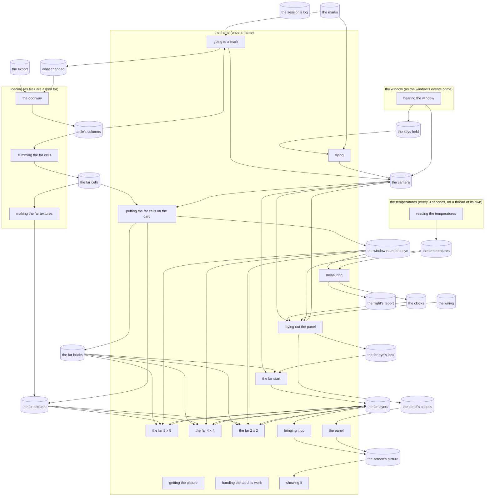

# The software map

What exists and how it's wired, drawn from the code's own list of its parts (`src/wiring.rs`) by its test on
every build: change the list, never this file. In the game, the same map is live: the editor (F2), "Software map".

The words: a **lane** is a line of work with its own pace; a **pass** is one piece of a lane's work, on the
processor or the card; a **stage** is one step of the world's recipe (none yet); a **store** is something held.

The costs are the newest kept flight's flown as the game runs, at its first standing, `kept logs/flight-1794589790.txt`: Incus Artus, build 149 (967dc51); the code committed.

## The lanes

### the window

- **Runs:** as the window's events come.
- **What it is:** What the window hears: keys pressed and let go, the mouse moving, the window resized, closed or left.
- **Its passes, in order:** hearing the window.
- **Files:** src/runner.rs.

### the frame

- **Runs:** once a frame.
- **What it is:** Each frame, its passes in order: the camera goes to a mark if it's time, flies, the panels are laid out, the card draws the picture, and it's handed to the screen.
- **Its passes, in order:** going to a mark, flying, putting the far cells on the card, laying out the panel, getting the picture, the far start, the far 8 x 8, the far 4 x 4, the far 2 x 2, bringing it up, the panel, handing the card its work, showing it and measuring.
- **Switch** `INCUS_FLIGHT`: a measured flight: every mark in data/marks.toml in turn, 5 s settling and 20 s measured at each, uncapped with the panel hidden; a report, then quits.
- **Switch** `WGPU_ADAPTER_NAME`: the card, by part of its name (intel: the laptop's Intel card).
- **Switch** `WGPU_POWER_PREF`: the card, by power (low or high).
- **Switch** `WGPU_BACKEND`: the card's language (DirectX 12 unless set).
- **Switch** `WGPU_DX12_COMPILER`: the shader compiler (the Windows SDK's DXC unless set).
- **Files:** src/main.rs, src/runner.rs and src/card.rs.

### loading

- **Runs:** as tiles are asked for.
- **What it is:** The world, read a tile at a time through the doorway. Going to a mark asks it for the ground under the eye; the far cells' lane will ask for tiles (2.2).
- **Its passes, in order:** the doorway, summing the far cells and making the far textures.
- **Files:** src/doorway.rs.

### the temperatures

- **Runs:** every 3 seconds, on a thread of its own.
- **What it is:** How hot the computer runs, read as old read it, so the frame never waits for it [David, 2026-11-12: "i'd like for you to start tracking temperatures again, just as before"].
- **Its passes, in order:** reading the temperatures.
- **Switch** `INCUS_TEMPERATURES`: 0: not read at all (it starts two programs every few seconds), to measure the game without them.
- **Files:** src/temperatures.rs.

## The passes

### hearing the window

- **A pass** in the window, on the processor.
- **What it is:** Each event: the keys held kept, the mouse turning the camera while it's captured, and F2 (the editor), F3 (the panel), F11 (window or full screen) and Tab (the mouse).
- **Reads:** none. **Writes:** the keys held and the camera.
- **Cost, last measured** (`kept logs/flight-1794589790.txt`): on the processor not run.
- **Files:** src/runner.rs and src/camera.rs.

### going to a mark

- **A pass** in the frame, on the processor.
- **What it is:** At the start, and on a flight once a mark is measured: the camera taken to the next mark, a player's eye over the ground the doorway answers, and the mark's changes made through the doorway (the build's placings, the scatter).
- **Reads:** the marks and a tile's columns. **Writes:** the camera and what changed.
- **Switch** `INCUS_MARK`: the mark the game starts at, by its name (the first in data/marks.toml unless set).
- **Cost, last measured** (`kept logs/flight-1794589790.txt`): on the processor median 0.000, 95th 0.000, 99th 0.000, worst 0.206.
- **Files:** src/marks.rs and src/runner.rs.

### flying

- **A pass** in the frame, on the processor.
- **What it is:** The camera flies by the keys held (WASD, Space, Ctrl, Shift), on real time, at the speed set on the Camera page. Not while the editor is open. On a flight, a moving mark flies it straight ahead at its speed (step 4).
- **Reads:** the keys held and the marks. **Writes:** the camera.
- **Cost, last measured** (`kept logs/flight-1794589790.txt`): on the processor median 0.000, 95th 0.001, 99th 0.001, worst 0.228.
- **Files:** src/camera.rs and src/runner.rs.

### putting the far cells on the card

- **A pass** in the frame, on the processor.
- **What it is:** The regions summed since the last frame put on the card as bricks, so the far view sharpens in live without holding the frame up; the levels over 1,024 made as their regions come in. Then the window round the eye brought to it (step 4): the 32s' and 64s' regions past it given back, those within it made from the far cells kept and put on, nearest first, the far textures following. At most 3 ms a frame for both.
- **Reads:** the far cells and the camera. **Writes:** the far bricks, the far textures and the window round the eye.
- **Switch** `INCUS_FAR_BRICK`: a brick's side in cells: 2, 4 or 8 (unset: 8), for the pool and the far textures both (2.2, step 3).
- **Switch** `INCUS_FAR_WINDOW`: the window round the eye: the 32s' radius in regions, the 64s' twice it (unset: 10; 0 the whole world on the card) (2.2, step 4).
- **Cost, last measured** (`kept logs/flight-1794589790.txt`): on the processor median 0.028, 95th 0.063, 99th 0.166, worst 0.342.
- **Files:** src/bricks.rs and src/far_eye.rs.

### laying out the panel

- **A pass** in the frame, on the processor.
- **What it is:** The developer panel (F3) and the editor (F2) laid out, and cut into shapes for the card. The panel's Camera page changes how fast the camera flies, its Render page the far eye's look.
- **Reads:** the camera, the clocks, the wiring and the temperatures. **Writes:** the panel's shapes, the camera and the far eye's look.
- **Cost, last measured** (`kept logs/flight-1794589790.txt`): on the processor median 0.016, 95th 0.033, 99th 0.151, worst 0.341.
- **Files:** src/panel.rs, src/editor/mod.rs and src/editor/software_map.rs.

### getting the picture

- **A pass** in the frame, on the processor.
- **What it is:** The screen's next picture to draw on, waited for if none is free (capped, this is where the frame waits for the screen).
- **Reads:** none. **Writes:** none.
- **Cost, last measured** (`kept logs/flight-1794589790.txt`): on the processor median 0.285, 95th 0.690, 99th 0.851, worst 4.014.
- **Files:** src/runner.rs.

### the far start

- **A pass** in the frame, on the card.
- **What it is:** One cone down each tile of 8 x 8 screen pixels, skipping over the far cells' tops, to where any of the tile's rays could first touch: they all start there. The layers' numbers for the frame written first, on the processor.
- **Reads:** the camera, the far bricks and the far eye's look. **Writes:** the far layers.
- **Switch** `INCUS_SIGHT_LEVELS`: the levels' view: each pixel tinted by the level its surface was read from.
- **Switch** `INCUS_SIGHT_STEPS`: the steps' view: dark blue few steps, through green, to red 256 or more.
- **Switch** `INCUS_SIGHT_NO_SHADOWS`: the sun's shadows left out (for measuring).
- **Switch** `INCUS_SIGHT_NO_SKY`: the sky light left out (for measuring).
- **Switch** `INCUS_FAR_EDGE`: 0: rays marched on past the map's edge toward the reach, as before (unset: ended at the edge).
- **Switch** `INCUS_FAR_TOGETHER`: 0: a blend's pictures read one after another, as before the lean step's 1b (unset: read together, and both levels' over a hand-over).
- **Switch** `INCUS_FAR_HAZE_STEP`: a far ray's step through thin haze (the land's faint fringe), in cells: 1 a whole cell (unset; the lean step, 1d, David's look), 0.5 as old's.
- **Switch** `INCUS_TEST_HALF`: for measuring (the Oracle's test): only the left half of each far layer marched.
- **Switch** `INCUS_TEST_STEPS`: for measuring (the Oracle's test): the most steps a far ray takes (unset: 768).
- **Switch** `INCUS_FAR_DETAIL`: the detail at launch, levels finer than a pixel's size (the Render page's; default 0, old's).
- **Cost, last measured** (`kept logs/flight-1794589790.txt`): recording it on the processor median 0.049, 95th 0.090, 99th 0.171, worst 0.353; on the card median 0.004, 95th 0.005, 99th 0.005, worst 0.027.
- **Files:** src/far_eye.rs and src/far.wgsl.

### the far 8 x 8

- **A pass** in the frame, on the card.
- **What it is:** The pyramid's base: a ray each 8 x 8 screen pixels through the far cells (old's far march: the level by distance, skipping empty space, the eight cells round each step blended, gathered front to back, faces lit by the sun, fog), its shadow ray towards the sun and its sky cones where it shows, and where the 4 x 4 is worth it.
- **Reads:** the far bricks, the far textures, the window round the eye and the far layers. **Writes:** the far layers.
- **Cost, last measured** (`kept logs/flight-1794589790.txt`): recording it on the processor median 0.001, 95th 0.001, 99th 0.001, worst 0.149; on the card median 0.536, 95th 0.550, 99th 0.564, worst 1.294.
- **Files:** src/far_eye.rs and src/far.wgsl.

### the far 4 x 4

- **A pass** in the frame, on the card.
- **What it is:** A ray each 4 x 4 screen pixels, only where the 8 x 8 above said it's worth it (never for sky), starting a little short of the nearest touch above it; and where the 2 x 2 is worth it.
- **Reads:** the far bricks, the far textures, the window round the eye and the far layers. **Writes:** the far layers.
- **Cost, last measured** (`kept logs/flight-1794589790.txt`): recording it on the processor median 0.000, 95th 0.001, 99th 0.001, worst 0.177; on the card median 0.011, 95th 0.011, 99th 0.012, worst 0.020.
- **Files:** src/far_eye.rs and src/far.wgsl.

### the far 2 x 2

- **A pass** in the frame, on the card.
- **What it is:** A ray each 2 x 2 screen pixels, only where the 4 x 4 above said it's worth it: the finest layer.
- **Reads:** the far bricks, the far textures, the window round the eye and the far layers. **Writes:** the far layers.
- **Cost, last measured** (`kept logs/flight-1794589790.txt`): recording it on the processor median 0.000, 95th 0.001, 99th 0.001, worst 0.139; on the card median 0.036, 95th 0.037, 99th 0.037, worst 0.235.
- **Files:** src/far_eye.rs and src/far.wgsl.

### bringing it up

- **A pass** in the frame, on the card.
- **What it is:** The pyramid onto the screen's picture: the 8 x 8 everywhere, each finer layer over it as much as it's worth there, crisp (a layer's pixel a square of screen pixels).
- **Reads:** the far layers. **Writes:** the screen's picture.
- **Cost, last measured** (`kept logs/flight-1794589790.txt`): recording it on the processor median 0.004, 95th 0.008, 99th 0.010, worst 0.188; on the card median 0.101, 95th 0.103, 99th 0.105, worst 0.328.
- **Files:** src/far_eye.rs and src/far_up.wgsl.

### the panel

- **A pass** in the frame, on the card.
- **What it is:** The panels drawn over the far eye's picture (the picture cleared to the sky's colour first, where there's no far eye). Recorded on the processor, run on the card.
- **Reads:** the panel's shapes. **Writes:** the screen's picture.
- **Cost, last measured** (`kept logs/flight-1794589790.txt`): recording it on the processor median 0.012, 95th 0.025, 99th 0.032, worst 0.429; on the card median 0.001, 95th 0.001, 99th 0.001, worst 0.136.
- **Files:** src/runner.rs.

### handing the card its work

- **A pass** in the frame, on the processor.
- **What it is:** The frame's work for the card finished and handed to it, with the card's clock asked to copy its times out.
- **Reads:** none. **Writes:** none.
- **Cost, last measured** (`kept logs/flight-1794589790.txt`): on the processor median 0.177, 95th 0.359, 99th 0.436, worst 1.918.
- **Files:** src/runner.rs.

### showing it

- **A pass** in the frame, on the processor.
- **What it is:** The picture handed to the screen, waited for if the screen's queue is full (Windows lets the frame run only so far ahead of what the card and the screen have taken).
- **Reads:** the screen's picture. **Writes:** none.
- **Cost, last measured** (`kept logs/flight-1794589790.txt`): on the processor median 0.103, 95th 0.218, 99th 0.283, worst 1.775.
- **Files:** src/runner.rs.

### measuring

- **A pass** in the frame, on the processor.
- **What it is:** The frame's length, and the card's times read back from frames it has finished; on a flight, kept for its report, with where the eye is and how far the window's usable regions reach round it. On a flight, once a second, the far layers' longest rays counted by a small pass of its own (the most steps any ray took, and how many took over 256, 384 and 512: the Oracle's step 0). The memory: the game's main memory (Windows' count for its process: in use, the most, and the machine's) once a second on a flight, for each standing's most and the report; the main memory and the card's in the session's log every half minute [David: "begin tracking ram use"].
- **Reads:** the window round the eye and the temperatures. **Writes:** the clocks and the flight's report.
- **Cost, last measured** (`kept logs/flight-1794589790.txt`): on the processor median 0.009, 95th 0.026, 99th 0.046, worst 0.734.
- **Files:** src/runner.rs, src/clocks.rs, src/flight.rs, src/memory.rs and src/far_tally.wgsl.

### the doorway

- **A pass** in loading, on the processor.
- **What it is:** Answers "what's here?" a tile at a time: each column's ground, its river's or lake's water, and its blocks from bedrock up as runs; and what changed in it. The engine never opens a world file itself. The export is read-only.
- **Reads:** the export and what changed. **Writes:** a tile's columns.
- **Cost, last measured** (`kept logs/flight-1794589790.txt`): on the processor not run.
- **Files:** src/doorway.rs.

### summing the far cells

- **A pass** in loading, on the processor.
- **What it is:** The far cells summed from the doorway's columns, a region (1,024 blocks a side) at a time, nearest the spawn first: cubes of 32 blocks and every level above, each exactly its children added. On the processor, not the card [David, 2026-11-12: "its a 1 time event, and it's quick"]: it's the loading lane, not the frame; the doorway's columns are already on the processor; and the card stays free for drawing. Nothing in the game asks yet: its test does, and the far eye will (2.2, step 2).
- **Reads:** a tile's columns. **Writes:** the far cells.
- **Cost, last measured** (`kept logs/flight-1794589790.txt`): on the processor not run.
- **Files:** src/far.rs.

### making the far textures

- **A pass** in loading, on the processor.
- **What it is:** Once every region is in, on a thread of its own: each far brick made again as a 9 x 9 x 9 block of texels (its border the next cells over) in the atlas (change 1: how solid and how watery in 16-bit floats; the colour and faces spread into empty neighbours, 8-bit; build 128 flew an exact way too, David saw no difference), and sent to the card an atlas layer at a time.
- **Reads:** the far cells. **Writes:** the far textures.
- **Switch** `INCUS_FAR_BLEND`: code: no far textures made, the far cells blended by the code (old's); unset, made and blended by the hardware once they're in.
- **Cost, last measured** (`kept logs/flight-1794589790.txt`): on the processor not run.
- **Files:** src/atlas.rs.

### reading the temperatures

- **A pass** in the temperatures, on the processor.
- **What it is:** The CPU area from Windows' thermal zone round the processor (typeperf) and the GPU with its clock (nvidia-smi), about a second a reading, the latest kept; every tenth in the session's log (half a minute). With LibreHardwareMonitor running (as administrator, its web server on), the processor's hottest core, watts and load and the card's watts and load too. Drawn top right whenever the world is shown, flights too (green under 70 °C, yellow under 85, red over): David watches the flights. On a flight, the hottest and the GPU's slowest clock at each standing in its report.
- **Reads:** none. **Writes:** the temperatures.
- **Cost, last measured** (`kept logs/flight-1794589790.txt`): on the processor not run.
- **Files:** src/temperatures.rs.

## The stores

### the keys held

- **A store** on the processor.
- **What it is:** The keys held down now (let go of all when the window is left).
- **Written by:** hearing the window. **Read by:** flying.
- **Files:** src/runner.rs.

### the camera

- **A store** on the processor.
- **What it is:** Where the eye is (north, east, up, in blocks) and where it looks (facing from north toward east, pitch up from level).
- **Written by:** hearing the window, going to a mark, flying and laying out the panel. **Read by:** putting the far cells on the card, laying out the panel and the far start.
- **Files:** src/camera.rs.

### the clocks

- **A store** on the processor.
- **What it is:** The frame's recent lengths, each pass's recent times on the processor, and the card's on the card.
- **Written by:** measuring. **Read by:** laying out the panel.
- **Limit:** recent frames kept, a pass, 240.
- **Limit:** frames on their way back from the card at once, 4.
- **Files:** src/clocks.rs.

### the wiring

- **A store** on the processor.
- **What it is:** This list: every lane, pass and store, fixed in the game. The frame runs in its order; the software map is drawn from it.
- **Written by:** none. **Read by:** laying out the panel.
- **Files:** src/wiring.rs.

### the panel's shapes

- **A store** on the processor.
- **What it is:** The panels cut into shapes for the card (made afresh each frame).
- **Written by:** laying out the panel. **Read by:** the panel.
- **Files:** src/panel.rs.

### the screen's picture

- **A store** on the card.
- **What it is:** The picture the card draws on and the screen shows, the window's size.
- **Written by:** bringing it up and the panel. **Read by:** showing it.
- **Files:** src/card.rs.

### the flight's report

- **A store** on the disk.
- **What it is:** A measured flight's report, logs/flight-<seconds since 1970>.txt (only on a flight).
- **Written by:** measuring. **Read by:** none.
- **Files:** src/flight.rs.

### the session's log

- **A store** on the disk.
- **What it is:** The session's messages and any crash, logs/session-<seconds since 1970>.log. Every part writes to it, so it has no lines on the map.
- **Written by:** none. **Read by:** none.
- **Files:** src/session.rs.

### the export

- **A store** on the disk.
- **What it is:** Old's test world written out as columns, exports/nice25 test: where it lies, the sea's level, every profile, and a file a tile (512 x 512 columns, raw deflate). The tablet takes its place at 3.1.
- **Written by:** none. **Read by:** the doorway.
- **Files:** src/doorway.rs.

### a tile's columns

- **A store** on the processor.
- **What it is:** A tile's answer: each column's ground, water and profile as the export holds them, its runs made when asked.
- **Written by:** the doorway. **Read by:** going to a mark and summing the far cells.
- **Files:** src/doorway.rs.

### the marks

- **A store** on the disk.
- **What it is:** The places every flight stands at, the same each time, data/marks.toml: where, how high, which way, fog, whose marks (near or far), and what's changed there first. The game starts at the first.
- **Written by:** none. **Read by:** going to a mark and flying.
- **Files:** src/marks.rs.

### what changed

- **A store** on the processor.
- **What it is:** The changes made through the doorway, by tile: whole blocks and bars, in the order they were made. A mark's are taken back when the flight moves on.
- **Written by:** going to a mark. **Read by:** the doorway.
- **Files:** src/doorway.rs.

### the far cells

- **A store** on the processor.
- **What it is:** The world as the far eye sees it: cubes of 32 blocks and every level above, 16 bytes a cell (old's form: how solid, how wet, which ways its faces look, their colour, how their light and height spread, how much surface shows), only each column's surface band kept. Colours from data/far colours.toml, old's, until the Registrar.
- **Written by:** summing the far cells. **Read by:** putting the far cells on the card and making the far textures.
- **Limit:** blocks a side of the first level's cells, 32.
- **Limit:** blocks a side of a region, made at once, 1024.
- **Files:** src/far.rs.

### the far bricks

- **A store** on the card.
- **What it is:** The far cells on the card, the whole world as old's bake kept it: each level's columns' bands (the lowest cell and how many: solid below, empty above), and the bands' cells in bricks of 8 x 8 x 8 found by arithmetic. The pool grows as it fills.
- **Written by:** putting the far cells on the card. **Read by:** the far start, the far 8 x 8, the far 4 x 4 and the far 2 x 2.
- **Limit:** levels, cells of 32 to 65,536, 12.
- **Limit:** cells a brick at most, 512.
- **Limit:** the largest buffer asked of the card (MB), 2047.
- **Files:** src/bricks.rs.

### the far layers

- **A store** on the card.
- **What it is:** The screen pyramid's pictures (8 x 8, 4 x 4 and 2 x 2 screen pixels a pixel), each with how far its rays first touched anything and how much the layer below is worth; and where each tile's rays start.
- **Written by:** the far start, the far 8 x 8, the far 4 x 4 and the far 2 x 2. **Read by:** the far 8 x 8, the far 4 x 4, the far 2 x 2 and bringing it up.
- **Limit:** layers, 3.
- **Files:** src/far_eye.rs.

### the far eye's look

- **A store** on the processor.
- **What it is:** What David tunes on the Render page (F3): where the levels hand over, where the 4 x 4 and the 2 x 2 fade in, and the sky's weight at a skyline; each with its default (Default puts them all back).
- **Written by:** laying out the panel. **Read by:** the far start.
- **Files:** src/far_eye.rs and src/panel.rs.

### the far textures

- **A store** on the card.
- **What it is:** The far bricks again as 3D textures for the card's texture hardware to blend (change 1): how solid and how watery (16-bit), and the colour and faces spread into empty neighbours (8-bit); each brick's slot beside its place in the bricks' index. A brick's texels a side: its cells a side and a border (9 at bricks of 8).
- **Written by:** putting the far cells on the card and making the far textures. **Read by:** the far 8 x 8, the far 4 x 4 and the far 2 x 2.
- **Limit:** bricks a side of an atlas layer, 64.
- **Files:** src/atlas.rs.

### the window round the eye

- **A store** on the card.
- **What it is:** Which regions' 32s and 64s are on the card (step 4): only those within the window round the eye. A word a region at each, 1 where it and its eight neighbours are on (usable), kept after the last level's bands in the far bands' buffer, so the far eye reads wgpu's default 8 storage buffers; the far eye reads the next coarser level where they aren't, so a window behind shows coarser cells, never a hole. Kept on the processor too, with each region's bricks and the places given back for the next to come; a region given back isn't written on the card, the flags guarding it. Later [David, 2026-11-12: "we will revisit that and ask, what can 16 buffers do for us, if there's anything to gain"]: what a raised storage-buffer limit could buy on cards that allow it, this 8-buffer way kept as the fallback.
- **Written by:** putting the far cells on the card. **Read by:** the far 8 x 8, the far 4 x 4, the far 2 x 2 and measuring.
- **Limit:** the 32s' radius in regions (the 64s' twice it), 10.
- **Files:** src/bricks.rs.

### the temperatures

- **A store** on the processor.
- **What it is:** The latest reading: the CPU area and the GPU (°C), and the GPU's clock (MHz); each left out where the computer doesn't offer it. On the laptop the CPU area is the thermal zone _TZ.TZ01, the motherboard round the processor, not its cores; 105 °C is the cutoff David agreed for long runs.
- **Written by:** reading the temperatures. **Read by:** laying out the panel and measuring.
- **Limit:** seconds between readings, 3.
- **Files:** src/temperatures.rs.

