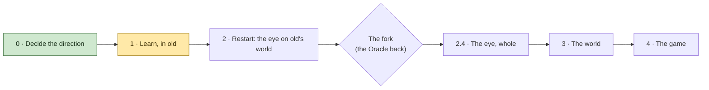

# The Master Plan

Where we've decided to go, in order, and where we are on the way. A living document: Counsel keeps it with David,
Builder ticks a line with the commit or log that proved it, and ticked lines stay. A change of order is David's
call, made here and recorded in the journal (`docs/decisions.md`, "The rebuild: after the Oracle").

Started 2026-11-11 from the Oracle's review (`vision/oracle-review.md`, parts 7 and 8), as David amended it.

---

## Where we are

- **Working on:** Phase 1, *Learn, in old*. Experiment 1 (the instruments) passed on both cards (2026-11-11,
  `docs/experiments.md`); the next experiments wait on David's go.
- **Why:** we can't size the rebuild on guesses. The last outside guesses were off by ten times both ways, so a
  handful of cheap experiments in old settle what paper can't before anything new is written.
- **Waiting on David:** his go for experiments 3 and 4a (1.3), after reading experiment 1's results; the laptop
  back to "NVIDIA GPU only" (it was switched to Optimus for the Intel flight).
- **The Oracle comes back** after experiment 6 (step 2.3), with the flight logs and David's look.

---

## In one picture

---

## Phase 0 · Decide the direction

- [x] Builder's review of the software as it stands (`docs/review-2026-11-10.md`)
- [x] The Oracle's review, after David answered its questions (`vision/oracle-review.md`)
- [x] Rebuild from scratch, old Incus Artus as the reference; experiments first, in old
      (`docs/decisions.md`, "The rebuild: after the Oracle", de53bb7)
- [x] VS Code set up for Builder (1ab561e)
- [ ] The spec cut by David (`master/spec.md`), alongside everything below

## Phase 1 · Learn, in old  ← *now*

Each experiment's pass mark is written down before it flies.

- [x] **1.1 The safety copy** (the Oracle's step 0)
  - [x] David's work that wasn't in git: blocks, textures, models, palettes, presets (1e3c21c)
  - [x] `vision/`, `CLAUDE.md`, the dyno-audit skill (0216222)
  - [x] The logs the record cites, in `kept logs/`; `notes/` and `imgui.ini` kept out of git (a203cdd)
  - [x] Pushed to the private GitHub repository
  - [x] USB copy: `D:\Incus Artus Backups\Incus Artus 2026-11-11 before rebuild`
  - [x] Tagged `before-rebuild` (a203cdd)
  - [x] `Art/`'s new files and `For Claude/` kept off GitHub for now (David 2026-11-11: "Not yet"); both are
        on the USB copy
- [x] **1.2 Experiment 1, the instruments** (both flights passed: `docs/experiments.md`)
  - [x] Flight headers say exactly what flew: every switch, the commit and whether it was clean, the card, the
        present mode (build 110, 090904f; flight A, `kept logs/dyno-1794414666.txt`)
  - [x] The card's time counts the work of making new ground (the lanes' clock; agrees with the build 104 trace:
        `docs/experiments.md`, flight A)
  - [x] Three standing marks, uncapped: on the ground at the spawn, beside the quarter-block build, a mountain
        top on a clear day (flight A: 5.9, 11.7 and 6.6 ms on the card standing)
  - [x] The choice of card restored; the marks flown once on the Intel card (restored in 090904f; flight B,
        `kept logs/dyno-1794416695.txt`: it ran, no failure but speed; standing 22.7, 20.6 and 29.5 ms)
  - *Gate:* David watches two flights; real baselines for the views that matter; the Intel card runs, or fails
    for a reason we can name
- [ ] **1.3 Experiments 3 and 4a:** the library's safety checks off; light switched off
  - *Gate:* two numbers: what the checks cost, and how much of each mark is light
- [ ] **1.4 Experiment 2, one-cell far reads against today's blend**
  - *Gate:* David's look. Decides the bricks' form (crisp: plain, 2.6 × the cells; soft: textures, 5.5 ×)
- [ ] **1.5 Experiment 4b, light stored in the baked cells and looked up**
  - *Gate:* what a lookup costs; David's look at light that steps
- [ ] **1.6 References from old, then old frozen**
  - [ ] Pictures at fixed places, times of day and settings
  - [ ] The marks' flights, with the repaired instruments
  - [ ] The default preset's maps and river network; sample columns
  - [ ] Tagged `old-final`
  - *Gate:* the references listed here, each with where it's kept

## Phase 2 · Restart: the eye on old's world

- [ ] **2.1 Pack, and the skeleton**
  - [ ] Old moves to `old\`, with its own assets and its own build folder, and still runs
  - [ ] `docs/` and `vision/` become `journal/`, with a contents page; `master/` on top; `CLAUDE.md` points at
        `master/`; memories trimmed to habits and warnings
  - [ ] The new project: a window that runs, the clock, a flying camera, the instruments
  - [ ] Every stage, pass, lane and store declared as data; it wires the game and draws `master/map.md`
  - [ ] The control room: the same map, live, in the game's panel
  - *Gate:* an empty frame measured; the map drawn from the code
- [ ] **2.2 The eye, far** (experiment 5): far cells kept in bricks, read straight from old's far bake
  - *Gate:* the far layers under 1 ms typical and 2 worst on the laptop; pictures beside old's; numbers from the
    Intel card. If they're twice that or more: keep the bricks and the light, march far the lean way instead
- [ ] **2.3 The eye, near** (experiment 6): near blocks from old's world, by rays, or by triangles if rays skim
  - *Gate:* the ground mark under 1.5 ms on the laptop; David's look, against old to the pixel
- [ ] **The fork. The Oracle comes back:** flight logs from both cards and David's look; it reads `master/`
      fresh. The design is fixed here, or changed
- [ ] **2.4 The eye, whole:** the light lane, water and glass, quarter blocks, textures, objects, glows, far lights
  - *Gate:* the reference pictures within a stated tolerance; under 4.2 ms at the 99th percentile on the laptop,
    on the flight and at all three marks; the Intel card's numbers recorded. **David walks old's world through
    the new eye**

## Phase 3 · The world

- [ ] **3.1 The tablet** (experiment 8 sizes it first): the made world on disk; one doorway for "what's here
      now"; walking, digging, placing, saving. Filled first from old's world
  - *Gate:* the same blocks as old's; dig, place, save, load; under 4 GB a world
- [ ] **3.2 The Registrar,** with its Color Lab and the way we work with HSL
- [ ] **3.3 The Graphics Kit,** built on the Registrar's colour system
- [ ] **3.4 World generation, stage by stage, with the new editor** (experiment 7 opens it)
  - [ ] Plans: tectonics, climate, rivers and lakes, peaks, cave plans
  - [ ] Broad ground, then fine ground, on the card
  - [ ] Water: sea level, cliffs and beaches, rivers. A design step of its own with David
  - [ ] Surface, then blocks (caves; later ores and strata)
  - [ ] Sums and light; the tablet written
  - *Gate, each stage:* David's eye, old beside new, on his default preset; the same result on both of the
    laptop's cards
- [ ] **3.5 Making a world as the player meets it:** the whole bake before play, the show while it's made, the
      rejector if wanted
  - *Gate:* a new world in the time David sets; no frame drops after entering

## Phase 4 · The game

- [ ] **4.1 The game's systems,** in the order `master/spec.md` gives, once David has cut it

---

## Open, and the step each one waits on

| Question | Waits on |
|---|---|
| `Art/`'s new files and `For Claude/` online? "Not yet" for now | David, any time |
| Far cells crisp or soft (one cell read, or eight blended)? | 1.4, David's look |
| The control room as a page in the game's own panel? | 2.1 |
| Old's new place: `old\` inside this folder (the default), or elsewhere? | 2.1 |
| The moons: does the brighter one cast shadows? | 2.4 |
| People far off: sharper than the squares behind them, or drawn into them? | 2.4 |
| Leaves far off: a little see-through, as the averages make them, or solid? | 2.4 |
| "1 always equals 1" as one stored answer everything reads, in David's words | 3.1 |
| Rivers and the shore: carried over first, or rearranged on the way? | 3.4 |
| The rejector: what makes one world better than another? | 3.5 |

## The targets

- **The laptop** (RTX 5070 Ti, 2,560 × 1,600, 240 Hz): a median of 237 fps, dips to about 180 fine, 120 the floor.
  Its budget: 4.2 ms a frame.
- **A GTX 980 Ti at 1080p:** a smooth 60, loosely. "If you have one, you should be able to play this game."
  Not a floor to design to.
- Room left in the frame for people, animals, battles of up to 800 figures, and the simulation on the processor.

## What every step keeps

- **The look:** hard textured blocks near; past a pixel, cells that are the exact sums of their blocks, in squares
  of 2, 4 and 8, enlarged crisp; edges that average and glide; blocky light in 16 steps; very dark nights; far
  lights that twinkle down to a pixel; the whole world in view on a clear day.
- **Honest:** near and far agree before any blending; everything that exists shows, however small; nothing pops;
  far changes may arrive late but are accurate; nothing is a stand-in.
- **The way we work:** even beats fast; nothing relies on fog; no tricks for one maker's cards; measure from the
  start; the pass mark before the flight; no number without its log; old is the check; one thing asked of David
  at a time; a drop is for its context, not for good; what's true lives in `master/`, and the agents' memory
  holds only habits and warnings.
