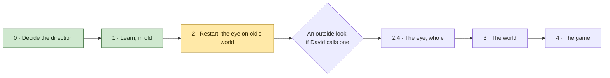

# The Master Plan

Where we've decided to go, in order, and where we are on the way. A living document: Counsel keeps it with David,
Builder ticks a line with the commit or log that proved it, and ticked lines stay. A change of order is David's
call, made here and recorded in the journal (`journal/docs/decisions.md`, "The rebuild: after the Oracle").

Started 2026-11-11 from the Oracle's review (`journal/vision/oracle-review.md`, parts 7 and 8), as David amended it.

---

## Where we are

- **Working on:** Phase 2, *Restart*, step 2.3, the near eye (experiment 6), from 2026-11-16. Builder is reading
  old's near walk, the Oracle's near eye and near light (third part, sections 3 and 6; second part 4.2) and the
  doorway's answers, to bring David its first step and its pass mark before any code. The near eye is triangles, the
  pieces too, drawn first so their depth spares the far rays they cover (his word, 2026-11-16: "I believe we should
  try to accomplish the rest of the graphics engine with triangles. rays may come in later for different cases";
  his "Yes, fly both" gives way, near rays not now). His goal for it: "64 chunk render radius running smoothly along
  with the far march like we have it now" (2,048 blocks; old drew real blocks to 256). His way there: "lets just make
  a radius slider and get started", the radius where triangles start and rays fade; a second slider, built things
  apart from the land, only "if that becomes intensive"; faces merged (greedy meshing) from the first build. First
  step: build 195, whole blocks a chunk at a time; in since: his radius slider (32 chunks to start), the x-fader
  where blocks fade into rays (128 blocks, curve 1: "the fade looks good"), the panel folded into sections, the sky
  dots mended and far rays skipped under blocks (builds 196 to 203), and quarter and eighth blocks, scattered at
  random to test them, his old build drawn whole for the first time in the new game (build 204). 240 a second holds
  at 64 chunks; as the game starts (32 chunks) the card's whole is under his 2 ms at every mark (the dearest high
  over the spawn, 1.80), pieces costing about what whole blocks do. Textures are on the near faces (build 205, old's
  placeholder pictures; with the scatter stage on, "its looking really good"; they cost nothing that can be shown,
  build 206). **Now, 2.4 by his checklist of 2026-11-16** (the list is under 2.4). In so far, each done enough to
  go on: placed things in the far view (build 207); the sky's light on the near faces (build 208); faces turned
  away left out (build 209: the near faces a third cheaper on the card); light kept apart from the faces, only where
  it isn't plain daylight (build 210, his "proceed with C": 15% cheaper again with the stage on). His look at build
  210 (2026-11-17): "this looks really good, builder. the only rough part is this. i feel like we should have a
  finer region between the triangles and the march." **So next, by his word, the fine region past the triangles**
  ("push the fineness-grossness gradient out to the triangle radius"), moved ahead of placed lights: Builder is
  measuring memory and making time and brings him its pass mark first. Then placed and moving lights, glows and far
  lights, more textures, and the near eye's own costs (listing chunks, chunks with pieces, chunk optimizing where
  it would show); "dont worry about very fast flight". The graphics style (one fixed screen of 2 x 2 squares, the
  world at half size) waits for the style pass in Phase 4: `journal/docs/graphics-style.md`.
- **His word on the road** (2026-11-16): "i'm pretty happy and confident with our graphics engine now"; hanging
  homework and questions are dropped (the kept Oracle's five questions among them; an outside look is his to call,
  no longer a gate); "Builder can proceed with the tests and basic fixes, i'll bring it up if i see undesirable
  graphics behaviors." After graphics, Phase 3 in his order: tectonics, world generation (topography, then water),
  the Registrar and the placer, ecology.
- **Just left:** 2.2, the far eye, left as it stands on his word (2026-11-16): "we can do that later. as long as
  we're set up to look back into the graphics engine at a later date, we can proceed." Not closed as 2.1 was: its
  gate's last line is owed (the Intel card's numbers, with the new march priced checked and unchecked, Phase 2's own
  rule, which slipped). Where it stands: everything under his 2 ms bar, the card's whole 0.48 to 1.12 ms over the
  nine views, two views over 1 ms; the march 168 registers, nothing put by, 12 groups. Everything set aside is in
  the list "For the later look back at the far eye", below the open questions, each packed to resume from. How it
  got there:
- **The far eye's road:** the Oracle, called midway, read the far eye as *waiting, not working* (a few hundred rays skimming the
  horizon set each layer's time while the card sits nearly idle), and the tests, the watts and Nsight agreed. David
  took its order (`journal/vision/oracle-review.md`, third part). Done enough to go on: step 0 (instruments; the Intel
  card works where the NVIDIA waits, and per David informs while the NVIDIA decides); step 1, the lean step (1a, 1b, 1d
  kept, 1c dropped); step 2, the three layers marched by **one dispatch**, overlapping their waits, on the library's
  default limits. Fog is off and for looks only. The far eye now (build 159): the sea 1.35 ms (nodding 99th 1.54), a
  player's run 1.38, the mountain top 1.34, high over the spawn 1.30, the plain 0.87, the spawn 0.66; **everything
  under 2 ms**, David's bar, and his look: "fantastic". Light now comes from the processor (build 160, the column
  light, 40 MB): on the card it costs what no light costs, and flown by day everything stays under 2 ms (medians 0.29
  to 1.15 ms, no frame over 1.56); his look, A/B against the rays: "column light is actually cleaner, i prefer it".
  The rays' light is cut from the march (build 162, his word: "Yes, cut them"). Close up he asked for the "whorls" to
  be more orderly: where a ray's steps begin is on a switch ("very subtle"); the switch to bare rock that drew flat
  plates is cut, and empty cells borrow colour across bricks (builds 163 to 167; build 167 flown within 0.7% of build
  163). His look at the rings where levels hand over: "i can't see any rings"; the gate owes only the Intel card's
  numbers (next time Optimus is on). The 16s' and 8s' rings are in ("looks pretty good"); the 4s and 2s wait for the
  near eye. The 8s found a wall on the plain, and a day of measuring placed it: the marks that wait wait on their
  longest rays, and the marks that work are full, the march holding 168 registers (12 groups of rays of 48). The
  height table took the sea and the run about a fifth faster. The Oracle, called again (her first reply in
  `journal/vision/oracle-prompt-2026-11-14.md`), waited on his five answers for her fourth part (dropped by his word,
  2026-11-16). The far eye's speed
  work is done enough to go on, in his order: the march's smaller passes and leaning went as far as they paid
  (builds 177 to 180, 2 to 7% off); then the long rays cut into lengths, packed, a ray given only the lengths it needs
  (builds 181 to 186). The cut is on as the game is launched (build 187; `INCUS_FAR_CUT=0` turns it off): 25 to 39%
  faster where the card waits, within 4% where it works; summed over nine views 6.58 ms against 8.06 uncut; the
  dearest view high over the spawn at 1.086 ms (uncut's the sea at 1.071); the worst 99th 1.25. His word on keeping
  it: "it looks like the new cut does bring the overall average down ... i'd like to get a move on." His look on
  it: "it is alarmingly fast and looks really nice." The scatter stage is in (build 188, Builder's to place: woods,
  towers, castles, towns, arches, a hall entrance, cave mouths; on with `INCUS_SCATTER_STAGE=1`), and with it the far
  cells summed from any column, so overhangs, arches, caves and David's build now reach the far eye. It showed bright
  bands at the rings' edges over shallow sea, mended (build 189: "basically invisible ... well done. let us
  proceed."); a long ray it showed on the plain mended too (build 190: the nine views' sum 6.55 ms). The skyline
  talk (haze or cover; his lean "i like the way cover works", with "pay careful attention to the weight of the
  shader"): its first step, cover by faces, makes walls, towers, spires and woods hold at a distance, one register
  more with nothing put by and about half a percent of the march once trimmed (builds 192 to 194); a "Cover by
  faces" tick box on the Render page for his A/B (build 193). His look: "looks good", kept and on. Lazy rays are
  shelved, kept in the back pocket "if we ever get a performance squeeze limited by long rays"
  (`journal/docs/lazy-rays.md`), and the land's own edge by a height table beside them
  (`journal/docs/cover-by-height.md`), with the march mapped by its parts for a later pass to free room
  (`journal/docs/march-by-parts.md`): "if i become dissatissfied with some views in a fuller game i'll come back to
  cover by height and lazy rays and there may be a final check pass against the engine later anyways." His weights by
  kind wait.
- **Just closed:** 2.1, done enough to go on (David: "yes, close 2.1. let us proceed."). Old is packed into `old\`
  and still runs; the journal is in `journal/`. The new project runs from the top of the folder (build 120; the
  numbers carry on from old's): a flying camera on old's keys, the panel (F3), the clocks a pass at a time, and the
  empty frame at 0.34 ms and 0.012 ms on the card once warmed up. The wiring draws `master/map.md`; the new editor
  (F2) has the software map. The doorway answers all 5,047 reference columns to the block, and the marks are data,
  every one flown at 0.338 to 0.344 ms. What's left of it is carried: both cards by one command to 2.2, the
  doorway's pieces and lights to 2.4, its named fields to the tablet. As the editor fills, every window, setting and
  control is placed with David (`journal/docs/decisions.md`, 2026-11-12).
- **Behind us:** experiments 1, 2, 3, 4a and 4b (`journal/docs/experiments.md`) gave soft bricks (the blend stays)
  and light kept a cell at a time, which David can't tell from rays ("in a blind test"), though at eye level
  light's cost is the near faces'. 1.7's reading flight found the bare plain's cost spread, and ruled out the sky's
  long rays. The references from old are taken, the test world is exported whole for the new eye to read (5.2
  billion columns in 0.11 GB, checked against old's, kept on the laptop and the USB), and old is frozen
  (`old-final`, 7c809d3), kept for looking at and reference. The Oracle, called early, answered before the first
  line (`journal/vision/oracle-review.md`, second part); David agreed its changes, amended by Builder and Counsel
  (`journal/docs/decisions.md`, "Before the first line").
- **Why:** we can't size the rebuild on guesses. The last outside guesses were off by ten times both ways, so a
  handful of cheap experiments in old settle what paper can't before anything new is written.
- **The near eye's tests are flown** (build 197, 2026-11-16, `journal/docs/experiments.md`): **at 64 chunks the
  frame holds the screen's 240 a second at every standing mark** (the slowest 295 a second, high over the spawn,
  on a hot processor); the near faces are then the dearest thing on the card (2.4 to 2.6 ms where 10 million
  triangles are in view, the far eye 0.5 to 0.7 beside them) and listing the chunks in view costs the processor
  1 ms a frame. **A miss:** the far eye is 16 to 21% dearer with the near eye on at ground views (its rays begin
  inside the ground under the near faces and make a false edge); mended by the step already next, the near
  faces' cover cancelling far rays. **His reading of the trace's rows** (2026-11-16): the near faces' cost on the card is their
  corners' work, 49% of the samples against 15% for their pixels: it goes with how many faces are sent. **His
  word on the next step:** "go ahead with the next step and launch". **His looks at builds 198 and 199** (2026-11-16): "the fade looks good, and the panel folding
  is good.  i notice speckling white dots of sky when looking down and moving." Build 199 is the near eye drawn
  into a picture and depth of its own and laid over the far picture by his x-fader ("x-fader width (blocks)",
  "x-fader curve", in "The near eye" section). **Build 200 (built, unlaunched):** the white dots mended (holes
  between merged faces: 38 to 117 lone pixels of sky looking down, none now), each face drawn a hair wider.
  **Build 201 (built, unlaunched, unflown):** far rays skipped under blocks (the near eye drawn before the
  march; "the near cover" says which far pixels blocks wholly cover; the march marches none of those), and his
  starting numbers, said to Counsel ("yes, and 32 chunk radius": 32 chunks, the x-fader 128 wide, curve 1). Off
  the screen the far eye's groups are held 7 to 87% fewer thread-steps and the far picture is unchanged.
  **His word for the rest** (2026-11-16, to Counsel): "Builder can proceed with the tests and basic fixes, i'll
  bring it up if i see undesirable graphics behaviors." So Builder goes on without waiting on a look: build 202
  (the near eye's depth, found too coarse at a distance: its mark written), then the window on it (an off and an
  on trace for the march's row, a bracket of flights, after a cool-down). **Build 202 flown** (2026-11-16, `journal/docs/experiments.md`): a mixed result. Skipping far rays
  under blocks saves the far eye a quarter to a half where it works (the mountain top, the spawn at 64 chunks,
  and wherever blocks fill the view: there the far eye falls to 0.25 ms), but its own new pass, the near cover,
  costs 0.145 ms a frame, so the card's whole frame is 0.06 to 0.19 ms dearer on open ground. 240 a second at 64
  chunks still holds at every standing mark (the slowest 284). Two faults of Builder's own found in the new code
  (the march asked the cover before asking whether a pixel is wanted; the cover's pass read a pixel at a time)
  **are mended in build 203, flown at 16 chunks:** the cover's pass halved to 0.07 ms, the far eye no dearer on
  open ground with the rule than without, its floor where blocks fill the view 0.20 ms. The rule now makes the
  card's whole frame cheaper at the working marks (the mountain top 0.35 ms, built-up views up to 0.54) and 0.05
  to 0.08 ms dearer on open flat ground (the cover's pass); left there, done enough to go on. And the plain is dearer with the near eye on whatever the rule: the
  far eye now draws a crisper horizon there with its finer layer (its near haze no longer hides it), which the
  Crossovers' sliders govern. **Waiting on David:** nothing; the trace's row is his to read when he likes. **Quarter and eighth blocks are in the near eye** (build 204, flown as the game starts, 32 chunks;
  `journal/docs/experiments.md`): his build drawn whole (146 bars, 23 blocks); pieces cost the card what whole
  blocks do, count for count; the card's whole frame under his 2 ms bar at every mark (the dearest 1.80), every
  standing mark at 544 a second or more. **Textures are on the near faces (build 205, 2.4's first step,** by his order "so textures and
  quarter/octs next"): old's placeholder pictures, crisp up close, shrinking to the far colour; they cost the card
  0.01 to 0.09 ms. **His look, with the scatter stage on: "its looking really good."** Build 206's bracket (the pictures
  off, on, off) shows no cost from them on the card or the processor: build 205's dearer reading was the
  difference between two sessions. All of the near eye's processor time is listing the chunks in view (0.15 to
  0.27 ms a frame at 32 chunks, 1 ms at 64). What of 2.4 comes next is his to say. Before the flights (his "go
  ahead with the tests", 2026-11-16) he looked at build 195: "holds 240fps at 64 chunks, once its loaded in"; flying very fast,
  90 to 120 a second while chunks are made ("i don't think a player could experience a hiccup. off to a good
  start"); "there is a seam, but, its not very bad, and i think a x-fader with curves could hide it almost
  completely so blocks smoothly fade into rays". **Next for him after the tests:** the x-fader drawn up, its
  controls' place and names asked of him first. Build 196 (unlaunched) put the near lane on fewer threads;
  build 197 is the flights' fittings, its mark written (`journal/docs/experiments.md`): the near lane told of a
  mark's changes (his build and the scatter have never been drawn by either eye), a flight waiting for the near
  eye's chunks, the near eye's line in a flight's report. Build 195 as it was checked off the screen: the blocks
  inside the radius drawn as merged faces over the far picture, crisp, the same colour and light as the far
  eye's, no gap between the two at radius 1, 4, 16 or 64; at 64 chunks 13,100 chunks are kept (14.4 million
  faces, 168 MB), 10 million triangles drawn in view from the spawn. Not yet: its flights, its row. **The near eye (2.3) is begun, by triangles, his word**
  (2026-11-16, `journal/docs/experiments.md`): "I believe we should try to accomplish the rest of the graphics
  engine with triangles. rays may come in later for different cases"; "lets just make a radius slider and get
  started. the render radius set there will determine where the triangles start and rays fade"; his goal, "64
  chunk render radius running smoothly along with the far march like we have it now" (2,048 blocks). Builder is
  on its first step, build 195, its pass mark written: whole blocks as merged faces (greedy meshing) a chunk of
  32 at a time on a lane, drawn after the far picture with depth, lit from the far eye's light, fading onto the
  far picture at the radius; the far march's program untouched. After it: the near faces' cover cancelling far
  rays; the hand-over tuned by his look; pieces and his build as changes; then light of its own and textures.
  **The far eye is left as it stands** (his word: "we can do that later. as long as we're set up to look back
  into the graphics engine at a later date, we can proceed"); what was set aside is listed under the open
  questions below ("For the later look back at the far eye"), the Intel card's flight among it. Cover by faces is in and done enough to go on (`journal/docs/experiments.md`): his look at
  build 193, the live switch in his hand (the Render page's "Cover by faces" tick box swaps the march's two
  compiled programs, nothing switched inside either): **"looks good"**. As flown in build 194 (one power where a
  step gathers; off, on, off) it costs the march about half a percent, the card's whole over the nine views 0.4%
  more; its size on the card by his reading of the rows one register (168 for 167, nothing put by, 12 groups;
  builds 192 and 194 alike). His weights by kind weren't asked for at his look. Its size on the card, by his reading of build 192's row: 168 registers for
  167, nothing put by, 12 groups still: it fits, for one register (two of room left under the line, where there
  were three). Build 192 is traced and flown
  (off, on, off): under 1% dearer at five marks, both working marks among them (the mountain top the same, high
  over the spawn 0.7%); 1.6% at the sea marks and 2.8% on the run, where rays gather at nearly every step (a miss
  on the run against its mark); the card's whole over the nine views 1.1% more. Next if he wants the rule: one
  power where build 192 works out two. Where it stands (2026-11-16,
  `journal/docs/experiments.md`): the skyline talk's first step is cover by faces (a far cell stops a ray by the
  face it shows it as well as by its bulk): walls solid, roofs their own colour, the arch and far spires read;
  woods become solid masses (the largest change); steep land's edge a little fuller; level skylines and shallow
  water as they were. Build 191, its first form, cost about 2% of the march at every mark, and David's reading of
  its rows showed it pressing on the program's size on the card (168 registers and two values put by, for 167 and
  none: onto the line; still 12 groups). His reading of the off row: the march is build 178's size, register for
  register: the cut added nothing. Build 192 (built, checked off the screen) is the same rule where a step is
  gathered, reusing what the march works out for light: the same look, the five places gone, steps through air
  doing nothing new. His words (2026-11-15): "i do like the crisper line of the
  'cover' ... against the skyline, and other things against other things, hopefully; but pay careful attention to
  the weight of the shader", by which he means "its size on the card". Owed to him when it's built: two Nsight rows
  to read (the rule off and on), his look on the stage, his word for one flight session. After it: his weights by
  kind on top, if he still wants things pulled up (the list of what could take a weight is sent); the land's own
  edge by a height table weighed after lazy rays. Builds 188, 189 and 190 are flown (2026-11-15,
  `journal/docs/experiments.md`). Build 189 missed at the bare plain (11.6% over) and the sea nodding (3.9%): a
  ray nearly covered at a cut had its next length begin as if a twentieth were let through, so the length marched
  far past the ray's true end and the join cut it and uncut it every other frame. Build 190 mends it (a length
  begins as the ray truly stood; the guard for a moving view is the join's) and its flight met its mark: the plain
  0.448 ms (build 186's 0.450), the sea nodding 0.518 (0.561), the plain nodding 0.451 (0.473); the card's whole
  over the nine views 6.548 ms, the least yet; the dearest view high over the spawn at 1.109 ms (it read 1.8%
  dearer than build 189's with the same work counted on a hotter machine: Builder reads it as the session, the
  next flight says). With the scatter stage on (build 189's flight), the card's whole over the nine views is 5%
  more (6.995 ms for 6.663), the dearest view 1.21 ms, and the run 39% more (there more rays are long than the
  list holds). Next: the skyline talk with Builder (haze, as now, or cover), which the stage's pictures
  now feed: thin things (an arch's piers, posts) nearly vanish against the
  sky at the far cells' size. After it by the plan: lazy rays, the Intel card's flight; then the near eye. His
  looks today: the cut, "alarmingly fast and looks really nice"; the scatter stage (build 188, on with
  `INCUS_SCATTER_STAGE=1`), "very nice builder. it looks like it should, i think"; the bright bands at the rings'
  edges over shallow water, mended in build 189 (a coarser level's ground was counted against the finer cell
  through every hand-over), "basically invisible ... well done. let us proceed." **Build 183, the cut's second stage, is flown: a miss** (2026-11-15,
  `journal/docs/experiments.md`). A ray long the frame before is marched as up to 17 lengths side by side and
  joined: the march is 49% shorter on the plain (0.769 to 0.396 ms) and 37% over the sea, where the card waits;
  and 18% longer at the mountain top, 32% high over the spawn, 17% on the run, where the card works. The dearest
  mark rose from 1.08 to 1.37 ms. The steps are the same, so Builder's reading: every cut ray gets sixteen threads
  whatever its length, uneven lengths share a group, and a group runs as long as its longest. The mend proposed: as
  many lengths as a ray needs (about a hundred steps each, cut where the frame before says), packed side by side.
  Build 183 marches with the cut on unless `INCUS_FAR_CUT=0`; uncut it's build 182's picture and time. The picture
  cut against uncut is within 8 of 255 but for three rays, two of them a flaw at the map's edge that was there
  before the cut (written down, not mended). The cut's first stage, the list of long rays, is flown through
  (builds 181 and 182: it costs nothing). His words for it (2026-11-15): "go on with the cut". His order for the far eye's last stretch of
  speed (2026-11-14): "we should probably start with trying to break it into smaller passes to fit more, and then
  lean and cut the rays." The first part is flown through (builds 177 to 180, `journal/docs/experiments.md`):
  the audit priced the march's parts in two batches; **build 178, the march once the textures are in, is kept** (a
  second program from the one text without the code's blend or the views: the picture kept, 2 to 7% off every mark
  but the spawn; the march's need of registers from 186 to 167, nothing put by in memory); and four flights said
  what fitting more groups is worth: 2 to 7% where the card is full, a loss of 3 to 4% where it waits (the compiler
  buys the groups by putting words by in memory). The hand-over's second read out is worth up to 14% on the plain
  and 4% at the dearest marks, as a ceiling, with a wrong picture till something stands in. So Builder's reading:
  the registers aren't chased further as a goal, and the cut of the long rays is next (rays stopped at 160 steps
  made the sea's march 45% shorter and the run's 29%, build 176). The far eye's whole now: high over the spawn
  1.096 ms, the sea 1.092, the mountain top 1.056, the run 0.977, the plain 0.886, the spawn 0.466. Not answered:
  what the mountain top's and high over the spawn's time is (not their longest rays, not room, not the hand-over;
  the 4 x 4 layer is the largest known part). Builder's assessment of lazy rays is with him and Counsel. If Nsight
  says "GPU Performance Counters unavailable": a restart of the laptop clears it (2026-11-15; cause not known).
  The 4s and 2s are held; the Oracle's reply and the plan's updates are with him
  and Counsel. Behind us today: his look at the
  rings met ("i can't see any rings"; a longer hand-over saved for his polish list); the blocks "go away mostly with
  the hardware blend, after it loads in"; the rock switch cut and the textures sound (build 167, flown). The gate's
  line owes only the Intel card's numbers; the skyline look, talked through with Builder first (haze or cover), after
  the cells of 2 to 16; later, one budget at the fork, and lazy rays fixed to the world or the
  screen; whether `CLAUDE.md` points at the map. His desktop has two launchers: "Play Incus Artus" (the new game) and
  "Play old Incus Artus" (`old\`).
- **The Oracle comes back** after experiment 6 (step 2.3), with the flight logs and David's look. Counsel gathers
  what we learn for it as we go, in `journal/vision/oracle-return.md`. It was also called early, after Phase 1 (2026-11-11).

---

## In one picture

---

## Phase 0 · Decide the direction

- [x] Builder's review of the software as it stands (`journal/docs/review-2026-11-10.md`)
- [x] The Oracle's review, after David answered its questions (`journal/vision/oracle-review.md`)
- [x] Rebuild from scratch, old Incus Artus as the reference; experiments first, in old
      (`journal/docs/decisions.md`, "The rebuild: after the Oracle", de53bb7)
- [x] VS Code set up for Builder (1ab561e)
- [ ] The spec cut by David (`master/spec.md`), alongside everything below

## Phase 1 · Learn, in old

Each experiment's pass mark is written down before it flies.

- [x] **1.1 The safety copy** (the Oracle's step 0)
  - [x] David's work that wasn't in git: blocks, textures, models, palettes, presets (1e3c21c)
  - [x] `vision/` (now `journal/vision/`), `CLAUDE.md`, the dyno-audit skill (0216222)
  - [x] The logs the record cites, in `kept logs/`; `notes/` and `imgui.ini` kept out of git (a203cdd)
  - [x] Pushed to the private GitHub repository
  - [x] USB copy: `D:\Incus Artus Backups\Incus Artus 2026-11-11 before rebuild`
  - [x] Tagged `before-rebuild` (a203cdd)
  - [x] `Art/`'s new files and `For Claude/` kept off GitHub for now (David 2026-11-11: "Not yet"); both are
        on the USB copy
- [x] **1.2 Experiment 1, the instruments** (both flights passed: `journal/docs/experiments.md`)
  - [x] Flight headers say exactly what flew: every switch, the commit and whether it was clean, the card, the
        present mode (build 110, 090904f; flight A, `kept logs/dyno-1794414666.txt`)
  - [x] The card's time counts the work of making new ground (the lanes' clock; agrees with the build 104 trace:
        `journal/docs/experiments.md`, flight A)
  - [x] Three standing marks, uncapped: on the ground at the spawn, beside the quarter-block build, a mountain
        top on a clear day (flight A: 5.9, 11.7 and 6.6 ms on the card standing)
  - [x] The choice of card restored; the marks flown once on the Intel card (restored in 090904f; flight B,
        `kept logs/dyno-1794416695.txt`: it ran, no failure but speed; standing 22.7, 20.6 and 29.5 ms)
  - *Gate:* David watches two flights; real baselines for the views that matter; the Intel card runs, or fails
    for a reason we can name
- [x] **1.3 Experiments 3 and 4a:** the library's safety checks off; light switched off (build 111; flights C, D,
      E in `kept logs/`; `journal/docs/experiments.md`)
  - *Gate:* two numbers: what the checks cost, and how much of each mark is light
  - The checks: unchecked, sight's march is 31 to 49% *slower* at the three marks (faster only on the light views);
    the world's rules about 15% faster a piece. The checks stay on.
  - Light (sky and shadows): 42% of the spawn mark, 17% of the mountain top and of the build, 25% of the route's
    median.
- [x] **1.4 Experiment 2, one-cell far reads against today's blend** (builds 112 and 113; David's two looks,
      `journal/docs/experiments.md`)
  - *Gate:* David's look. Decides the bricks' form (crisp: plain, 2.6 × the cells; soft: textures, 5.5 ×)
  - **Soft.** Blended is the look: crisp "doesn't look better", the in-between (smooth in height) "better than
    ziggurat lods but, its not better than blended" (David). Crisp stays a known fallback for a card short of memory.
- [x] **1.5 Experiment 4b, light stored in the baked cells and looked up** (builds 114 and 115; flights C2 and H,
      the light's view; `journal/docs/experiments.md`)
  - *Gate:* what a lookup costs; David's look at light that steps
  - The lookup is almost free and found nearly everywhere far: the spawn 9% faster, the mountain top and the build 3%
    (at eye level light's cost is the near faces'). David on light that steps: "i don't think i could tell the
    difference between the two in a blind test".
- [x] **1.6 References from old, then old frozen** (`master/references.md`; tagged `old-final`, 7c809d3; the export
      on the USB)
  - [x] Pictures at fixed places, times of day and settings (24: six places, four times of day; `references/pictures/`,
        `master/references.md`)
  - [x] The marks' flights, with the repaired instruments (C and C2, the Intel card's B; `master/references.md`)
  - [x] The default preset's maps and river network; sample columns (the test world's, nice25 with the dyno's
        presets, not the startup default: `references/world/`, `references/columns.txt`, 5,047 columns)
  - [x] Tagged `old-final` (7c809d3, pushed; after the events log the third mark replays went in. David: "so,
        we'll pack up the old incus artus into old, and just use it for looking at and reference")
  - [x] The test world exported whole as columns, for the new eye to read, so it never runs old's world gen. David:
        "export nice25 so that we can use it as a 'generated' world to look at with the new graphics engine, before
        rebuilding world gen after the graphics engine is done." (`world/export.rs`, a7d3cfb; kept in `exports/`
        and on the USB, not in git)
        - Written 2026-11-11 (build 115): 19,881 tiles, 5.2 billion columns, 0.11 GB, 7 profiles, 8 minutes.
        - Checked: one tile in 50 read back (399 tiles, 104.6 million columns), every column's ground and water the
          world's, and 1,029,963 whole profiles the world's (`INCUS_EXPORT_CHECK=50`).
        - On the USB: `D:\Incus Artus Backups\exports\nice25 test` (2026-11-11; all 19,883 files compared with
          the laptop's by SHA-256, none differing).
  - The pictures are kept for reference, not as a yardstick (David: "it'll look good or it won't, idc what the old
    things look like in particular, other than the basic way we're doing things")
  - *Gate:* the references listed here, each with where it's kept
- [x] **1.7 The reading flight** (the Oracle's second part; David: "i agree on all counts"): the third mark with old's
      switches only, no code after `old-final`. The march split from light, and the layers turned off one at a time,
      to find where the bare plain's cost lives (9.51 ms before the build goes in, which adds about 2)
      (flights I to N, f9e79bc, `kept logs/dyno-1794448108.txt` to `dyno-1794450518.txt`; `journal/docs/experiments.md`)
  - *Gate:* the plain's cost placed in its parts, with the logs
  - The bare plain is 9.66 ms; the build adds 2.02. The cost is spread: the blocks 31%, light 21%, the finest layer
    20%, overlapping. The Oracle's guess, the long rays over the sky, is ruled out: four times the sky rays made it 4%
    cheaper. Placed only as far as old's switches reach: with the blocks or light off, the plain still costs twice the
    spawn, and old can't time a layer alone. So the plain is flown in both eyes' marks, and the new engine's clocks
    place the rest.
  - *Corrected (Counsel):* the line above says "the march split from light". Light was measured by switching it off
    (flight J) instead, because old's clock times the whole compute pass as one, so a split wouldn't time light alone.
  - Found on the way: the coarsest layer at 4 × 4 was cheaper than 8 × 8 at all three standing marks (16% at the
    mountain top); a dial for the new eye to measure.

## Phase 2 · Restart: the eye on old's world  ← *now*

Each change in 2.2 and 2.3 flies alone, behind its own switch, on both cards, and each program is priced checked and
unchecked the first time it flies. Marks are data, flown on both cards by one command.

- [x] **2.1 Pack, the skeleton, and the doorway** (closed done enough to go on, David 2026-11-12: "yes, close 2.1.
      let us proceed."; its gate met; what's left carried to 2.2, 2.4 and 3.1, each where it's first fed)
  - [x] Old moves to `old\`, with its own assets and its own build folder, and still runs
        (daf4e2c, IntelliJ's files with it in c0def46; its tests pass from there, 414; the check flight,
        `kept logs/dyno-1794475773.txt`, within 0.3% of 1.7's I at all three marks; `journal/docs/experiments.md`)
  - [x] `docs/` and `vision/` become `journal/`, with a contents page; `master/` on top; `CLAUDE.md` points at
        `master/`; memories trimmed to habits and warnings
        (the move, 1436bf2: as they were, with history, and `journal/contents.md`; the paths in `master/`,
        `CLAUDE.md`, the dyno-audit skill and the memories updated. Counsel's memories trimmed: the rivers
        walkthrough gone, its record in the journal; the fresh-eyes audit moved to the new engine. Builder's trimmed:
        her habits, the team's ways and the rebuild's direction now hold habits and warnings only)
  - [x] The new project: a window that runs, the clock, a flying camera, the instruments (the card timed a layer
        and a pass at a time from the first build: old's one clock couldn't place the bare plain's cost, 1.7)
        (392ae0d, build 116 c4d102e, David: "looks fine"; the empty frame flown, `kept logs/flight-1794486371.txt`:
        0.40 ms a frame, 0.019 ms on the card; `journal/docs/experiments.md`)
        *Corrected (Builder, build 119's flight):* that floor was measured inside the session's first ~25 s, which run
        slower. Settled, the empty frame is 0.34 ms and 0.012 on the card (build 120, `kept logs/flight-1794489536.txt`)
  - [x] Every stage, pass, lane and store declared as data; it wires the game and draws `master/map.md`
        (`src/wiring.rs`, 1ae278c: two lanes, seven passes, eight stores, no stages yet; its tests check both ways;
        the map's costs from build 117's flight, `kept logs/flight-1794487642.txt`; `journal/docs/experiments.md`)
  - [x] The control room: the software map, a page of the new editor (its own screen, pages by a drop-down at the
        top): black, magenta boxes with a tooltip on hover, joined by lines, inside larger boxes for sections; live
        (David, 2026-11-12)
        (build 117, 1ae278c and 8283179; David: "editor looks about like what i'd expect")
  - [x] **The doorway** (moved up from 3.1): one small piece that answers "what's here?" a tile at a time: columns as
        runs of blocks; pieces, objects and lights; what changed; named fields over the land. The export behind it
        now, the tablet at 3.1. Read-only until the fork. The engine never opens a world file
        (columns as runs in, `src/doorway.rs`: the 5,047 reference columns answered to the block, a tile in 2.2 ms;
        `journal/docs/experiments.md`. What changed in too, by tile: the build's 146 bars and 23 blocks, and the
        scatter, b48ddc3. Pieces, objects and lights, and the named fields come with what first feeds them: carried
        to 2.4 and 3.1 when 2.1 closed)
  - [x] The marks as data: the spawn; the bare plain; the plain with David's build (its 169 placings from the event
        log, replayed as changes); the mountain top; far marks (high over the spawn, low over the sea, the plain's
        horizon); the scatter dial (random blocks, none to very many)
        (`data/marks.toml`, build 119 b48ddc3 and 120 2ee6651: every eye where old's stood, the build and the scatter
        made through the doorway, none refused; flown, `kept logs/flight-1794489536.txt`, every mark 0.338 to 0.344 ms.
        The plain's horizon is the bare plain, marked for both eyes. One command flies every mark on one card; both
        cards at once waits on the Optimus setting, when the Intel card is flown)
  - *Gate:* an empty frame measured; the map drawn from the code; the doorway answers the 5,047 reference columns
    to the block
- [ ] **2.2 The eye, far** (experiment 5): old's far march moved onto bricks as it is, then three changes, each
      alone: soft bricks blended by the texture hardware (flown two ways: Builder's exact blend and the Oracle's
      spread); rays begun at drawn boxes; light read from the cell. The far cells are summed by a lane from what the
      doorway answers (old's far bake checks the sums; the first sum's time is measured). The open-sea shortcut
      waits until a sea mark shows it's needed
  - [x] Step 1, the far cells summed from the doorway on the processor, checked against old's bake (`src/far.rs`,
        `data/far colours.toml` old's colours; `far::tests::the_far_cells_are_old_s_bake`): all 5,184 regions and 11.2
        million cells the same as old's, byte for byte, each region's 1,024 to its exact sums. The eighth round the
        spawn in 2.6 s and the whole world in 16.9 s on 24 threads (old's, on the card: 46 to 55 s and about 12 min);
        `journal/docs/experiments.md`
  - [x] Step 2, old's far march on bricks as it is (`src/far_eye.rs`, `far.wgsl`, `bricks.rs`): 2a the shape and
        2b old's light, David's looks ("it looks right, mostly", "light looks normal ... so proceed"); the whole
        world's bricks 911 MB; the baseline, `kept logs/flight-1794497402.txt`: the far marks 1.4 to 4.0 ms on the card,
        light 3 to 13% of it. Found on the way: the sky's weight at a skyline (David's 4) and the Render page
        (`journal/docs/experiments.md`)
  - [x] The panel fix (no text selection, the mouse's let-go always heard) and the far eye's settings live on the
        Render page, each with Default (build 127, ac1a9d8; the card's memory shown beside them)
  - [x] Change 1, soft bricks blended by the texture hardware, both ways (A exact, B spread), switchable live
        (build 128, 842f83a: 14 to 29% off at every mark; David: "they all look the same", so the spread is kept and
        exact taken out, build 129, 4ad4788; memory 2.7 GB with the whole world's far view on the card. Detail +2
        tried and put back to 0, 2f756a4: "yeah 0 is fine". `journal/docs/experiments.md`)
  - [x] ~~The fog line: the finer layers earned along edges where neighbouring squares differ~~. Dropped with fog
        off by default (build 149; David: "we are not using fog ... it is just for looks"): without fog, near and far
        are one colour and the squares don't show. Finer layers earned at edges stays an idea for the final touches,
        if fog comes back
  - [x] Bricks of 4 against bricks of 8, chosen at launch (build 131, f6958f9: counted first, then flown at 8, 4
        and 2; the whole game 2,656 MB in use at 8, 1,555 at 4, 1,315 at 2, for 5-13% more far time at 4, 14-24% at
        2; the picture the same. David: "4 sounds good", the default from 18d2537; the last pick after step 4's
        flights at 4 and 8. `journal/docs/experiments.md`)
  - [x] A window round the eye for the 32- and 64-block levels, flown fast
        (f47e006 built, 85d876f the camera's step fixed, 6dc9171 back to 8 storage buffers; the game's card memory 471
        MB at bricks of 4, still time within 3% of the whole world's; at 200 blocks a second it keeps up with spikes,
        at 2,000 it creaks; `journal/docs/experiments.md`; David: "it looks good")
  - [x] Change 2, rays begun at the drawn boxes (flown, build 137: the picture the same, but it doesn't pay on this
        card; taken out after the Oracle's mid-2.2 reply, git keeping it; `journal/docs/experiments.md`)
  - [x] The Oracle's mid-2.2 tests: rays ended at the map's edge (kept, 6 to 19% off every far mark), half the rays,
        the step limit halved, the watts, and Nsight (the 8 × 8 and 4 × 4 keep 6.9% and 1.3% of the card in flight
        over the sea): "waiting, not working", confirmed three ways (builds 140 and 141, c15d256, b516975, e2ea8bf)
  - *The rest of 2.2 in the Oracle's order* (its third part, section 11; David: "Yes, its order", 2026-11-12):
  - [ ] Step 0, instruments: the longest ray per layer in every report; a nodding mark at the sea and the plain; one
        Intel flight now, to learn whether that card waits or works (David on "Optimus", put to him a step ahead).
        *In, but for the Intel flight* (build 142, e496645, 19de6db): a few hundred rays set the dearest marks, and cost
        follows the longest ray (the sea's 558 and 764 steps, 2.59 ms); the nodding marks at their 99th, the plain
        1.18 and the sea 3.15 ms, are the gate's numbers from here. *The Intel flight* (f8d6b01): the Intel card is
        working, not waiting (cost follows how much is marched; 4 to 8 times the NVIDIA's; dearest the mountain top,
        10.5 ms), so each step after is priced on both cards
  - [x] Step 1, the lean step, in halves flown apart, each the same picture pixel for pixel: kept in hand; read
        together (behind a switch, priced on both cards); several steps at once (alone, checked with care); thin haze
        by whole cells (a look). *1a, kept in hand, is in* (build 143, c89a040, 63409af): 6 to 13% off the far marks
        (the sea 2.58 → 2.24 ms, its nodding 99th 3.13 → 2.72), the spawn 5% slower, the picture pixel for pixel;
        kept, its keep-or-drop after the Intel flight. David chose the lean step before the Intel flight. *On the
        Intel card 1a is 2.5 to 10% slower* (32f4703); a trimmed 1a (build 144) wasn't "just better", so **1a is kept
        as built** (build 145, c89a040's march), by David's rule: "unless its just better than 1, we go 1". The
        NVIDIA side to be re-flown on "NVIDIA GPU only", for the record. *1b, read together* (build 146, behind a
        switch): on "NVIDIA GPU only" 2.5 to 7% off every far mark, nothing slower, the Intel losing nothing; **kept,
        on from build 147**. Against the gate now: the sea 2.21 ms (nodding 99th 2.72), the plain 0.95, the mountain
        top 1.63, high over the spawn 1.65. *1c, several steps at once,* dropped (build 148: 11 to 25% slower, its
        code costing even off; taken out whole). The fog-off baseline (build 149): the sea 2.20 ms (nodding 99th
        2.69), the plain 0.94, the mountain top 1.59, high over the spawn 1.64. *1d, thin haze by whole cells* (build
        151, a setting): the sea 2.22 → 1.78 ms (nodding 99th 2.14), a player's run 2.29 → 2.00, the plain 0.88; the
        pictures nearly the same; David: "i don't see anything bad about it. Seems like a good thing.", **kept, on from
        build 152**. Step 1 done enough to go on: 1a, 1b, 1d kept; 1c dropped
  - [x] Step 2, the layers side by side, each taking its lead from the coarser layer of the frame before; the finer
        base layer first, as its probe. *The probe* (build 153, 337cc47): a 4 × 4 base is slower at every mark (the
        sea 1.78 → 2.11 ms, the mountain top 1.57 → 3.05), so ray count matters too, and the 8 × 8 base stays; step 2
        proper's estimate comes down. *Step 2 proper* (build 154): nothing gained; three dispatches in one pass still
        ran in turn, so the waits still add. Its code behind a switch. *One dispatch over all three layers* (build 155,
        David's "go on with a"): the worst marks 33 to 38% faster (the sea 1.78 → 1.11 ms, its nodding 99th 2.14 →
        1.30, a player's run 1.99 → 1.34), the light marks 13 to 23% slower (the spawn 0.85, the plain 1.00), from a
        cost of its own of 0.12 to 0.2 ms; not kept as it is. *Trimmed* (build 156, "Yes, trim it"): its cost gone;
        faster or level at every mark, **everything under 2 ms**, medians and 99ths (the sea 1.41 ms, nodding 99th 1.61;
        the mountain top 1.38; high over the spawn 1.37; the plain 0.88; the spawn 0.68). Kept, to go on with. *One more
        arrangement* (build 157, the base and middle layer in the same rows): level or 1 to 3% faster everywhere (the
        sea 1.38, nodding 99th 1.58), kept though under its pass mark's 5%, in the open. David: "hell to the yeah ...
        You can go ahead with finishing up and then cutting code we won't be using". *Finished* (build 158, c90ff53):
        the textures packed, the game back on the default limits, the one dispatch the default. *Cut* (build 159,
        e97aed5): the closed switches out, about 2% at every mark ("just hygiene"). Step 2 done enough to go on: the
        sea 1.78 → 1.35 ms, its nodding 99th 2.14 → 1.54, the mountain top 1.57 → 1.34, high over the spawn 1.61 →
        1.30, a player's run 2.00 → 1.38; everything under 2 ms. His look at build 159 next; the lag look again once
        the near eye draws
  - [ ] Alongside: light read from the cell, made on the processor by sweeps (the sun's shadow each sun step, the next
        made ready; the sky's openness once); change 3 and "light split out" as one; its own pass mark on lag. *Its
        price, measured* (build 159, 2d6a715): the light's rays are 11 to 56% of the far eye now; without them every
        mark is 1.14 ms or under. The sun snaps at each sixteenth of a day, smoothed only if bad (David). Builder's
        design: per column, the sun's shadow height and the sky each column's top sees, two small pictures (about 40
        MB); behind a switch, flown against the rays, then his look. It treats far cells as a surface for light (no
        shadows under far overhangs and arches): his condition, "everything has to look even, and reveal everything
        accurately". *Built* (build 160, unflown): pictures at all five marks beside the rays, "those pics look fine
        to me"; a sun change shows in about 0.3 s. Each cell's own cover (for overhangs and arches) shelved until the
        cells of 2 to 16 and the test detail, which come together. *Flown* (the night queue, fifteen flights,
        2026-11-13): the column light costs what no light costs (within 0.02 ms at every mark) and is 0.12 to 0.49
        ms under the rays; medians 0.33 to 1.21 ms. The night's 99ths can't be read (something else took the card's
        time from half an hour in, and the machine ran 4 to 18% slow): two day flights owed before the bar is
        shown for build 160. The one dispatch is worth 20 to 35% with the light's rays gone; the finer base costs
        0.35 to 1.33 ms. *Flown by day* (2026-11-14, the laptop off his TV): the column light's medians 0.29 to
        1.15 ms, its 99ths 0.30 to 1.34, no frame over 1.56 at any mark; within 0.012 ms of build 159's no light,
        every pass mark met. The TV taken as the night's cause. *The rays' light cut* (build 162, "Yes, cut them"):
        the shadow ray, the sky cones, the sky light handed down and the "light by rays" switch gone; all five
        marks' pictures byte for byte as before; one flight owed for what the cut gives
  - [ ] Step 3, the gate, read moving and nodding at the 99th. Step 4 only if it's missed: the long ray cut into
        lengths, marched side by side, joined front to back. *Met by David's bar* (everything under 2 ms, build 157);
        step 4 not needed. His look at the rings where levels hand over: *met* (build 167, "i can't see any
        rings"). Still owed for the gate's line: the Intel card's numbers for the final form, for the record; both after light moves to the processor ("why don't we
        skip 1. we're putting light on the processor, probably.")
  - [ ] The cells of 2 to 16 in the far eye's march, each in its own ring; a scatter stage behind the doorway (a
        wood, rows of posts, towers, slabs and an arch), off by default; marks from it. Before the fork. First the
        16s' ring alone (128 × 128 columns round the eye, old's size), to prove the moving ring, the store, the march
        and the light on one level before the other three reuse them; then the scatter stage's woods; then shapes
        placed by hand. *The scatter, on his word* (2026-11-15): Builder picks the blocks, colours and places, an
        instrument for testing, not world generation ("its gonna be blurry and just for testing anyways, so go nuts,
        do whatever you want, have fun"); what to check: arched entrances to mountain halls, castles with walls and
        towers, towers in the mountains and on the ground, towns on the ground, forests here and there, cave mouths
        here and there; the trees from his `oak.png`. *The scatter stage built* (build 188, unflown,
        `journal/docs/experiments.md`; on with `INCUS_SCATTER_STAGE=1`): the far cells summed from any column (they
        knew only a height, so nothing could stand over air), checked block by block; woods, towers, a castle, two
        towns, a hall's entrance, cave mouths, posts, a slab and an arch; its own marks. His look: "very nice builder. it
        looks like it should, i think"; and of the rings' edges it showed over shallow water, mended in build 189:
        "basically invisible ... well done. let us proceed." *The 16s and the 8s in* (builds 168 to 171: "looks pretty good"); the
        8s found the plain's wall (0.54 → 0.96 ms). The 4s and 2s held: at 128 cells a side they'd lie under the near
        eye's ground, so they're decided with the near eye, on David's answers to the Oracle's questions 1 and 5
  - [x] The far eye's speed work, for headroom to make it prettier (David, 2026-11-15: "i don't think we should leave
        anything undone ... that will translate directly to more headroom for prettying it up"), ranked by what it
        takes off the dearest mark ("the goal should always be to bring down the high spot"). Found: the marks that
        wait (the sea, the run, the plain) wait on their longest rays; the marks that work (high over the spawn, the
        mountain top) are full at 12 groups of rays of 48, the march holding 168 registers. *Done enough:* the height
        table (builds 174 and 176; the sea 1.40 → 1.11 ms, the run 1.31 → 1.01; the near marks 3 to 9% dearer). In his
        order: (1) the march broken into smaller passes, to fit more groups, priced first by an instrument that lists
        candidate pieces' registers in one trace; (2) the march leaned; (3) the long rays cut into lengths, marched
        side by side (the Oracle's step 4). Each with its pass mark and flight, and taken out again if it doesn't pay.
        *Done enough to go on* (David, 2026-11-15: "and then we can move on, if it gets a little better overall than
        it is now"): (1) and (2), builds 177 to 180, 2 to 7% off, build 178's march once the textures are in kept;
        (3) the cut, builds 181 to 187 (`journal/docs/experiments.md`): a ray long the frame before is marched as
        the lengths it needs, packed side by side, and joined; on as the game is launched from build 187. Flown
        (build 186, `logs/flight-1794778376` and `-1794778772`): the far eye's whole a quarter to two fifths less
        at five of nine views (the plain 0.872 to 0.568 ms, the sea 1.071 to 0.651, the run 0.962 to 0.721), 1 to 4%
        more at the other four (high over the spawn 1.052 to 1.086); two views over 1 ms for four. Its first form,
        sixteen threads a ray, was a sixth to a third dearer where the card works (build 183): there the cost is
        threads kept waiting, not steps, and the march's program has no room to carry more (builds 184 to 186)
  - [ ] The looks (David's "2, 3 and 4"): the skyline by cover, with a column-height table (haze or cover is his);
        if cover, the sheet (plain far land as rings of mesh) flown as the far levels' rival; the horizon band over
        frames comes as lazy rays. After the cells of 2 to 16, so it's judged on them (David, 2026-11-14: "yes and
        yes, you can proceed"). His lean (2026-11-15): "i like the way cover works", with an idea for the talk:
        weights like the sky's feather, by kind of far hit, to pull thin things (posts, towers, trunks) up in the
        picture. *The talk, his word* (2026-11-15: "i do like the crisper line of the 'cover' ... but pay careful
        attention to the weight of the shader"), in three steps: (1) cover by faces, a ray stopped by the face a
        far cell shows it as well as by its bulk, from what the cells already carry (builds 191 to 194: in, his
        look "looks good", one register and about half a percent); (2) his weights on top if he still wants
        things pulled up, the 26 classes that could carry one sent him (not asked for at his look); (3) the
        land's own edge by a height table (the Oracle's cover). **(3) shelved by David, 2026-11-16, not
        dropped,** with the sheet that hangs on it: "pack it up next to lazy rays ... if i become dissatissfied
        with some views in a fuller game i'll come back to cover by height and lazy rays and there may be a final
        check pass against the engine later anyways." To resume from: `journal/docs/cover-by-height.md`. At his
        word the march was scanned by its parts for that later review: `journal/docs/march-by-parts.md` (a tree
        of its program by size, the 98 values it holds in hand, eleven candidates for making room)
  - [ ] Lazy rays (David's lead: "spread out any rays that can be lazy"), by lengths of distance, under the Oracle's
        nine rules (a ray in flight always finishes; light and fog put on every frame; the gate read moving); its
        tests amended (the store, once whole, equals a full march of its own directions; the lag; card time moving,
        laziness on and off; his eye turning, walking past a ridge, and at the sun's step). **Shelved by David,
        2026-11-16, not dropped:** "lets hold off on lazy rays for now. we can keep that in our back pocket if we
        ever get a performance squeeze limited by long rays. i think we can move on." Everything to resume from is
        in `journal/docs/lazy-rays.md` (the rules, the measurements, Builder's proposal, his two open questions)
  - [ ] Rays shuffled or sorted by length: held for the Intel card
  - [x] Main memory in every report and the session's log, beside the card's (build 138, dce3afb: 2.8 GB held,
        1.0 GB in use)
  - [ ] Spare main memory's free wins, priced once the 1.3 GB held at the start is placed: prepared bricks for the
        window, the tiles round the eye unpacked, the far light's sweeps
  - [ ] Every mark flown on both cards by one command (carried from 2.1): the Intel card's flight needs the laptop
        switched to "Optimus", put to David a step ahead. Last
  - *Each:* measured, then David's eye still, moving his head, and flying ("try all these things and gather data")
  - *Gate:* the far layers under 1 ms typical and 2 worst on the laptop, at the far marks; David's look, above all at
    rings where levels hand over; numbers from the Intel card. If they're twice that or more: keep the bricks and
    the light, march far the lean way instead. *As David reads it now* (2026-11-13): "if everything in the far view
    is under 2ms we should be gold"; the worst and irregular frames weigh above the typical, read moving and nodding
    at the 99th
- [ ] **2.3 The eye, near** (experiment 6): rays first, from the eye with no boxes (the Oracle's third part): a
      column-height table and a table of each brick's empty boxes from the first build, light kept in the air cell in
      front of each face, pieces walked by their octants; then faces as triangles; both flown on the same marks
      before the fork. David's build arrives as changes, testing the eye's change path. Marks: the bare plain (and
      nodding), the scatter at three densities, the build, a bigger quarter-block building, the spawn, the mountain
      top; the wood at eye level, along a long wall and still water, under a roof, a walk and a run
  - *The rule, changed by David's word* ("Yes, fly both", 2026-11-12; it was: triangles only if rays missed a mark):
    rays and triangles both built and flown; 1.5 ms or under at every ground mark; over 1 ms apart at the worst mark
    is David's call; his eye for pops and seams
  - ***Changed again by his word, 2026-11-16: triangles.*** "I believe we should try to accomplish the rest of the
    graphics engine with triangles. rays may come in later for different cases, but i don't believe quarter/oct
    blocks will present any difficulty in terms of triangle count ... i'd like to hear how you think we could
    gracefully add the triangles in, and make sure they cooperate nicely with the march." So the near eye is built
    with triangles, pieces too; near rays aren't built now. The lines above about rays first stand as the record
    of what was planned. Still his: 1.5 ms or under at every ground mark, and his eye for pops and seams, above
    all where near hands over to far (`journal/docs/experiments.md`, 2026-11-16)
  - *Gate:* the rule above; David's eye for pops and seams; the scatter's curve (cost should follow the screen)
- [ ] **The fork. An outside look** (the Oracle: any outside advisor, a fresh agent each time, on a prompt David
      puts together; David, 2026-11-16)**:** flight logs from both cards and David's look; it reads `master/`
      fresh, then Counsel's brief, `journal/vision/oracle-return.md`. The design is fixed here, or changed.
      *No longer a gate* (his word, 2026-11-16: "i'm pretty happy and confident with our graphics engine now ... if i
      want an outside look, i'll construct a prompt"): called when he wants one; 2.4 follows 2.3 without it
- [ ] **2.4 The eye, whole:** the light lane, water and glass, textures, objects, glows, far lights (quarter blocks
      were here; built in 2.3 as triangles, build 204)
  - **The near-term checklist, his word (2026-11-16):** "we need placed things, near light, glows and far light,
    textures, an assessement of a fine ring after the triangles to transition more smoothly, listing chunks, faces
    turned away, a chunk with pieces taking too long, chunk optimizing if theres a visible way, dont worry about
    very fast flight." In his order; each its own build, pass mark first, flown in a bracket where it's a cost:
    - [ ] **Placed things in the far view:** whatever is placed (a build, a scatter, later a player's work) summed
          into the far cells, so it doesn't stop at the render radius. He called it necessary before graphics are
          done enough to move on from
    - *Order within near light, his word 2026-11-17* ("i agree with your suggestions about the order"): after step
      1 (sky light, build 208), **faces turned away** (below) and **where light is kept** (a light picture round
      the eye, or a strip of light beside each merged face, so faces merge whatever the light; Builder boils the two
      down first) come before step 2, placed lights, which are built on it
    - *Where light is kept, his word 2026-11-17* ("proceed with C", of three ways put to him with counts): **light
      kept only where it isn't plain daylight**, in one table on the card a face's pixel looks its cell up in (no
      entry: plain daylight), so faces carry no light and merge whatever it is; a small light picture round the eye
      later, for moving lights only. Build 209 is faces turned away; build 210 this, built: bricks of 8 x 8 x 8
      cells behind a directory, in one buffer; off the screen the same picture as build 208's, 16 to 18% fewer faces
      with the stage, the light 20 MB at 32 chunks of it and nothing on bare land; flown in a bracket with the
      stage on (2026-11-17): the near faces' time on the card 15% less than build 208's way over 20 marks, at no
      mark dearer. Done enough to go on; his look at builds 208 to 210 owed (the cut and the floor are his by eye)
    - [ ] **Near light:** the near eye's own light, per face, blocky and quantised (the spec); placed lights in 16
          clear steps a block, coloured, flooding through air and stopped by walls, flickering; moving lights (a
          held lantern, effects); caves and interiors dark unless lit ("i want light to be precious")
    - [ ] **Glows and far lights:** lights seen from far off, sparkling, their glow shrinking and fading into fog,
          never snapping off
    - [ ] **Textures:** bars wearing their own side and end pictures along each bar, joins seamless; the grass's
          shared edge; pictures for the blocks that have none (the stage's seven), placeholders or his art
    - [ ] **A finer region between the triangles and the march** (his words at build 210, 2026-11-17: "i feel like
          we should have a finer region between the triangles and the march"; "push the fineness-grossness gradient
          out to the triangle radius"; and "i don't think we need very much of the finer cells to blend the
          transition from angles to rays ... i can focus it into the seam at a natural grade"). Moved ahead of
          placed lights by his word. Today the 16s' and 8s' rings reach 1,024 and 512 blocks, wholly under the
          triangles at 32 chunks; past them the cells are 32s, ten times the screen's grain (a 2 x 2 square covers
          about 3 blocks at 1,024). Build 211, a first look: the rings' sizes settable at launch
          (`INCUS_FAR_RING_SIDE`); three times wider costs about 200 MB, 35 s to make the 16s from nothing, and 0.4
          to 1.1 ms a frame. Next, after his look: a narrow band at the seam that begins under the x-fader and
          follows the render radius, hollow, priced at 64 chunks too; his eye decides how much
    - [ ] **The near picture on squares** ("Near pixel size" in The near eye: 1, 2 or 4; his "i agree", its place
          and name his choices, 2026-11-17): build 212, built: at 2 the near view is drawn at half size and laid
          over in 2 x 2 squares on the far eye's own grid, a whole frame about 0.3 ms shorter off the screen; his
          look decides whether it stays and at what size. With it, **the field of view on the Camera page** (5 to
          130 degrees), for zooming into seams. **Panini, or another flex that makes up for a wide field of view,
          is owed a talk** (his word: "we can talk about some kind of panini or donut flex that compensates for
          higher fov. it was good last time"; the spec has Panini decided)
    - [ ] **The detail curve** (his words, 2026-11-17: "a sort of linear equivalence of detail from the back if
          your hand towards infinity ... a formula with a single flexture. triangles go 4x to 2x to 1x and then march
          2x - 32x on that golden curve"): the smallest thing drawn at a distance d is **sqrt(a² + (g × d / P)²)**
          blocks: a a fixed size in the world up close (a quarter block to begin), g a fixed size on the glass far
          off (pixels), P the pixels a block one block away is tall (from the picture's height and the field of
          view). His order: **(1) the near half** (three near pictures at a quarter, a half and the whole size by
          bands of distance, "Largest near squares" and "Detail up close (blocks)" in The near eye; build 213 with
          hard edges, built: no hole on the ground off the screen, a whole frame a tenth shorter on the ground; his
          look; the fades by a stipple, his choice ("lets try stippling"), build 214, built: "Stipple width" in The
          near eye, no cost that shows; his look: "the blocks become blurry after like 5 block radius around me, set
          to 4" (a block's picture is 32 squares a side, smaller than a 4-pixel square past 5 blocks, so they
          blend); build 215 for it, both ways as sliders by his choice: "Detail up close" down to 1/64, and
          "Picture sharpness in the squares" (his name), built: crisp squares off the screen, a speckle in the
          middle distance at 1, no hole, no cost that shows; his look decides their starting places, the stipple's
          width, and whether the curve is on from the start); **(2) lights and nights** (his answers, 2026-11-17:
          the first lights "red and green blocks", taken as two plain blocks that glow red and green, stood about
          the stage; their controls in a new section "Placed lights"; build 216, placed lights, built: `data/lights.toml`,
          the light spread a step a block when a chunk is made and kept in colour bricks beside the sky's, the
          cave by the spawn lit red and green off the screen, 4.3 MB within 16 chunks, no cost that shows; his
          look: "it looks great", done enough to go on; lamps flickering at random asked for "at some point"
          (a flicker voice a lamp, in the colour bricks' spare bits); then moving lights, glows and far lights,
          night) (placed and moving lights, glows and far lights,
          night); **then assess**; (3) the far half after (rings that reach where the curve says, with a band of
          4s at the seam; at g = 2 perhaps 600 MB and the finer rays' time: priced first)
    - [ ] **Listing chunks:** the near eye's processor time is all in listing the chunks in view (0.15 to 0.27 ms a
          frame at 32 chunks, about 1 ms at 64)
    - [x] **Faces turned away** from the eye left out: build 209 (ff0c6b2), the card drops them and a chunk's
          groups of them aren't listed: half as many faces sent at 32 chunks; flown in a bracket of five
          (2026-11-17), the near faces' time on the card a third less over the marks, half at the spawn, the dearest
          frame 1.89 to 1.62 ms. Done enough to go on
    - [ ] **A chunk with pieces** meshes nine times slower than a plain one (2.8 ms against 0.3): half blocks only
          round the pieces, or another way
    - [ ] **Chunk optimizing where it would show:** what a player would feel (filling 64 chunks took 37 s at the
          spawn; the corners' program is half the card at 64 chunks), each only if its gain is visible
    - Not now, by his word: very fast flight (single frames of about 20 ms at 2,000 blocks a second)
    - Not in his list, kept here as they were: water's look, objects, glass, the doorway's pieces and lights below;
      the Intel card's flight and his walk through old's world (the gate)
  - [ ] The doorway's pieces, objects and lights, as the eye first draws them (carried from 2.1)
  - [ ] Water's look, far: shallow sea over a nearly flat shelf shows as long square contours (the shore and each
        block of depth), seen from high over the plain at build 188; a shallow edge that fades in, with water's own
        design. (The bright square bands he asked about there, "two square rings that move with me", are the 8s' and
        16s' ring edges, a flaw of the march, mended in 2.2 as build 189.)
  - [ ] The polish passes, once the gates are met (David, 2026-11-13: "work the rays into a prettier shape without
        doing much ... we may have a lot of headroom inside the card for making things prettier"), each a look step:
        the far view's "splotchy" noise made more "orderly" by a rounder blend, light from the solid field's slope, an
        even (blue-noise) step offset, a finer base layer; the skyline's squares if they still show
        (`journal/docs/decisions.md`)
  - *Gate:* David's eye, on its own terms, the basic way kept; under 4.2 ms at the 99th percentile on the laptop,
    on the flight and at every mark; the Intel card's numbers recorded. **David walks old's world through
    the new eye**

## Phase 3 · The world

*Reordered on David's word, 2026-11-16* (`journal/docs/decisions.md`, "the road after it"): tectonics, world
generation, the Registrar and the placer, ecology. It was: the tablet, the Registrar, the Graphics Kit, world
generation, making a world. The steps he didn't place are kept at the end of the phase, to be fitted in where the
work first needs them.

*Throughout the editor, from its first page:* every window, setting and control placed with David first; a line
in a shared top bar only if every window under it needs it; a control goes when what it controls goes (David,
2026-11-12: "organizing the UI is super important to me"). The pages put back together "in a more streamlined
way, because it gets pretty crowded, so we'll use space a little better" (2026-11-16).

- [ ] **3.1 Tectonics, put back together:** David goes through old's tectonics and names the important
      parameters, "and try to make it a little more flexible"; its page laid out with him
- [ ] **3.2 World generation, a modular stack, built deliberately** ("since we know the road now ... a modular
      stack that works much like it did before, but we can do a better job with topography and water layers"), with
      the new editor (experiment 7 opens it), on its World Gen page, the stack laid out afresh with David: "we can
      definitely organize the world gen stack better this time" (old's compiler and interpreter inside the page, "if
      it even needs an explicit window")
  - [ ] What a topography layer must be for new ones to be invented later: "we should consider the prerequisites
        for making it extensible so that you could invent new topographies for it"
  - [ ] Plans: climate, peaks, cave plans (tectonics is 3.1's; rivers and lakes come with water)
  - [ ] Topography: broad ground, then fine ground, on the card
  - [ ] Water, after topography, a design step of its own with David: "a much more deliberate way water is added,
        after topography, so that we can get flush beaches and cliffs that make more sense"; sea level, cliffs and
        beaches, lakes, rivers (his idea of 2026-11-14 in the spec: hollows filled, an easing stage, then rivers)
  - [ ] Surface, then blocks (caves; later ores and strata)
  - [ ] Sums and light; the tablet written
  - *Gate, each stage:* David's eye, old beside new, on his default preset; the same result on both of the
    laptop's cards
- [ ] **3.3 The Registrar and the placer:** the Registrar with its Color Lab and the way we work with HSL, and "a
      more deliberately gui'd master palette than last time, it got a bit confusing to navigate. i'll give more
      explicit input on shape and boxes in it"; the placer, which ecology needs
- [ ] **3.4 Ecology,** on the placer and the Registrar, "once the terrain and waterways are dialed in again"
- [ ] **Not placed in his order, fitted in where the work first needs them:**
  - [ ] **The tablet** (it was 3.1; experiment 8 sizes it first): the made world on disk, put behind the doorway
        built at 2.1; walking, digging, placing, saving. Filled first from the exported test world. It holds no
        summed levels: those are the eye's. World generation's last line writes it
    - [ ] The doorway's named fields over the land, as the tablet first holds them (carried from 2.1)
    - *Gate:* the same blocks as old's; dig, place, save, load; under 4 GB a world
  - [ ] **The Graphics Kit** (it was 3.3), built on the Registrar's colour system; the master palette can be
        copied into it for the image processor "and do most of the same things" (David, 2026-11-16), so the palette
        is made once, as a piece both pages show ("they'd have the same palette"). Its three, in order: the image
        processor first (filters, layers, curves, colours; no pen tool), then the sequencer, whose timeline can
        automate them, then the fx engine; work bounced between the three through a shared clipboard
  - [ ] **Making a world as the player meets it** (it was 3.5): the whole bake before play, the show while it's
        made, the rejector if wanted
    - *Gate:* a new world in the time David sets; no frame drops after entering

## Phase 4 · The game

- [ ] **A graphics style pass, once there's a healthy amount of content for a small slice of gameplay** (David,
      2026-11-17): styles tried and thrown away with real figures, a workshop and combat to judge them by. Waiting
      for it, in the decisions and the vision's Figures: figures as live 3D drawn chunky; the near view on the far
      eye's own 2 × 2 tiles; held poses (the whole note, and where it sits in the frame: `journal/docs/graphics-style.md`)
- [ ] **4.1 The game's systems,** in the order `master/spec.md` gives, once David has cut it. First, by his word
      (2026-11-16): "players, items, and animals, ideally through the editor gui entirely"; he needn't be a player in
      the game "until we get up to the point of cutting down a tree"

---

## Open, and the step each one waits on

| Question | Waits on |
|---|---|
| `Art/`'s new files and `For Claude/` online? "Not yet" for now | David, any time |
| ~~Far cells crisp or soft (one cell read, or eight blended)?~~ | Answered at 1.4: soft |
| The world's new format, cut so generation can grow: "that lets me expand and refine the generation process" (David, `journal/docs/decisions.md`). Where the engine meets it is decided: the doorway (2.1), with the exported test world behind it first. Left open: the tablet's own layout | The tablet |
| Seasons: a re-texture (a named field the look reads), a re-block (changes through the doorway), or both. Both are kept possible | Later; nothing to decide now |
| Digging and placing before the fork? Decided no: read-only until then | Answered 2026-11-11 |
| ~~The control room as a page in the game's own panel?~~ | Answered 2026-11-11: yes |
| ~~The control room: a page in the editor ("the control panel will be a page in" it, David 2026-11-12), or in the game's panel as answered the day before?~~ | Answered 2026-11-12: the editor's, as the software map |
| ~~Old's new place: `old\` inside this folder (the default), or elsewhere?~~ | Answered 2026-11-11: `old\` |
| ~~Temporal reuse (TAA, his rules of 2026-11-08): after the eye is whole, in the speed pass, or earlier as a lever if the far or near eye misses its gate? Its narrow form, the horizon band refreshed over a few frames, is to be tried in 2.2~~ | Dropped as a question 2026-11-16 (its narrow form, lazy rays, is shelved); the later look back at the engine, if wanted |
| ~~The cells of 2 to 16 blocks: in the far eye's march before the fork, or in 2.3?~~ | Answered by the Oracle, as David left it: before the fork, after the lean step and the layers side by side |
| ~~The Oracle's third part's changes to 2.2's order (its section 11)?~~ | Answered 2026-11-12: "Yes, its order" |
| ~~One budget at the fork (the Oracle's split: far 1.2 typical and 2 worst, near 1.5, finishing 0.4, 0.9 left), read moving at the 99th?~~ | Dropped as a question 2026-11-16; the later look back at the engine, if wanted |
| ~~At the skyline's look: haze, as now, or cover (with the column-height table, and the sheet flown as rival if cover)?~~ | Answered 2026-11-16: cover by faces for what stands, in ("looks good"); the land's own edge by a height table, and the sheet with it, shelved (`journal/docs/cover-by-height.md`) |
| Lazy rays' far squares fixed to the world or to the screen? And refreshed all at once or piece by piece? | If lazy rays are taken up (shelved 2026-11-16, `journal/docs/lazy-rays.md`) |
| The moons: does the brighter one cast shadows? | 2.4 |
| People far off: sharper than the squares behind them, or drawn into them? | 2.4 |
| Leaves far off: a little see-through, as the averages make them, or solid? | 2.4 |
| "1 always equals 1" as one stored answer everything reads, in David's words | The tablet |
| Rivers and the shore: carried over first, or rearranged on the way? | Answered 2026-11-16: water added deliberately, after topography (3.2) |
| The rejector: what makes one world better than another? | Making a world |

**For the later look back at the far eye** (David, 2026-11-16: "as long as we're set up to look back into the
graphics engine at a later date, we can proceed"; "there may be a final check pass against the engine later
anyways"). Everything set aside on the way, in one place, each with where to pick it up:

| Set aside | Take it up when | Where it's packed |
|---|---|---|
| Lazy rays (far land kept as a picture round the eye, redone as the eye travels) | the far eye's time is in the way and the far part of its rays is where it goes | `journal/docs/lazy-rays.md` |
| Cover by height (land's edge crisp against land and sky, by a height table), and the sheet that hangs on it | David is dissatisfied with far land's edges in a fuller game | `journal/docs/cover-by-height.md` |
| Room in the march: eleven candidates for what could come out or be made lighter (one decided: the ray start's blue noise and weave come out, David 2026-11-16: "it really does almost nothing"; "scattered" stays) | something new wants into the march (it has two registers of room), or the final check pass | `journal/docs/march-by-parts.md`; the script and build 194's trees in `kept logs/march/` |
| The Intel card's flight, the last line of the far eye's gate (David: "we can do that later"); with it, the new march priced checked and unchecked, each of the library's three checks alone (Phase 2's rule, slipped) | the laptop is next switched to "Optimus" (a restart, which ends the sessions: notes first) | `journal/docs/experiments.md`, 2026-11-16; the candidates' first note in `march-by-parts.md` |
| David's weights by kind, to pull thin far things up (26 classes that could carry one were sent him) | he asks for it | `journal/docs/experiments.md`, build 191's mark; `journal/docs/decisions.md` |
| The long rays' list filling where there's much detail (the run with the scatter stage on: 4,686 rays long for 4,096 places, 39% dearer) | the world has real detail in it | `journal/docs/experiments.md`, builds 188 and 189 flown; one number, `LONG_LIST` |
| Small things written down and not mended: the last stride at the map's edge; the picture test's noise from run to run, and which compiler it uses; the main-memory test that fails now and then | they show, or the final check pass | `journal/docs/experiments.md` (builds 182, 183, 189; 2026-11-16) |

## The targets

- **The laptop** (RTX 5070 Ti, 2,560 × 1,600, 240 Hz): a median of 237 fps, dips to about 180 fine, 120 the floor.
  Its budget: 4.2 ms a frame.
- **A GTX 980 Ti at 1080p:** a smooth 60, loosely. "If you have one, you should be able to play this game."
  Not a floor to design to. No machine bought for it: players with one send their performance logs "by the time its
  important" (David, 2026-11-14); till then it's weighed by reasoning, and the library's default limits.
- **The laptop's Intel card** (integrated graphics): flown for information, not a target. "i don't expect someone to
  be able to play this game on an igpu without turning some settings way down" (David, 2026-11-13). A step that
  helps the NVIDIA and costs the Intel is weighed by the NVIDIA and the 980 Ti.
- Room left in the frame for people, animals, battles of up to 800 figures, and the simulation on the processor.
- **Card memory:** well below 4 GB in the worst case, on a world of the standard size (David, 2026-11-12). It grows
  with the world's size, which is fine for modders' giant worlds, but never with play: only the changes accumulate.
- **Speed:** solid as a rock at a player's pace; fast developer flight may creak, as long as it isn't egregious.
- **Main memory:** "somewhere between 4 and 8gb in the end" (David, 2026-11-12); what the game must have to run
  toward the low end, so an 8 GB machine still runs it.
- **Today's gap** (experiment 1, build 110, `journal/docs/experiments.md`): on the laptop, standing, the card takes 1.4
  times the budget at the spawn, 1.6 times on the mountain top and 2.8 times beside the quarter-block build; on
  the route, the worst frames (99th percentile, new ground counted) take 13.9 ms, 3.3 times. The Intel card is 2.5
  to 3.8 times slower than the NVIDIA, standing.
- **With light free** (experiment 4a): the spawn fits the budget (3.46 ms), but the mountain top (5.45) and the
  build (9.76) don't. There the rest is the far reach and the near walk through quarter blocks, so storing light
  alone won't close the gap: the near field (2.3) and the far reads (2.2) have to win too.
- **Light kept, far only** (experiment 4b): 9% off the spawn, 3% off the mountain top and the build. At eye level most
  of light's cost is in the near faces, lit afresh every frame. The new eye looks their light up too (2.3).
- **The blend** (flights F and G): the far reads' blend in code is a quarter to a third of every mark. That's the
  most the soft bricks' texture hardware can win back (2.2).

## What every step keeps

- **The look:** hard textured blocks near; past a pixel, cells that are the exact sums of their blocks, in squares
  of 2, 4 and 8, enlarged crisp; edges that average and glide; blocky light in 16 steps; very dark nights; far
  lights that twinkle down to a pixel; the whole world in view on a clear day.
- **Honest:** near and far agree before any blending; everything that exists shows, however small; nothing pops;
  far changes may arrive late but are accurate; nothing is a stand-in.
- **The way we work:** even beats fast; nothing relies on fog; no tricks for one maker's cards; measure from the
  start; the pass mark before the flight; no number without its log; old is the reference (its columns check the world to the block; the look is David's eye); one thing asked of David
  at a time; a drop is for its context, not for good; what's true lives in `master/`, and the agents' memory
  holds only habits and warnings.
- **The shape:** no megakernels. The eye is built as small passes over a per-pixel store, each measured alone (David,
  2026-11-12: "establish an architectural goal that supports the microkernalization of it"). The far march's
  program is full where the card works, so nothing new is carried through its loop; work goes before it, after it,
  or into the sums, each addition flown against a switch back to the program before: "pay careful attention to the
  weight of the shader. i hope it doesn't become too much and start squeezing no matter what we do"; "by weight of
  the shader i mean its size on the card" (David, 2026-11-15): the registers the march needs, read in Nsight (167
  at build 178, about 170 the line where fewer groups fit).
- **The graphics engine is never welded shut:** it's left so it can be come back to often, and looks tried and
  thrown away once there's enough content to judge them by: "we have to make sure the graphics engine is left in a way
  that its not welded shut, so that we can come back to it often. i don't think we'll really ever be finished with
  it until the end, and we're going to probably have to try and throw away some styles" (David, 2026-11-17). So: a
  look is a pass or a switch of its own, removable; each pass measured alone; the documents for looking back kept
  current.
- **Room for modders, later:** David's recipe ships first; nothing is built for modders now, but each system is
  assembled so its parts can be opened to them later (content as data, his own content through the same door a
  pack would use, world gen as stages): "i just want to architecture that later on can be set up for modders at a
  later date, once many people are playing it" (David, 2026-11-14).
