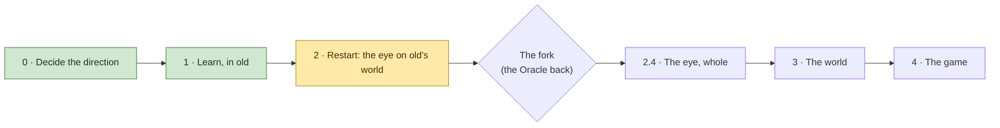

# The Master Plan

Where we've decided to go, in order, and where we are on the way. A living document: Counsel keeps it with David,
Builder ticks a line with the commit or log that proved it, and ticked lines stay. A change of order is David's
call, made here and recorded in the journal (`journal/docs/decisions.md`, "The rebuild: after the Oracle").

Started 2026-11-11 from the Oracle's review (`journal/vision/oracle-review.md`, parts 7 and 8), as David amended it.

---

## Where we are

- **Working on:** Phase 2, *Restart*, step 2.1. Old is packed into `old\` and still runs there (its tests pass, and
  the check flight matched 1.7's to within 0.3%); the journal is in `journal/`, found through
  `journal/contents.md`. Next, Builder starts the new project's skeleton at the top of the folder: a window that
  runs, the clock, a flying camera, and instruments that time the card a layer and a stage at a time.
- **Behind us:** experiments 1, 2, 3, 4a and 4b (`journal/docs/experiments.md`) gave soft bricks (the blend stays)
  and light kept a cell at a time, which David can't tell from rays ("in a blind test"), though at eye level
  light's cost is the near faces'. 1.7's reading flight found the bare plain's cost spread, and ruled out the sky's
  long rays. The references from old are taken, the test world is exported whole for the new eye to read (5.2
  billion columns in 0.11 GB, checked against old's, kept on the laptop and the USB), and old is frozen
  (`old-final`, 7c809d3), kept for looking at and reference. The Oracle, called early, answered before the first
  line (`journal/vision/oracle-review.md`, second part); David agreed its changes, amended by Builder and Counsel
  (`journal/docs/decisions.md`, "Before the first line").
- **Why:** we can't size the rebuild on guesses. The last outside guesses were off by ten times both ways, so a
  handful of cheap experiments in old settle what paper can't before anything new is written.
- **Waiting on David:** two small answers. His desktop "Play Incus Artus.bat" starts at the top of the folder, where
  there's no game now: point it at `old\`? And do the new project's build numbers carry on from old's (116 next),
  or start again?
- **The Oracle comes back** after experiment 6 (step 2.3), with the flight logs and David's look. Counsel gathers
  what we learn for it as we go, in `journal/vision/oracle-return.md`. It was also called early, after Phase 1 (2026-11-11).

---

## In one picture

---

## Phase 0 · Decide the direction

- [x] Builder's review of the software as it stands (`journal/docs/review-2026-11-10.md`)
- [x] The Oracle's review, after David answered its questions (`journal/vision/oracle-review.md`)
- [x] Rebuild from scratch, old Incus Artus as the reference; experiments first, in old
      (`journal/docs/decisions.md`, "The rebuild: after the Oracle", de53bb7)
- [x] VS Code set up for Builder (1ab561e)
- [ ] The spec cut by David (`master/spec.md`), alongside everything below

## Phase 1 · Learn, in old

Each experiment's pass mark is written down before it flies.

- [x] **1.1 The safety copy** (the Oracle's step 0)
  - [x] David's work that wasn't in git: blocks, textures, models, palettes, presets (1e3c21c)
  - [x] `vision/` (now `journal/vision/`), `CLAUDE.md`, the dyno-audit skill (0216222)
  - [x] The logs the record cites, in `kept logs/`; `notes/` and `imgui.ini` kept out of git (a203cdd)
  - [x] Pushed to the private GitHub repository
  - [x] USB copy: `D:\Incus Artus Backups\Incus Artus 2026-11-11 before rebuild`
  - [x] Tagged `before-rebuild` (a203cdd)
  - [x] `Art/`'s new files and `For Claude/` kept off GitHub for now (David 2026-11-11: "Not yet"); both are
        on the USB copy
- [x] **1.2 Experiment 1, the instruments** (both flights passed: `journal/docs/experiments.md`)
  - [x] Flight headers say exactly what flew: every switch, the commit and whether it was clean, the card, the
        present mode (build 110, 090904f; flight A, `kept logs/dyno-1794414666.txt`)
  - [x] The card's time counts the work of making new ground (the lanes' clock; agrees with the build 104 trace:
        `journal/docs/experiments.md`, flight A)
  - [x] Three standing marks, uncapped: on the ground at the spawn, beside the quarter-block build, a mountain
        top on a clear day (flight A: 5.9, 11.7 and 6.6 ms on the card standing)
  - [x] The choice of card restored; the marks flown once on the Intel card (restored in 090904f; flight B,
        `kept logs/dyno-1794416695.txt`: it ran, no failure but speed; standing 22.7, 20.6 and 29.5 ms)
  - *Gate:* David watches two flights; real baselines for the views that matter; the Intel card runs, or fails
    for a reason we can name
- [x] **1.3 Experiments 3 and 4a:** the library's safety checks off; light switched off (build 111; flights C, D,
      E in `kept logs/`; `journal/docs/experiments.md`)
  - *Gate:* two numbers: what the checks cost, and how much of each mark is light
  - The checks: unchecked, sight's march is 31 to 49% *slower* at the three marks (faster only on the light views);
    the world's rules about 15% faster a piece. The checks stay on.
  - Light (sky and shadows): 42% of the spawn mark, 17% of the mountain top and of the build, 25% of the route's
    median.
- [x] **1.4 Experiment 2, one-cell far reads against today's blend** (builds 112 and 113; David's two looks,
      `journal/docs/experiments.md`)
  - *Gate:* David's look. Decides the bricks' form (crisp: plain, 2.6 × the cells; soft: textures, 5.5 ×)
  - **Soft.** Blended is the look: crisp "doesn't look better", the in-between (smooth in height) "better than
    ziggurat lods but, its not better than blended" (David). Crisp stays a known fallback for a card short of memory.
- [x] **1.5 Experiment 4b, light stored in the baked cells and looked up** (builds 114 and 115; flights C2 and H,
      the light's view; `journal/docs/experiments.md`)
  - *Gate:* what a lookup costs; David's look at light that steps
  - The lookup is almost free and found nearly everywhere far: the spawn 9% faster, the mountain top and the build 3%
    (at eye level light's cost is the near faces'). David on light that steps: "i don't think i could tell the
    difference between the two in a blind test".
- [x] **1.6 References from old, then old frozen** (`master/references.md`; tagged `old-final`, 7c809d3; the export
      on the USB)
  - [x] Pictures at fixed places, times of day and settings (24: six places, four times of day; `references/pictures/`,
        `master/references.md`)
  - [x] The marks' flights, with the repaired instruments (C and C2, the Intel card's B; `master/references.md`)
  - [x] The default preset's maps and river network; sample columns (the test world's, nice25 with the dyno's
        presets, not the startup default: `references/world/`, `references/columns.txt`, 5,047 columns)
  - [x] Tagged `old-final` (7c809d3, pushed; after the events log the third mark replays went in. David: "so,
        we'll pack up the old incus artus into old, and just use it for looking at and reference")
  - [x] The test world exported whole as columns, for the new eye to read, so it never runs old's world gen. David:
        "export nice25 so that we can use it as a 'generated' world to look at with the new graphics engine, before
        rebuilding world gen after the graphics engine is done." (`world/export.rs`, a7d3cfb; kept in `exports/`
        and on the USB, not in git)
        - Written 2026-11-11 (build 115): 19,881 tiles, 5.2 billion columns, 0.11 GB, 7 profiles, 8 minutes.
        - Checked: one tile in 50 read back (399 tiles, 104.6 million columns), every column's ground and water the
          world's, and 1,029,963 whole profiles the world's (`INCUS_EXPORT_CHECK=50`).
        - On the USB: `D:\Incus Artus Backups\exports\nice25 test` (2026-11-11; all 19,883 files compared with
          the laptop's by SHA-256, none differing).
  - The pictures are kept for reference, not as a yardstick (David: "it'll look good or it won't, idc what the old
    things look like in particular, other than the basic way we're doing things")
  - *Gate:* the references listed here, each with where it's kept
- [x] **1.7 The reading flight** (the Oracle's second part; David: "i agree on all counts"): the third mark with old's
      switches only, no code after `old-final`. The march split from light, and the layers turned off one at a time,
      to find where the bare plain's cost lives (9.51 ms before the build goes in, which adds about 2)
      (flights I to N, f9e79bc, `kept logs/dyno-1794448108.txt` to `dyno-1794450518.txt`; `journal/docs/experiments.md`)
  - *Gate:* the plain's cost placed in its parts, with the logs
  - The bare plain is 9.66 ms; the build adds 2.02. The cost is spread: the blocks 31%, light 21%, the finest layer
    20%, overlapping. The Oracle's guess, the long rays over the sky, is ruled out: four times the sky rays made it 4%
    cheaper. Placed only as far as old's switches reach: with the blocks or light off, the plain still costs twice the
    spawn, and old can't time a layer alone. So the plain is flown in both eyes' marks, and the new engine's clocks
    place the rest.
  - *Corrected (Counsel):* the line above says "the march split from light". Light was measured by switching it off
    (flight J) instead, because old's clock times the whole compute pass as one, so a split wouldn't time light alone.
  - Found on the way: the coarsest layer at 4 × 4 was cheaper than 8 × 8 at all three standing marks (16% at the
    mountain top); a dial for the new eye to measure.

## Phase 2 · Restart: the eye on old's world  ← *now*

Each change in 2.2 and 2.3 flies alone, behind its own switch, on both cards, and each program is priced checked and
unchecked the first time it flies. Marks are data, flown on both cards by one command.

- [ ] **2.1 Pack, the skeleton, and the doorway**
  - [x] Old moves to `old\`, with its own assets and its own build folder, and still runs
        (daf4e2c, IntelliJ's files with it in c0def46; its tests pass from there, 414; the check flight,
        `kept logs/dyno-1794475773.txt`, within 0.3% of 1.7's I at all three marks; `journal/docs/experiments.md`)
  - [ ] `docs/` and `vision/` become `journal/`, with a contents page; `master/` on top; `CLAUDE.md` points at
        `master/`; memories trimmed to habits and warnings
        (the move, 1436bf2: as they were, with history, and `journal/contents.md`; the paths in `master/`,
        `CLAUDE.md`, the dyno-audit skill and the memories updated. Counsel's memories trimmed: the rivers
        walkthrough gone, its record in the journal; the fresh-eyes audit moved to the new engine. Ticks when
        Builder has trimmed hers)
  - [ ] The new project: a window that runs, the clock, a flying camera, the instruments (the card timed a layer
        and a stage at a time from the first build: old's one clock couldn't place the bare plain's cost, 1.7)
  - [ ] Every stage, pass, lane and store declared as data; it wires the game and draws `master/map.md`
  - [ ] The control room: the same map, live, in the game's panel
  - [ ] **The doorway** (moved up from 3.1): one small piece that answers "what's here?" a tile at a time: columns as
        runs of blocks; pieces, objects and lights; what changed; named fields over the land. The export behind it
        now, the tablet at 3.1. Read-only until the fork. The engine never opens a world file
  - [ ] The marks as data: the spawn; the bare plain; the plain with David's build (its 169 placings from the event
        log, replayed as changes); the mountain top; far marks (high over the spawn, low over the sea, the plain's
        horizon); the scatter dial (random blocks, none to very many)
  - *Gate:* an empty frame measured; the map drawn from the code; the doorway answers the 5,047 reference columns
    to the block
- [ ] **2.2 The eye, far** (experiment 5): old's far march moved onto bricks as it is, then three changes, each
      alone: soft bricks blended by the texture hardware (flown two ways: Builder's exact blend and the Oracle's
      spread); rays begun at drawn boxes; light read from the cell. The far cells are summed by a lane from what the
      doorway answers (old's far bake checks the sums; the first sum's time is measured). The open-sea shortcut
      waits until a sea mark shows it's needed
  - *Gate:* the far layers under 1 ms typical and 2 worst on the laptop, at the far marks; David's look, above all at
    rings where levels hand over; numbers from the Intel card. If they're twice that or more: keep the bricks and
    the light, march far the lean way instead
- [ ] **2.3 The eye, near** (experiment 6): rays first: old's near walk on bricks of blocks, begun at the drawn boxes,
      light kept in the air cell in front of each face, pieces walked by their octants. David's build arrives as
      changes, testing the eye's change path. Marks: the bare plain, the scatter at three densities, the build, a
      bigger quarter-block building, the spawn, the mountain top
  - *The rule, written beforehand:* rays pass every ground mark at 1.5 ms or under on the laptop: rays keep the near
    field. Rays miss a mark: faces as triangles are built and flown on the same marks, and take the near field if
    they pass where rays missed. Both pass and triangles are over 1 ms cheaper at the worst mark: David's call
  - *Gate:* the rule above; David's eye for pops and seams; the scatter's curve (cost should follow the screen)
- [ ] **The fork. The Oracle comes back:** flight logs from both cards and David's look; it reads `master/`
      fresh, then Counsel's brief, `journal/vision/oracle-return.md`. The design is fixed here, or changed
- [ ] **2.4 The eye, whole:** the light lane, water and glass, quarter blocks, textures, objects, glows, far lights
  - *Gate:* David's eye, on its own terms, the basic way kept; under 4.2 ms at the 99th percentile on the laptop,
    on the flight and at every mark; the Intel card's numbers recorded. **David walks old's world through
    the new eye**

## Phase 3 · The world

- [ ] **3.1 The tablet** (experiment 8 sizes it first): the made world on disk, put behind the doorway built at 2.1;
      walking, digging, placing, saving. Filled first from the exported test world. It holds no summed levels:
      those are the eye's
  - *Gate:* the same blocks as old's; dig, place, save, load; under 4 GB a world
- [ ] **3.2 The Registrar,** with its Color Lab and the way we work with HSL
- [ ] **3.3 The Graphics Kit,** built on the Registrar's colour system
- [ ] **3.4 World generation, stage by stage, with the new editor** (experiment 7 opens it)
  - [ ] Plans: tectonics, climate, rivers and lakes, peaks, cave plans
  - [ ] Broad ground, then fine ground, on the card
  - [ ] Water: sea level, cliffs and beaches, rivers. A design step of its own with David
  - [ ] Surface, then blocks (caves; later ores and strata)
  - [ ] Sums and light; the tablet written
  - *Gate, each stage:* David's eye, old beside new, on his default preset; the same result on both of the
    laptop's cards
- [ ] **3.5 Making a world as the player meets it:** the whole bake before play, the show while it's made, the
      rejector if wanted
  - *Gate:* a new world in the time David sets; no frame drops after entering

## Phase 4 · The game

- [ ] **4.1 The game's systems,** in the order `master/spec.md` gives, once David has cut it

---

## Open, and the step each one waits on

| Question | Waits on |
|---|---|
| `Art/`'s new files and `For Claude/` online? "Not yet" for now | David, any time |
| ~~Far cells crisp or soft (one cell read, or eight blended)?~~ | Answered at 1.4: soft |
| The world's new format, cut so generation can grow: "that lets me expand and refine the generation process" (David, `journal/docs/decisions.md`). Where the engine meets it is decided: the doorway (2.1), with the exported test world behind it first. Left open: the tablet's own layout | 3.1 |
| Seasons: a re-texture (a named field the look reads), a re-block (changes through the doorway), or both. Both are kept possible | Later; nothing to decide now |
| Digging and placing before the fork? Decided no: read-only until then | Answered 2026-11-11 |
| ~~The control room as a page in the game's own panel?~~ | Answered 2026-11-11: yes |
| ~~Old's new place: `old\` inside this folder (the default), or elsewhere?~~ | Answered 2026-11-11: `old\` |
| The moons: does the brighter one cast shadows? | 2.4 |
| People far off: sharper than the squares behind them, or drawn into them? | 2.4 |
| Leaves far off: a little see-through, as the averages make them, or solid? | 2.4 |
| "1 always equals 1" as one stored answer everything reads, in David's words | 3.1 |
| Rivers and the shore: carried over first, or rearranged on the way? | 3.4 |
| The rejector: what makes one world better than another? | 3.5 |

## The targets

- **The laptop** (RTX 5070 Ti, 2,560 × 1,600, 240 Hz): a median of 237 fps, dips to about 180 fine, 120 the floor.
  Its budget: 4.2 ms a frame.
- **A GTX 980 Ti at 1080p:** a smooth 60, loosely. "If you have one, you should be able to play this game."
  Not a floor to design to.
- Room left in the frame for people, animals, battles of up to 800 figures, and the simulation on the processor.
- **Today's gap** (experiment 1, build 110, `journal/docs/experiments.md`): on the laptop, standing, the card takes 1.4
  times the budget at the spawn, 1.6 times on the mountain top and 2.8 times beside the quarter-block build; on
  the route, the worst frames (99th percentile, new ground counted) take 13.9 ms, 3.3 times. The Intel card is 2.5
  to 3.8 times slower than the NVIDIA, standing.
- **With light free** (experiment 4a): the spawn fits the budget (3.46 ms), but the mountain top (5.45) and the
  build (9.76) don't. There the rest is the far reach and the near walk through quarter blocks, so storing light
  alone won't close the gap: the near field (2.3) and the far reads (2.2) have to win too.
- **Light kept, far only** (experiment 4b): 9% off the spawn, 3% off the mountain top and the build. At eye level most
  of light's cost is in the near faces, lit afresh every frame. The new eye looks their light up too (2.3).
- **The blend** (flights F and G): the far reads' blend in code is a quarter to a third of every mark. That's the
  most the soft bricks' texture hardware can win back (2.2).

## What every step keeps

- **The look:** hard textured blocks near; past a pixel, cells that are the exact sums of their blocks, in squares
  of 2, 4 and 8, enlarged crisp; edges that average and glide; blocky light in 16 steps; very dark nights; far
  lights that twinkle down to a pixel; the whole world in view on a clear day.
- **Honest:** near and far agree before any blending; everything that exists shows, however small; nothing pops;
  far changes may arrive late but are accurate; nothing is a stand-in.
- **The way we work:** even beats fast; nothing relies on fog; no tricks for one maker's cards; measure from the
  start; the pass mark before the flight; no number without its log; old is the reference (its columns check the world to the block; the look is David's eye); one thing asked of David
  at a time; a drop is for its context, not for good; what's true lives in `master/`, and the agents' memory
  holds only habits and warnings.
