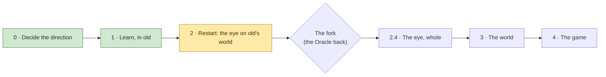

# The Master Plan

Where we've decided to go, in order, and where we are on the way. A living document: Counsel keeps it with David,
Builder ticks a line with the commit or log that proved it, and ticked lines stay. A change of order is David's
call, made here and recorded in the journal (`journal/docs/decisions.md`, "The rebuild: after the Oracle").

Started 2026-11-11 from the Oracle's review (`journal/vision/oracle-review.md`, parts 7 and 8), as David amended it.

---

## Where we are

- **Working on:** Phase 2, *Restart*, step 2.2, the far eye (experiment 5), each change tried, measured and looked at
  by David's word ("try all these things and gather data"). In so far: the far cells summed from the doorway (old's
  bake, byte for byte, the whole world in 17 s); old's far march on bricks with old's light; the texture hardware's
  spread blend (14 to 29% off); bricks of 8; a window round the eye (the game's card memory 916 MB, against 2.7 GB for
  the whole world); the sky's feather at skylines; the Render and Camera pages; temperatures always on; main memory
  tracked (2.8 GB held, 1.0 GB in use). Change 2, the drawn boxes, didn't pay and is out. The far eye stands at 1.1 to
  2.9 ms at the far marks against the gate's 1 typical and 2 worst.
- **Now:** the Oracle, called midway (its prompt `journal/vision/oracle-prompt-2026-11-12.md`), read the far eye as
  *waiting, not working*: about a thousand rays skimming the horizon set each layer's time. Builder's tests (build
  140) point nearer that reading, and ending rays at the map's edge took 6 to 19% off (low over the sea 2.58 ms, a
  player's run 2.52). David's lead from it: **lazy rays**, long rays marched a little each frame, lazier with
  distance, ramping up when flying. The watts agree (build 141): the card shows full load but draws 58 W over the sea
  against 99 at the spawn, so it's queued, not working; the processor idles at 5 to 11%. David's goal, before
  answering the Oracle: **no megakernels**, the eye as small passes, each measured alone. Nsight confirms "waiting":
  the far march keeps 1 to 7% of the card in flight over the sea, too few long rays to fill it, so more rays are
  nearly free and the chain is the time. The Oracle's third part is in (`journal/vision/oracle-review.md`): on a
  waiting card, work is nearly free and waiting is dear. Its order: instruments and an Intel flight now; the lean
  step in halves; the layers side by side; light read from the cell, made on the processor; the gate; the cells of 2
  to 16 with scattered detail before the fork; lazy rays after, by lengths. David took it ("Yes, its order"), and
  both near drawers flown before the fork ("Yes, fly both"). Builder starts at step 0. The fog line waits.
- **Just closed:** 2.1, done enough to go on (David: "yes, close 2.1. let us proceed."). Old is packed into `old\`
  and still runs; the journal is in `journal/`. The new project runs from the top of the folder (build 120; the
  numbers carry on from old's): a flying camera on old's keys, the panel (F3), the clocks a pass at a time, and the
  empty frame at 0.34 ms and 0.012 ms on the card once warmed up. The wiring draws `master/map.md`; the new editor
  (F2) has the software map. The doorway answers all 5,047 reference columns to the block, and the marks are data,
  every one flown at 0.338 to 0.344 ms. What's left of it is carried: both cards by one command to 2.2, the
  doorway's pieces and lights to 2.4, its named fields to 3.1. As the editor fills, every window, setting and
  control is placed with David (`journal/docs/decisions.md`, 2026-11-12).
- **Behind us:** experiments 1, 2, 3, 4a and 4b (`journal/docs/experiments.md`) gave soft bricks (the blend stays)
  and light kept a cell at a time, which David can't tell from rays ("in a blind test"), though at eye level
  light's cost is the near faces'. 1.7's reading flight found the bare plain's cost spread, and ruled out the sky's
  long rays. The references from old are taken, the test world is exported whole for the new eye to read (5.2
  billion columns in 0.11 GB, checked against old's, kept on the laptop and the USB), and old is frozen
  (`old-final`, 7c809d3), kept for looking at and reference. The Oracle, called early, answered before the first
  line (`journal/vision/oracle-review.md`, second part); David agreed its changes, amended by Builder and Counsel
  (`journal/docs/decisions.md`, "Before the first line").
- **Why:** we can't size the rebuild on guesses. The last outside guesses were off by ten times both ways, so a
  handful of cheap experiments in old settle what paper can't before anything new is written.
- **Waiting on David:** the laptop back to "NVIDIA GPU only" now, the Intel flights done (a restart); then Builder
  flies 1b on and off there for its keep-or-drop, with 1a's numbers for the gate; later, one budget at the fork, haze or cover at the skyline's look, and lazy rays fixed to the world or
  the screen; when to take the fog line; whether `CLAUDE.md` points at the map. His desktop has two launchers: "Play Incus Artus" (the new game) and
  "Play old Incus Artus" (`old\`).
- **The Oracle comes back** after experiment 6 (step 2.3), with the flight logs and David's look. Counsel gathers
  what we learn for it as we go, in `journal/vision/oracle-return.md`. It was also called early, after Phase 1 (2026-11-11).

---

## In one picture

---

## Phase 0 · Decide the direction

- [x] Builder's review of the software as it stands (`journal/docs/review-2026-11-10.md`)
- [x] The Oracle's review, after David answered its questions (`journal/vision/oracle-review.md`)
- [x] Rebuild from scratch, old Incus Artus as the reference; experiments first, in old
      (`journal/docs/decisions.md`, "The rebuild: after the Oracle", de53bb7)
- [x] VS Code set up for Builder (1ab561e)
- [ ] The spec cut by David (`master/spec.md`), alongside everything below

## Phase 1 · Learn, in old

Each experiment's pass mark is written down before it flies.

- [x] **1.1 The safety copy** (the Oracle's step 0)
  - [x] David's work that wasn't in git: blocks, textures, models, palettes, presets (1e3c21c)
  - [x] `vision/` (now `journal/vision/`), `CLAUDE.md`, the dyno-audit skill (0216222)
  - [x] The logs the record cites, in `kept logs/`; `notes/` and `imgui.ini` kept out of git (a203cdd)
  - [x] Pushed to the private GitHub repository
  - [x] USB copy: `D:\Incus Artus Backups\Incus Artus 2026-11-11 before rebuild`
  - [x] Tagged `before-rebuild` (a203cdd)
  - [x] `Art/`'s new files and `For Claude/` kept off GitHub for now (David 2026-11-11: "Not yet"); both are
        on the USB copy
- [x] **1.2 Experiment 1, the instruments** (both flights passed: `journal/docs/experiments.md`)
  - [x] Flight headers say exactly what flew: every switch, the commit and whether it was clean, the card, the
        present mode (build 110, 090904f; flight A, `kept logs/dyno-1794414666.txt`)
  - [x] The card's time counts the work of making new ground (the lanes' clock; agrees with the build 104 trace:
        `journal/docs/experiments.md`, flight A)
  - [x] Three standing marks, uncapped: on the ground at the spawn, beside the quarter-block build, a mountain
        top on a clear day (flight A: 5.9, 11.7 and 6.6 ms on the card standing)
  - [x] The choice of card restored; the marks flown once on the Intel card (restored in 090904f; flight B,
        `kept logs/dyno-1794416695.txt`: it ran, no failure but speed; standing 22.7, 20.6 and 29.5 ms)
  - *Gate:* David watches two flights; real baselines for the views that matter; the Intel card runs, or fails
    for a reason we can name
- [x] **1.3 Experiments 3 and 4a:** the library's safety checks off; light switched off (build 111; flights C, D,
      E in `kept logs/`; `journal/docs/experiments.md`)
  - *Gate:* two numbers: what the checks cost, and how much of each mark is light
  - The checks: unchecked, sight's march is 31 to 49% *slower* at the three marks (faster only on the light views);
    the world's rules about 15% faster a piece. The checks stay on.
  - Light (sky and shadows): 42% of the spawn mark, 17% of the mountain top and of the build, 25% of the route's
    median.
- [x] **1.4 Experiment 2, one-cell far reads against today's blend** (builds 112 and 113; David's two looks,
      `journal/docs/experiments.md`)
  - *Gate:* David's look. Decides the bricks' form (crisp: plain, 2.6 × the cells; soft: textures, 5.5 ×)
  - **Soft.** Blended is the look: crisp "doesn't look better", the in-between (smooth in height) "better than
    ziggurat lods but, its not better than blended" (David). Crisp stays a known fallback for a card short of memory.
- [x] **1.5 Experiment 4b, light stored in the baked cells and looked up** (builds 114 and 115; flights C2 and H,
      the light's view; `journal/docs/experiments.md`)
  - *Gate:* what a lookup costs; David's look at light that steps
  - The lookup is almost free and found nearly everywhere far: the spawn 9% faster, the mountain top and the build 3%
    (at eye level light's cost is the near faces'). David on light that steps: "i don't think i could tell the
    difference between the two in a blind test".
- [x] **1.6 References from old, then old frozen** (`master/references.md`; tagged `old-final`, 7c809d3; the export
      on the USB)
  - [x] Pictures at fixed places, times of day and settings (24: six places, four times of day; `references/pictures/`,
        `master/references.md`)
  - [x] The marks' flights, with the repaired instruments (C and C2, the Intel card's B; `master/references.md`)
  - [x] The default preset's maps and river network; sample columns (the test world's, nice25 with the dyno's
        presets, not the startup default: `references/world/`, `references/columns.txt`, 5,047 columns)
  - [x] Tagged `old-final` (7c809d3, pushed; after the events log the third mark replays went in. David: "so,
        we'll pack up the old incus artus into old, and just use it for looking at and reference")
  - [x] The test world exported whole as columns, for the new eye to read, so it never runs old's world gen. David:
        "export nice25 so that we can use it as a 'generated' world to look at with the new graphics engine, before
        rebuilding world gen after the graphics engine is done." (`world/export.rs`, a7d3cfb; kept in `exports/`
        and on the USB, not in git)
        - Written 2026-11-11 (build 115): 19,881 tiles, 5.2 billion columns, 0.11 GB, 7 profiles, 8 minutes.
        - Checked: one tile in 50 read back (399 tiles, 104.6 million columns), every column's ground and water the
          world's, and 1,029,963 whole profiles the world's (`INCUS_EXPORT_CHECK=50`).
        - On the USB: `D:\Incus Artus Backups\exports\nice25 test` (2026-11-11; all 19,883 files compared with
          the laptop's by SHA-256, none differing).
  - The pictures are kept for reference, not as a yardstick (David: "it'll look good or it won't, idc what the old
    things look like in particular, other than the basic way we're doing things")
  - *Gate:* the references listed here, each with where it's kept
- [x] **1.7 The reading flight** (the Oracle's second part; David: "i agree on all counts"): the third mark with old's
      switches only, no code after `old-final`. The march split from light, and the layers turned off one at a time,
      to find where the bare plain's cost lives (9.51 ms before the build goes in, which adds about 2)
      (flights I to N, f9e79bc, `kept logs/dyno-1794448108.txt` to `dyno-1794450518.txt`; `journal/docs/experiments.md`)
  - *Gate:* the plain's cost placed in its parts, with the logs
  - The bare plain is 9.66 ms; the build adds 2.02. The cost is spread: the blocks 31%, light 21%, the finest layer
    20%, overlapping. The Oracle's guess, the long rays over the sky, is ruled out: four times the sky rays made it 4%
    cheaper. Placed only as far as old's switches reach: with the blocks or light off, the plain still costs twice the
    spawn, and old can't time a layer alone. So the plain is flown in both eyes' marks, and the new engine's clocks
    place the rest.
  - *Corrected (Counsel):* the line above says "the march split from light". Light was measured by switching it off
    (flight J) instead, because old's clock times the whole compute pass as one, so a split wouldn't time light alone.
  - Found on the way: the coarsest layer at 4 × 4 was cheaper than 8 × 8 at all three standing marks (16% at the
    mountain top); a dial for the new eye to measure.

## Phase 2 · Restart: the eye on old's world  ← *now*

Each change in 2.2 and 2.3 flies alone, behind its own switch, on both cards, and each program is priced checked and
unchecked the first time it flies. Marks are data, flown on both cards by one command.

- [x] **2.1 Pack, the skeleton, and the doorway** (closed done enough to go on, David 2026-11-12: "yes, close 2.1.
      let us proceed."; its gate met; what's left carried to 2.2, 2.4 and 3.1, each where it's first fed)
  - [x] Old moves to `old\`, with its own assets and its own build folder, and still runs
        (daf4e2c, IntelliJ's files with it in c0def46; its tests pass from there, 414; the check flight,
        `kept logs/dyno-1794475773.txt`, within 0.3% of 1.7's I at all three marks; `journal/docs/experiments.md`)
  - [x] `docs/` and `vision/` become `journal/`, with a contents page; `master/` on top; `CLAUDE.md` points at
        `master/`; memories trimmed to habits and warnings
        (the move, 1436bf2: as they were, with history, and `journal/contents.md`; the paths in `master/`,
        `CLAUDE.md`, the dyno-audit skill and the memories updated. Counsel's memories trimmed: the rivers
        walkthrough gone, its record in the journal; the fresh-eyes audit moved to the new engine. Builder's trimmed:
        her habits, the team's ways and the rebuild's direction now hold habits and warnings only)
  - [x] The new project: a window that runs, the clock, a flying camera, the instruments (the card timed a layer
        and a pass at a time from the first build: old's one clock couldn't place the bare plain's cost, 1.7)
        (392ae0d, build 116 c4d102e, David: "looks fine"; the empty frame flown, `kept logs/flight-1794486371.txt`:
        0.40 ms a frame, 0.019 ms on the card; `journal/docs/experiments.md`)
        *Corrected (Builder, build 119's flight):* that floor was measured inside the session's first ~25 s, which run
        slower. Settled, the empty frame is 0.34 ms and 0.012 on the card (build 120, `kept logs/flight-1794489536.txt`)
  - [x] Every stage, pass, lane and store declared as data; it wires the game and draws `master/map.md`
        (`src/wiring.rs`, 1ae278c: two lanes, seven passes, eight stores, no stages yet; its tests check both ways;
        the map's costs from build 117's flight, `kept logs/flight-1794487642.txt`; `journal/docs/experiments.md`)
  - [x] The control room: the software map, a page of the new editor (its own screen, pages by a drop-down at the
        top): black, magenta boxes with a tooltip on hover, joined by lines, inside larger boxes for sections; live
        (David, 2026-11-12)
        (build 117, 1ae278c and 8283179; David: "editor looks about like what i'd expect")
  - [x] **The doorway** (moved up from 3.1): one small piece that answers "what's here?" a tile at a time: columns as
        runs of blocks; pieces, objects and lights; what changed; named fields over the land. The export behind it
        now, the tablet at 3.1. Read-only until the fork. The engine never opens a world file
        (columns as runs in, `src/doorway.rs`: the 5,047 reference columns answered to the block, a tile in 2.2 ms;
        `journal/docs/experiments.md`. What changed in too, by tile: the build's 146 bars and 23 blocks, and the
        scatter, b48ddc3. Pieces, objects and lights, and the named fields come with what first feeds them: carried
        to 2.4 and 3.1 when 2.1 closed)
  - [x] The marks as data: the spawn; the bare plain; the plain with David's build (its 169 placings from the event
        log, replayed as changes); the mountain top; far marks (high over the spawn, low over the sea, the plain's
        horizon); the scatter dial (random blocks, none to very many)
        (`data/marks.toml`, build 119 b48ddc3 and 120 2ee6651: every eye where old's stood, the build and the scatter
        made through the doorway, none refused; flown, `kept logs/flight-1794489536.txt`, every mark 0.338 to 0.344 ms.
        The plain's horizon is the bare plain, marked for both eyes. One command flies every mark on one card; both
        cards at once waits on the Optimus setting, when the Intel card is flown)
  - *Gate:* an empty frame measured; the map drawn from the code; the doorway answers the 5,047 reference columns
    to the block
- [ ] **2.2 The eye, far** (experiment 5): old's far march moved onto bricks as it is, then three changes, each
      alone: soft bricks blended by the texture hardware (flown two ways: Builder's exact blend and the Oracle's
      spread); rays begun at drawn boxes; light read from the cell. The far cells are summed by a lane from what the
      doorway answers (old's far bake checks the sums; the first sum's time is measured). The open-sea shortcut
      waits until a sea mark shows it's needed
  - [x] Step 1, the far cells summed from the doorway on the processor, checked against old's bake (`src/far.rs`,
        `data/far colours.toml` old's colours; `far::tests::the_far_cells_are_old_s_bake`): all 5,184 regions and 11.2
        million cells the same as old's, byte for byte, each region's 1,024 to its exact sums. The eighth round the
        spawn in 2.6 s and the whole world in 16.9 s on 24 threads (old's, on the card: 46 to 55 s and about 12 min);
        `journal/docs/experiments.md`
  - [x] Step 2, old's far march on bricks as it is (`src/far_eye.rs`, `far.wgsl`, `bricks.rs`): 2a the shape and
        2b old's light, David's looks ("it looks right, mostly", "light looks normal ... so proceed"); the whole
        world's bricks 911 MB; the baseline, `kept logs/flight-1794497402.txt`: the far marks 1.4 to 4.0 ms on the card,
        light 3 to 13% of it. Found on the way: the sky's weight at a skyline (David's 4) and the Render page
        (`journal/docs/experiments.md`)
  - [x] The panel fix (no text selection, the mouse's let-go always heard) and the far eye's settings live on the
        Render page, each with Default (build 127, ac1a9d8; the card's memory shown beside them)
  - [x] Change 1, soft bricks blended by the texture hardware, both ways (A exact, B spread), switchable live
        (build 128, 842f83a: 14 to 29% off at every mark; David: "they all look the same", so the spread is kept and
        exact taken out, build 129, 4ad4788; memory 2.7 GB with the whole world's far view on the card. Detail +2
        tried and put back to 0, 2f756a4: "yeah 0 is fine". `journal/docs/experiments.md`)
  - [ ] The fog line: the finer layers earned along edges where neighbouring squares differ, priced by flight (David
        saw near ridges' 8 × 8 squares against fogged far mountains). A look step; when he says. Fog itself is for
        looks only and may be taken out and done another way later (David: "there are different ways and times to
        add fog"); finer detail and the near eye may change how it reads first
  - [x] Bricks of 4 against bricks of 8, chosen at launch (build 131, f6958f9: counted first, then flown at 8, 4
        and 2; the whole game 2,656 MB in use at 8, 1,555 at 4, 1,315 at 2, for 5-13% more far time at 4, 14-24% at
        2; the picture the same. David: "4 sounds good", the default from 18d2537; the last pick after step 4's
        flights at 4 and 8. `journal/docs/experiments.md`)
  - [x] A window round the eye for the 32- and 64-block levels, flown fast
        (f47e006 built, 85d876f the camera's step fixed, 6dc9171 back to 8 storage buffers; the game's card memory 471
        MB at bricks of 4, still time within 3% of the whole world's; at 200 blocks a second it keeps up with spikes,
        at 2,000 it creaks; `journal/docs/experiments.md`; David: "it looks good")
  - [x] Change 2, rays begun at the drawn boxes (flown, build 137: the picture the same, but it doesn't pay on this
        card; taken out after the Oracle's mid-2.2 reply, git keeping it; `journal/docs/experiments.md`)
  - [x] The Oracle's mid-2.2 tests: rays ended at the map's edge (kept, 6 to 19% off every far mark), half the rays,
        the step limit halved, the watts, and Nsight (the 8 × 8 and 4 × 4 keep 6.9% and 1.3% of the card in flight
        over the sea): "waiting, not working", confirmed three ways (builds 140 and 141, c15d256, b516975, e2ea8bf)
  - *The rest of 2.2 in the Oracle's order* (its third part, section 11; David: "Yes, its order", 2026-11-12):
  - [ ] Step 0, instruments: the longest ray per layer in every report; a nodding mark at the sea and the plain; one
        Intel flight now, to learn whether that card waits or works (David on "Optimus", put to him a step ahead).
        *In, but for the Intel flight* (build 142, e496645, 19de6db): a few hundred rays set the dearest marks, and cost
        follows the longest ray (the sea's 558 and 764 steps, 2.59 ms); the nodding marks at their 99th, the plain
        1.18 and the sea 3.15 ms, are the gate's numbers from here. *The Intel flight* (f8d6b01): the Intel card is
        working, not waiting (cost follows how much is marched; 4 to 8 times the NVIDIA's; dearest the mountain top,
        10.5 ms), so each step after is priced on both cards
  - [ ] Step 1, the lean step, in halves flown apart, each the same picture pixel for pixel: kept in hand; read
        together (behind a switch, priced on both cards); several steps at once (alone, checked with care); thin haze
        by whole cells (a look). *1a, kept in hand, is in* (build 143, c89a040, 63409af): 6 to 13% off the far marks
        (the sea 2.58 → 2.24 ms, its nodding 99th 3.13 → 2.72), the spawn 5% slower, the picture pixel for pixel;
        kept, its keep-or-drop after the Intel flight. David chose the lean step before the Intel flight. *On the
        Intel card 1a is 2.5 to 10% slower* (32f4703); a trimmed 1a (build 144) wasn't "just better", so **1a is kept
        as built** (build 145, c89a040's march), by David's rule: "unless its just better than 1, we go 1". The
        NVIDIA side to be re-flown on "NVIDIA GPU only", for the record. *1b, read together* (build 146, behind a
        switch): a small gain on Optimus (3 to 10% off most far marks, the mountain top 8% slower; the Intel 0 to 3%);
        its keep-or-drop from the "NVIDIA GPU only" flight after the switch-back
  - [ ] Step 2, the layers side by side, each taking its lead from the coarser layer of the frame before; the finer
        base layer first, as its probe
  - [ ] Alongside: light read from the cell, made on the processor by sweeps (the sun's shadow each sun step, the next
        made ready; the sky's openness once); change 3 and "light split out" as one; its own pass mark on lag
  - [ ] Step 3, the gate, read moving and nodding at the 99th. Step 4 only if it's missed: the long ray cut into
        lengths, marched side by side, joined front to back
  - [ ] The looks (David's "2, 3 and 4"): the skyline by cover, with a column-height table (haze or cover is his);
        if cover, the sheet (plain far land as rings of mesh) flown as the far levels' rival; the horizon band over
        frames comes as lazy rays
  - [ ] The cells of 2 to 16 in the far eye's march, each in its own ring; a scatter stage behind the doorway (a
        wood, rows of posts, towers, slabs and an arch), off by default; marks from it. Before the fork
  - [ ] Lazy rays (David's lead: "spread out any rays that can be lazy"), by lengths of distance, under the Oracle's
        nine rules (a ray in flight always finishes; light and fog put on every frame; the gate read moving); its
        tests amended (the store, once whole, equals a full march of its own directions; the lag; card time moving,
        laziness on and off; his eye turning, walking past a ridge, and at the sun's step)
  - [ ] Rays shuffled or sorted by length: held for the Intel card
  - [x] Main memory in every report and the session's log, beside the card's (build 138, dce3afb: 2.8 GB held,
        1.0 GB in use)
  - [ ] Spare main memory's free wins, priced once the 1.3 GB held at the start is placed: prepared bricks for the
        window, the tiles round the eye unpacked, the far light's sweeps
  - [ ] Every mark flown on both cards by one command (carried from 2.1): the Intel card's flight needs the laptop
        switched to "Optimus", put to David a step ahead. Last
  - *Each:* measured, then David's eye still, moving his head, and flying ("try all these things and gather data")
  - *Gate:* the far layers under 1 ms typical and 2 worst on the laptop, at the far marks; David's look, above all at
    rings where levels hand over; numbers from the Intel card. If they're twice that or more: keep the bricks and
    the light, march far the lean way instead
- [ ] **2.3 The eye, near** (experiment 6): rays first, from the eye with no boxes (the Oracle's third part): a
      column-height table and a table of each brick's empty boxes from the first build, light kept in the air cell in
      front of each face, pieces walked by their octants; then faces as triangles; both flown on the same marks
      before the fork. David's build arrives as changes, testing the eye's change path. Marks: the bare plain (and
      nodding), the scatter at three densities, the build, a bigger quarter-block building, the spawn, the mountain
      top; the wood at eye level, along a long wall and still water, under a roof, a walk and a run
  - *The rule, changed by David's word* ("Yes, fly both", 2026-11-12; it was: triangles only if rays missed a mark):
    rays and triangles both built and flown; 1.5 ms or under at every ground mark; over 1 ms apart at the worst mark
    is David's call; his eye for pops and seams
  - *Gate:* the rule above; David's eye for pops and seams; the scatter's curve (cost should follow the screen)
- [ ] **The fork. The Oracle comes back:** flight logs from both cards and David's look; it reads `master/`
      fresh, then Counsel's brief, `journal/vision/oracle-return.md`. The design is fixed here, or changed
- [ ] **2.4 The eye, whole:** the light lane, water and glass, quarter blocks, textures, objects, glows, far lights
  - [ ] The doorway's pieces, objects and lights, as the eye first draws them (carried from 2.1)
  - *Gate:* David's eye, on its own terms, the basic way kept; under 4.2 ms at the 99th percentile on the laptop,
    on the flight and at every mark; the Intel card's numbers recorded. **David walks old's world through
    the new eye**

## Phase 3 · The world

- [ ] **3.1 The tablet** (experiment 8 sizes it first): the made world on disk, put behind the doorway built at 2.1;
      walking, digging, placing, saving. Filled first from the exported test world. It holds no summed levels:
      those are the eye's
  - [ ] The doorway's named fields over the land, as the tablet first holds them (carried from 2.1)
  - *Gate:* the same blocks as old's; dig, place, save, load; under 4 GB a world
- [ ] **3.2 The Registrar,** with its Color Lab and the way we work with HSL
  - *Throughout the editor, from its first page:* every window, setting and control placed with David first; a
    line in a shared top bar only if every window under it needs it; a control goes when what it controls goes
    (David, 2026-11-12: "organizing the UI is super important to me")
- [ ] **3.3 The Graphics Kit,** built on the Registrar's colour system
- [ ] **3.4 World generation, stage by stage, with the new editor** (experiment 7 opens it), on its World Gen
      page, the stack laid out afresh with David: "we can definitely organize the world gen stack better this time"
      (old's compiler and interpreter inside the page, "if it even needs an explicit window")
  - [ ] Plans: tectonics, climate, rivers and lakes, peaks, cave plans
  - [ ] Broad ground, then fine ground, on the card
  - [ ] Water: sea level, cliffs and beaches, rivers. A design step of its own with David
  - [ ] Surface, then blocks (caves; later ores and strata)
  - [ ] Sums and light; the tablet written
  - *Gate, each stage:* David's eye, old beside new, on his default preset; the same result on both of the
    laptop's cards
- [ ] **3.5 Making a world as the player meets it:** the whole bake before play, the show while it's made, the
      rejector if wanted
  - *Gate:* a new world in the time David sets; no frame drops after entering

## Phase 4 · The game

- [ ] **4.1 The game's systems,** in the order `master/spec.md` gives, once David has cut it

---

## Open, and the step each one waits on

| Question | Waits on |
|---|---|
| `Art/`'s new files and `For Claude/` online? "Not yet" for now | David, any time |
| ~~Far cells crisp or soft (one cell read, or eight blended)?~~ | Answered at 1.4: soft |
| The world's new format, cut so generation can grow: "that lets me expand and refine the generation process" (David, `journal/docs/decisions.md`). Where the engine meets it is decided: the doorway (2.1), with the exported test world behind it first. Left open: the tablet's own layout | 3.1 |
| Seasons: a re-texture (a named field the look reads), a re-block (changes through the doorway), or both. Both are kept possible | Later; nothing to decide now |
| Digging and placing before the fork? Decided no: read-only until then | Answered 2026-11-11 |
| ~~The control room as a page in the game's own panel?~~ | Answered 2026-11-11: yes |
| ~~The control room: a page in the editor ("the control panel will be a page in" it, David 2026-11-12), or in the game's panel as answered the day before?~~ | Answered 2026-11-12: the editor's, as the software map |
| ~~Old's new place: `old\` inside this folder (the default), or elsewhere?~~ | Answered 2026-11-11: `old\` |
| Temporal reuse (TAA, his rules of 2026-11-08): after the eye is whole, in the speed pass, or earlier as a lever if the far or near eye misses its gate? Its narrow form, the horizon band refreshed over a few frames, is to be tried in 2.2 | The fork |
| ~~The cells of 2 to 16 blocks: in the far eye's march before the fork, or in 2.3?~~ | Answered by the Oracle, as David left it: before the fork, after the lean step and the layers side by side |
| ~~The Oracle's third part's changes to 2.2's order (its section 11)?~~ | Answered 2026-11-12: "Yes, its order" |
| One budget at the fork (the Oracle's split: far 1.2 typical and 2 worst, near 1.5, finishing 0.4, 0.9 left), read moving at the 99th? | The fork |
| At the skyline's look: haze, as now, or cover (with the column-height table, and the sheet flown as rival if cover)? | Its look in 2.2 |
| Lazy rays' far squares fixed to the world or to the screen? | When lazy rays are built |
| The moons: does the brighter one cast shadows? | 2.4 |
| People far off: sharper than the squares behind them, or drawn into them? | 2.4 |
| Leaves far off: a little see-through, as the averages make them, or solid? | 2.4 |
| "1 always equals 1" as one stored answer everything reads, in David's words | 3.1 |
| Rivers and the shore: carried over first, or rearranged on the way? | 3.4 |
| The rejector: what makes one world better than another? | 3.5 |

## The targets

- **The laptop** (RTX 5070 Ti, 2,560 × 1,600, 240 Hz): a median of 237 fps, dips to about 180 fine, 120 the floor.
  Its budget: 4.2 ms a frame.
- **A GTX 980 Ti at 1080p:** a smooth 60, loosely. "If you have one, you should be able to play this game."
  Not a floor to design to.
- **The laptop's Intel card** (integrated graphics): flown for information, not a target. "i don't expect someone to
  be able to play this game on an igpu without turning some settings way down" (David, 2026-11-13). A step that
  helps the NVIDIA and costs the Intel is weighed by the NVIDIA and the 980 Ti.
- Room left in the frame for people, animals, battles of up to 800 figures, and the simulation on the processor.
- **Card memory:** well below 4 GB in the worst case, on a world of the standard size (David, 2026-11-12). It grows
  with the world's size, which is fine for modders' giant worlds, but never with play: only the changes accumulate.
- **Speed:** solid as a rock at a player's pace; fast developer flight may creak, as long as it isn't egregious.
- **Main memory:** "somewhere between 4 and 8gb in the end" (David, 2026-11-12); what the game must have to run
  toward the low end, so an 8 GB machine still runs it.
- **Today's gap** (experiment 1, build 110, `journal/docs/experiments.md`): on the laptop, standing, the card takes 1.4
  times the budget at the spawn, 1.6 times on the mountain top and 2.8 times beside the quarter-block build; on
  the route, the worst frames (99th percentile, new ground counted) take 13.9 ms, 3.3 times. The Intel card is 2.5
  to 3.8 times slower than the NVIDIA, standing.
- **With light free** (experiment 4a): the spawn fits the budget (3.46 ms), but the mountain top (5.45) and the
  build (9.76) don't. There the rest is the far reach and the near walk through quarter blocks, so storing light
  alone won't close the gap: the near field (2.3) and the far reads (2.2) have to win too.
- **Light kept, far only** (experiment 4b): 9% off the spawn, 3% off the mountain top and the build. At eye level most
  of light's cost is in the near faces, lit afresh every frame. The new eye looks their light up too (2.3).
- **The blend** (flights F and G): the far reads' blend in code is a quarter to a third of every mark. That's the
  most the soft bricks' texture hardware can win back (2.2).

## What every step keeps

- **The look:** hard textured blocks near; past a pixel, cells that are the exact sums of their blocks, in squares
  of 2, 4 and 8, enlarged crisp; edges that average and glide; blocky light in 16 steps; very dark nights; far
  lights that twinkle down to a pixel; the whole world in view on a clear day.
- **Honest:** near and far agree before any blending; everything that exists shows, however small; nothing pops;
  far changes may arrive late but are accurate; nothing is a stand-in.
- **The way we work:** even beats fast; nothing relies on fog; no tricks for one maker's cards; measure from the
  start; the pass mark before the flight; no number without its log; old is the reference (its columns check the world to the block; the look is David's eye); one thing asked of David
  at a time; a drop is for its context, not for good; what's true lives in `master/`, and the agents' memory
  holds only habits and warnings.
- **The shape:** no megakernels. The eye is built as small passes over a per-pixel store, each measured alone (David,
  2026-11-12: "establish an architectural goal that supports the microkernalization of it").
